# Graph-It-Live

<div align="center">
  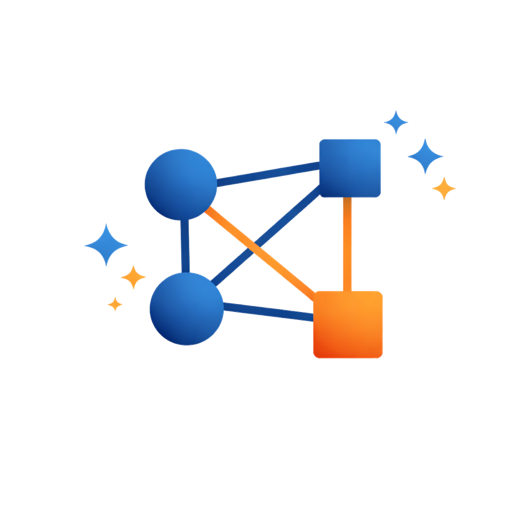

  **See your codebase as a graph — in VS Code, your CLI, and your AI assistant.**

</div>

[](https://marketplace.visualstudio.com/items?itemName=magic5644.graph-it-live)
[](https://marketplace.visualstudio.com/items?itemName=magic5644.graph-it-live)
[](https://open-vsx.org/extension/magic5644/graph-it-live)
[](https://open-vsx.org/extension/magic5644/graph-it-live)
[](https://www.npmjs.com/package/@magic5644/graph-it-live)
[](LICENSE)

Graph-It-Live analyzes imports, symbols, calls, cycles, unused exports, and change impact. Use it as a VS Code extension, a standalone CLI, or an MCP/native tool provider for GitHub Copilot and other AI clients. Analysis runs locally and returns evidence from your codebase.

### ▶ Watch the videos

Click an image to play its video (sound on).

**The 75-second tour**

[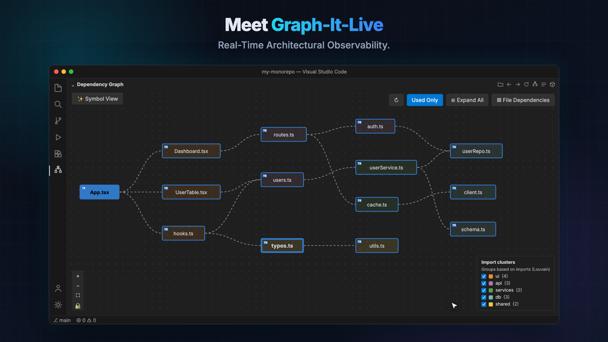](media/graph-it-live-promo.mp4)

It walks through the file graph with Louvain import clusters, the Dependency Structure Matrix, boundary rules declared in `graphit.architecture.json`, and an AI agent fixing a rule violation through the Graph-It-Live MCP server.

**A real architecture fix in 120 seconds**

[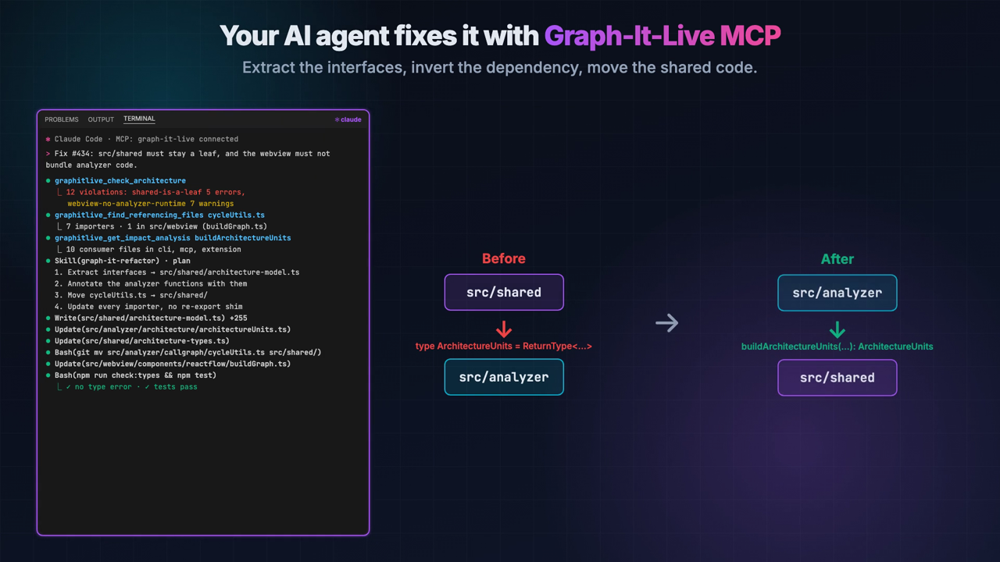](media/graph-it-live-architecture-fix.mp4)

It replays how this repository fixed issue #434, with real outputs. You see a circular import in the live dependency graph (ReactFlow) and units in layers with their cycle in the Architecture view, both on `tests/fixtures/workspaces-project`. Then come the call graph, the matrix cycle between `analyzer` and `shared`, and `graph-it check-architecture` failing on 12 violations. Next, the REPL walks the importers, an AI agent extracts interfaces into `src/shared` through the MCP server to invert the dependency, and the review gate scores the pull request. The check ends green.

## Table of Contents

- [What it does](#what-it-does)
- [Quick start](#quick-start)
- [Features](#features)
- [Standalone CLI](#standalone-cli)
- [AI integrations](#ai-integrations)
- [Configuration](#configuration)
- [CI review gate](#ci-review-gate)
- [Supported languages](#supported-languages)
- [Documentation](#documentation)
- [Development](#development)
- [License](#license)

## What it does

Graph-It-Live provides three views of a codebase:

| View | Answers | Analysis layer |
| --- | --- | --- |
| **File graph** | Which files import this file? What depends on this module? | Regex and AST parsing |
| **Symbol view** | Which functions and classes call each other in this file? | AST analysis |
| **Live call graph** | Which symbols call each other across files? | Tree-sitter and SQLite |

Use the same graph data to navigate code, review refactors, generate codemaps, and give AI assistants focused context instead of entire source files.

<div align="center">
  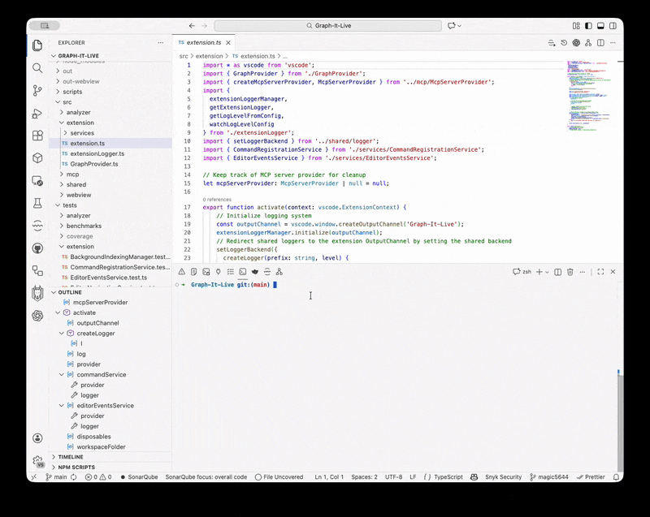
</div>

## Quick start

### VS Code extension

**Requirements:** VS Code 1.96 or later. Install from the [VS Code Marketplace](https://marketplace.visualstudio.com/items?itemName=magic5644.graph-it-live) or [Open VSX](https://open-vsx.org/extension/magic5644/graph-it-live).

1. Open a project.
2. Open the Graph-It-Live view from the Activity Bar.
3. Run **Graph-It-Live: Show Dependency Graph** from the Command Palette.
4. Click a file to open it, double-click it for the Symbol View, or use **Show Call Graph** for cross-file calls.

Supported projects include TypeScript, JavaScript, Python, Rust, C#, Go, Java, Vue, Svelte, and GraphQL.

### First useful actions

| Goal | Action |
| --- | --- |
| Explore imports | Open the dependency graph and expand a file node |
| Inspect functions | Switch to **Symbol View** or double-click a file |
| Find callers | Open **Show Call Graph** with a symbol selected |
| Find reverse dependencies | Use **Show Reverse Dependencies** |
| Hide unused imports | Enable **Filter Unused Dependencies** |
| Refresh analysis | Run **Refresh Graph** or **Force Graph-It-Live re-index** |

## Features

### File dependency graph

- Visualize file-to-file imports across a workspace.
- Detect circular dependencies and highlight cycles.
- Expand and collapse nodes as you explore.
- Open files directly from graph nodes.
- Find reverse dependencies with an indexed lookup.

### Symbol View

Drill into TypeScript, JavaScript, Python, or Rust files to see functions, classes, variables, outgoing calls, incoming callers, and recursive calls. Click a symbol to navigate to its definition.

<div align="center">
  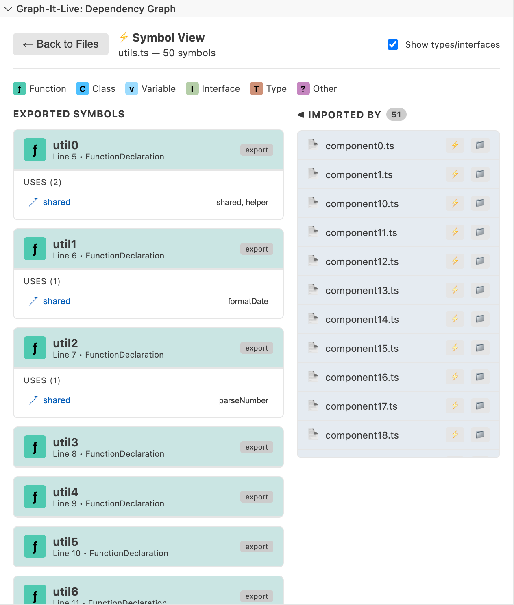
</div>

### Live Call Graph

The Live Call Graph shows cross-file symbol relationships in a Cytoscape.js panel.

- Expand callers and callees with a depth from 1 to 5. A view shows at most 500 symbols, nearest hops first; a notice counts the hidden ones.
- Group symbols by folder.
- Number calls in invocation order.
- Highlight self-recursion and mutual recursion.
- Filter by symbol type or folder.
- Refresh automatically after file saves.
- Show runtime references that are not calls as `REFERENCES` edges: a passed function (`register(save)`, `items.map(format)`) in every language, and in `.jsx` and `.tsx` files a rendered component (`<Card />`) or an attribute value (`onClick={save}`). An edge appears only when the name resolves to an import or to one declaration in the file. Imports resolve through aliases, barrels, default exports, `lazy(() => import('./literal'))`, and `memo()` or `forwardRef()` around a component name. Identified React components carry the React icon and color here, in the file graph and in the Symbol View.

<div align="center">
  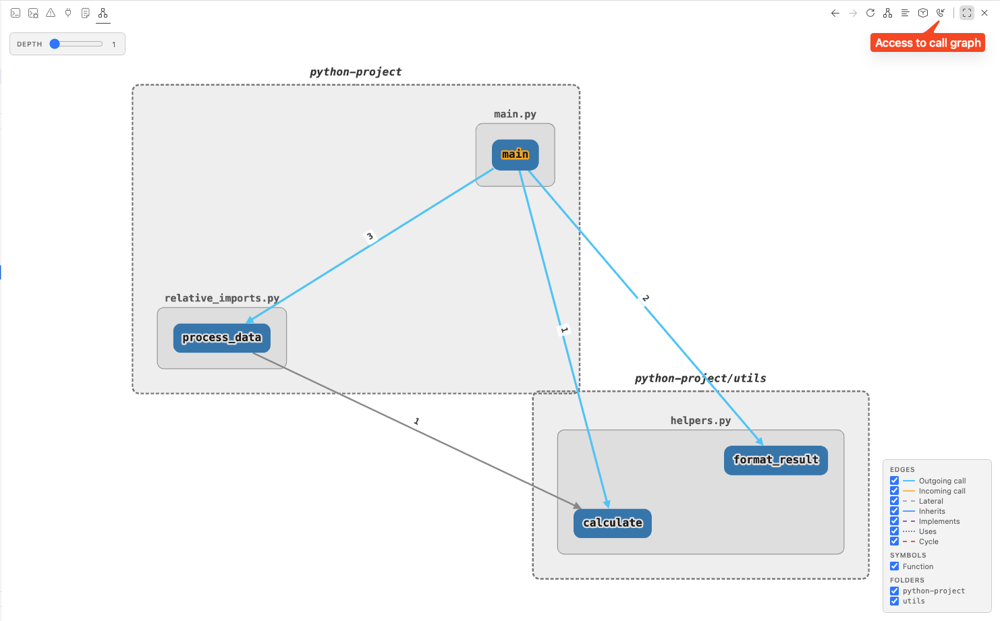
</div>

<div align="center">
  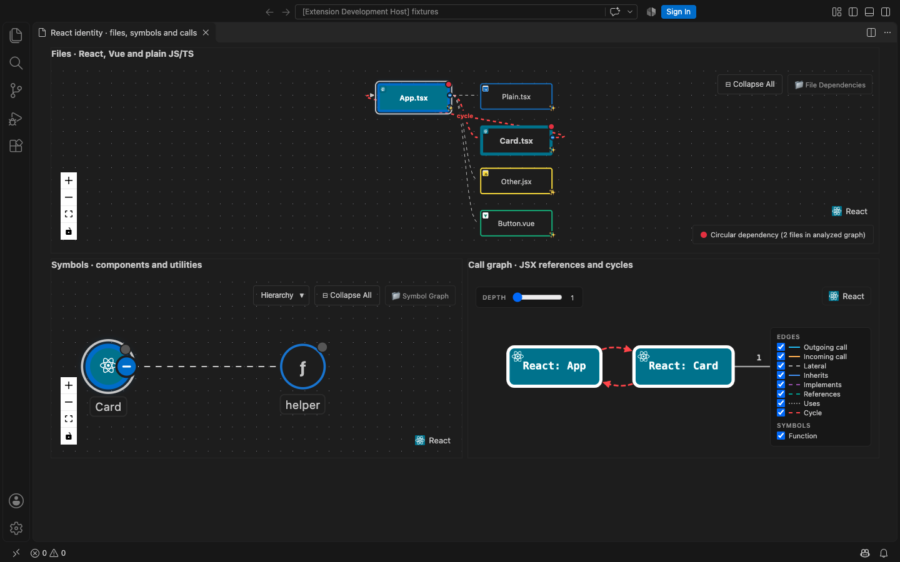
</div>

*React components on a test fixture: the file graph marks `.tsx` files that declare components, the Symbol View marks the `Card` component, and the call graph shows `App` and `Card` rendering each other: two `REFERENCES` edges, red because they form a cycle. Open any `.jsx` or `.tsx` file; the React badge in each view's legend names the mark.*

The Live Call Graph supports TypeScript, JavaScript, React (JSX and TSX, parsed with the TSX grammar), Vue, Svelte, Python, Rust, C#, Go, Java, and GraphQL. C#, Go, Java, and GraphQL are supported in the file graph and Live Call Graph; Symbol View support is currently limited to TypeScript, JavaScript, Python, and Rust. In GraphQL, operations and fragments call the fragments they spread; an operation's default root type (`Query`, `Mutation`, `Subscription`), type conditions, field, argument and variable types, and union members are type-only references (`USES`, shown with `includeTypeOnly`); `implements` is an `IMPLEMENTS` edge.

A method call links only when the type of its receiver is proven: `this`/`self`, a parameter or variable with a declared type, a construction (`new Calculator()`, `Calculator()`), or a static call (`Calculator.create()`). The type can be declared in the same file or in another one. In TypeScript, JavaScript, and Python, it must be bound by an import (aliases, barrels, default and type-only imports included). The call reaches the method that this class declares in its own body. When a method is declared more than once (Python redefinition, TypeScript overloads), it reaches the last declaration. Inherited methods, union or unknown types, and a rebound variable create no edge. They never reach a same-named method of another class. Java and Go are the exception: a receiver of unknown type still links by method name.

In TypeScript and Python, a call on a returned value links too, read from the annotation of the function or method that returns it, never inferred:

- a named return type: `make(): Calculator`, `def make() -> Calculator` (also `-> "Calculator"`). The name resolves in the callee's file, through its own imports;
- a fluent method: `: this` or `-> Self` returns the receiver's type, so `b.setX(1).build().compute()` follows each link;
- an identity generic: `<T>(value: T): T`, or `def f(value: T) -> T` with a `TypeVar` or a PEP 695 parameter, returns the type of its argument.

A chain stops at its first unproven link and after 8 calls. An unannotated return, a union, `Promise<T>`/`Awaited`, `Optional[T]`, utility types, other generics, `any`/`unknown`, overloads with different return types and `async def` create no edge. Java, C#, Go and Rust do not type returned values yet: Java and Go link such a call by method name, C# and Rust do not link it.

### Architecture view

The Architecture view draws the whole workspace as **units** (packages, else top-level folders) in layers, with the import edges between them, their roles and their cycles. It answers three questions: what are my layers, who depends on this, and does the code follow my rules. The [architecture guide](docs/architecture.md) defines every term, explains the marks of each view and how to fix what they raise: cycles, rule violations, unmatched files.

<div align="center">
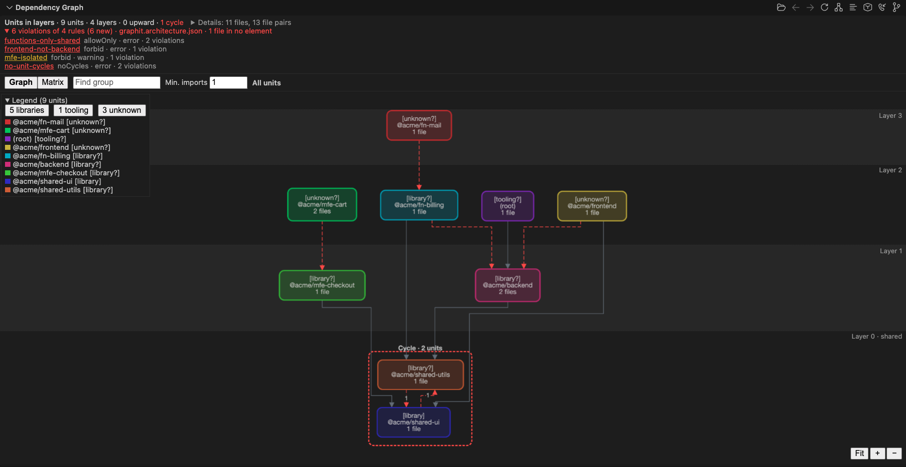
</div>

*Units in layers with their roles, a cycle outlined, and rule violations (test fixture monorepo). Open it with *Switch to Architecture View* in the *Dependency Graph* view title bar.*

Quick start:

1. Open the *Dependency Graph* view and click *Switch to Architecture View* (icon `$(type-hierarchy)`).
2. Double-click a unit to enter its folders; *Escape* goes back.
3. Click an edge to list the file pairs behind it.
4. Select a node, then *Dependents by group* to see every group that imports it.
5. Click *Matrix* for the dependency structure matrix of the level.

The CLI (`graph-it architecture --level units`) and the MCP tool `explore_architecture` report the same counts.

<div align="center">
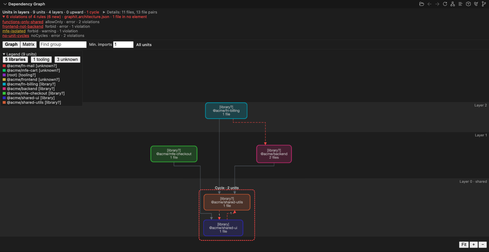
</div>

*Role badges: `[library?]` inferred, `[library]` declared. Click a role in the units legend to filter.*

<div align="center">
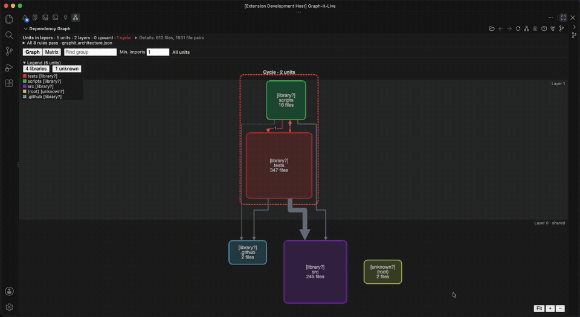
</div>

*Double-click a unit or folder to enter it; the breadcrumb or *Escape* goes back.*

<div align="center">
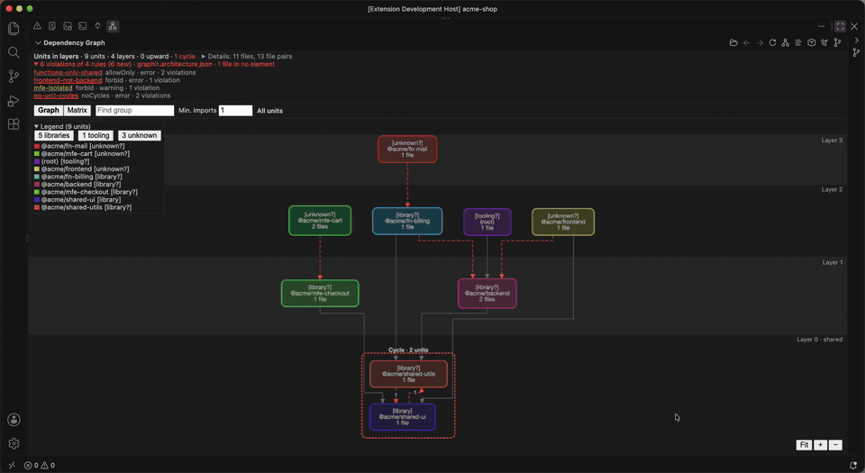
</div>

*Click an edge for its file pairs, then a file to open it.*

<div align="center">
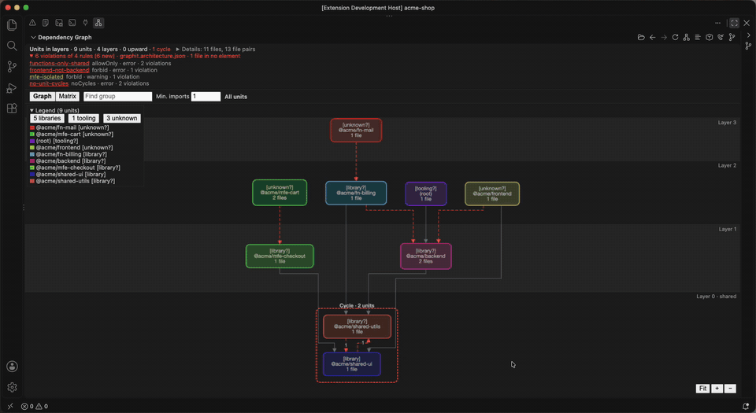
</div>

*Select a node, then *Dependents by group* in the bottom-left action bar.*

<div align="center">
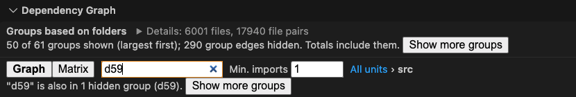
</div>

*Enter a unit with more than 50 folder groups: the view draws the 50 largest, and *Show more groups* draws up to 150.*

<div align="center">
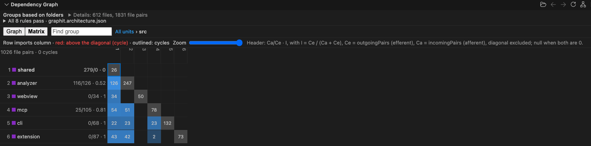
</div>

*Click *Matrix* in the *Graph | Matrix* switch for the dependency structure matrix.*

To share the drawn level as a picture, click *Export Architecture Diagram* (icon `$(desktop-download)`) in the *Dependency Graph* view title bar, then save it as `.svg`, `.html` or `.png`. *Copy Architecture Diagram as SVG* (icon `$(copy)`) puts the SVG on the clipboard. Both commands are also in the Command Palette while the Architecture view is open. The export draws the units, or the groups of the entered unit or folder, as a graph or a matrix, with the rule violations of the view; the graph also keeps the role filter and *Min. imports*, which the matrix does not apply. It uses the renderer of `graph-it diagram`: without a role or *Min. imports* filter, the same level gives the same SVG as the CLI; the PNG is that SVG at twice its size, and the SVG follows the editor's light or dark theme. Exports need the default `graph-it-live.communityMode` (`path`).

<div align="center">
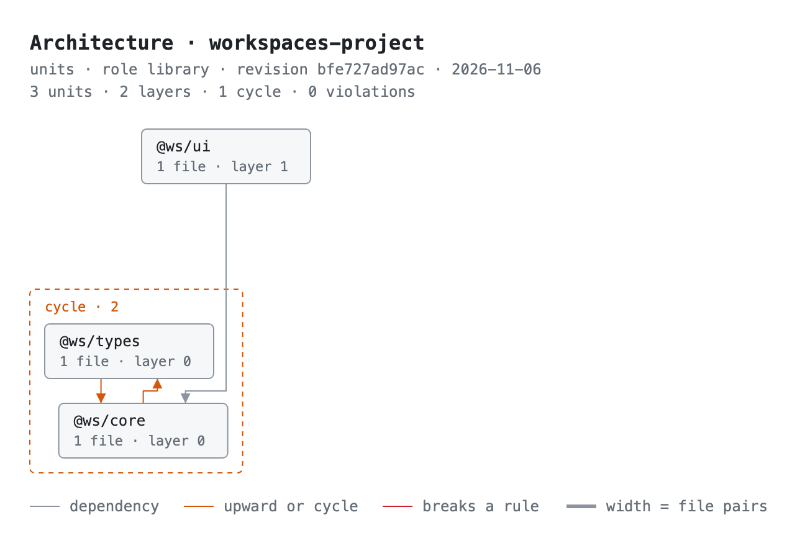
</div>

*An exported diagram with the role filter on `library`: the caption names the filter.*

### Architecture rules

Declare your intended architecture in `graphit.architecture.json` at the workspace root: `elements` name sets of files, `rules` say what each may import, and `roles` declare what each unit is. The view lists each rule with its violations; `graph-it check-architecture` exits with 1 on a new `error` violation, so it can gate CI, with SARIF output for code scanning and a baseline for existing code. On existing code, `graph-it init` writes the config from today's imports, so only new drift fails, and reports quick wins and the reading of the dependency matrix. See [the config file](docs/architecture.md#the-config-file) for a complete example.

<div align="center">
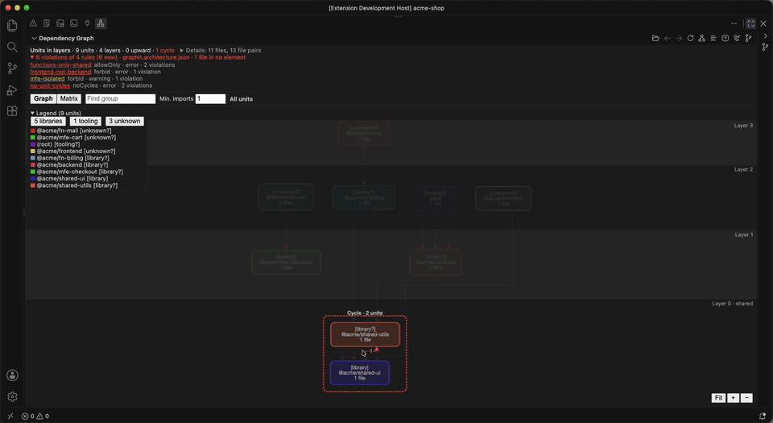
</div>

*Write `graphit.architecture.json` at the workspace root, then click *Refresh*: click a rule to list the file pairs that break it, then a file to open it.*

<div align="center">
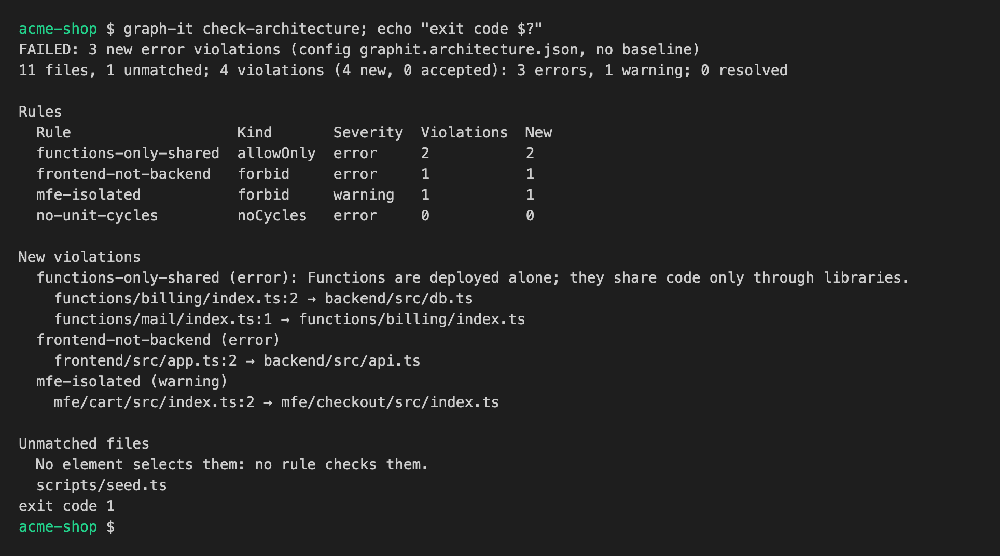
</div>

*`graph-it check-architecture` on the rules test fixture: verdict, totals, rules table, then each new violation as `importing/file.ts:line → target`. Add `--verbose` to list baselined violations, `--format markdown` for a PR comment.*

### Unused dependencies and impact analysis

- Hide or dim unused dependencies.
- Detect unused exported symbols.
- Trace execution from a function or symbol.
- Identify callers affected by a signature change.
- Generate a codemap with exports, internals, dependencies, dependents, and call flow.

<div align="center">
  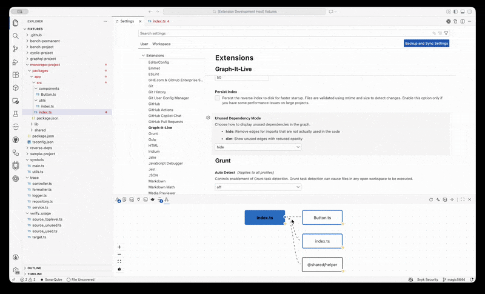
  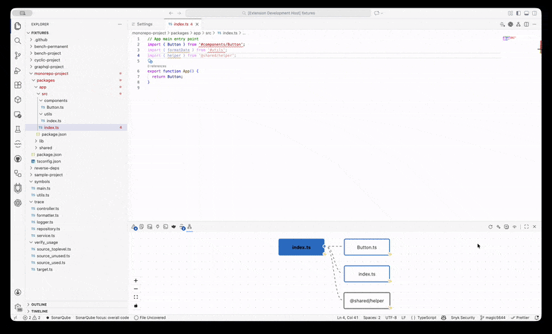
</div>

### While a view loads

<div align="center">
  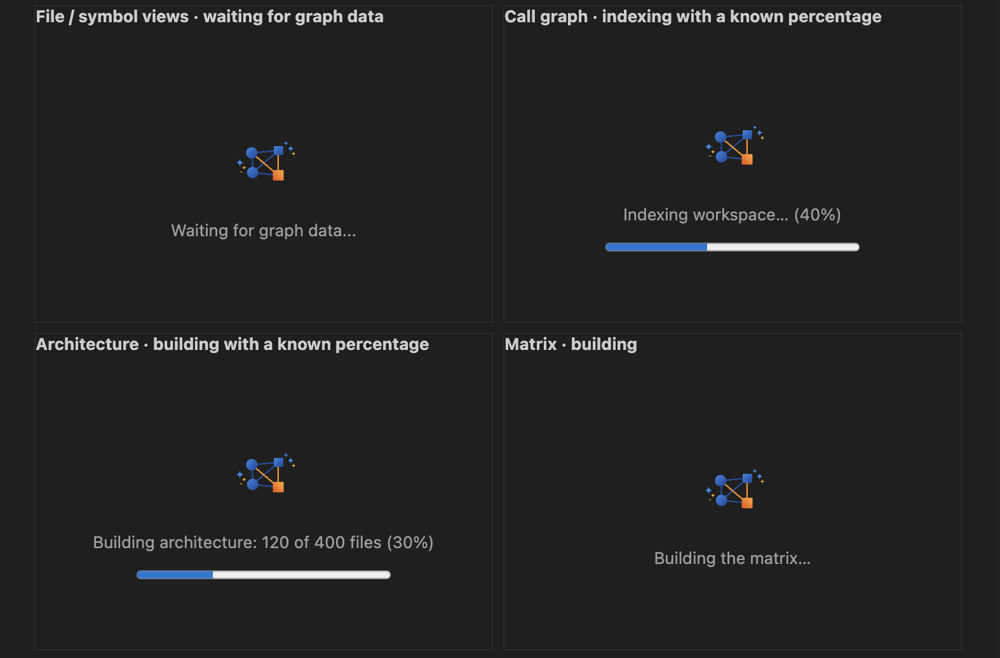
</div>

*Every view shows the same loading state with the Graph-It-Live logo: what it waits for, and a progress bar once the percentage is known (call graph indexing, Architecture build). You see it when a view opens before its data is ready, for example *Show Call Graph* on a workspace not indexed yet.*

## Standalone CLI

Use the same analysis engine without VS Code. Install it globally:

```bash
npm install -g @magic5644/graph-it-live
```

Or run it with `npx`:

```bash
npx @magic5644/graph-it-live scan
```

On an existing codebase, start with `graph-it init`: it guards the architecture you have today (only new drift fails `graph-it check-architecture`) and lists the quick wins.

Common commands:

```text
graph-it scan                         Index the workspace
graph-it summary                      Show a workspace overview
graph-it summary <file>               Generate a file codemap
graph-it trace <file#Symbol>          Trace execution from a symbol
graph-it explain <file>               Explain intra-file call flow
graph-it path <file>                  Show a dependency path
graph-it check [path]                 Find unused exported symbols
graph-it architecture --groups        Show the workspace architecture by folder or community
graph-it init                         Generate graphit.architecture.json from the current code, plus quick wins
graph-it check-architecture           Check imports against graphit.architecture.json
graph-it diagram                      Write a static architecture diagram (SVG, HTML or diagram spec)
graph-it query "<question>"           Ask a natural-language graph question
graph-it context "<question>"         Retrieve bounded graph context
graph-it wiki                         Generate a navigable Markdown wiki
graph-it serve                        Start the MCP stdio server
graph-it export [path]                Export the graph as HTML
graph-it --help                       Show all commands and options
```

Analysis commands support `--format json|toon|markdown`. `trace`, `path` and `architecture` also support `--format mermaid`, `architecture --matrix` supports `--format csv`, `check-architecture` and `review-pr` support `--format sarif`, and `diagram` writes `--format svg|html|diagram-spec` (the last for a diagram skill). Use `--workspace <path>` or `-w` to analyze a project other than the current directory. Outside a project (no `package.json`, `pyproject.toml`, `Cargo.toml`, `go.mod`, `pom.xml`, `*.csproj` or other supported marker at or above the current directory), the CLI exits with code `3`; the MCP server (`graph-it serve`, the plugins) starts without indexing, and its tools ask for `graphitlive_set_workspace` or `WORKSPACE_ROOT`.

See the [complete CLI reference](docs/CLI.md), including installation troubleshooting, REPL commands, output formats, and tool details.

Run `graph-it` without arguments for the interactive REPL. Press `Esc` on an empty line to move into the results: `j`/`k` move a cursor, `[`/`]` jump between results, `Space` folds one, `z` folds all, and `Enter` on a file or symbol line opens its actions (`/explain`, `/check-dependencies`, `/trace`, Open in editor). File rows are clickable links in terminals that support OSC 8; `/mouse on` adds wheel and click support.

<div align="center">
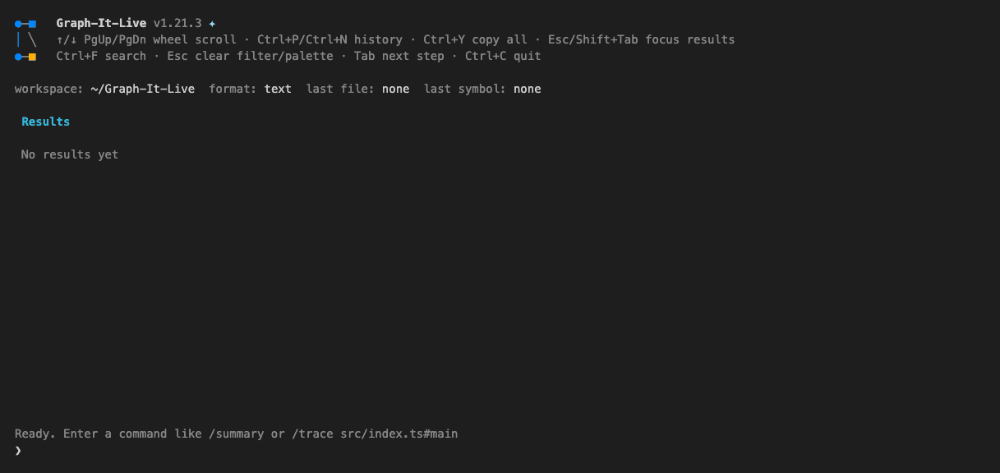
</div>

*The REPL on this repository: results focus, jumps between results, folding and the actions menu ([key reference](docs/CLI.md#results-navigation)).*

### Unified graph context

`graph-it context` combines imports, symbols, calls, tests, impact, paths, hubs, and communities in one bounded response. It supports `search`, `neighbors`, `path`, `impact`, `refactor`, and `overview` modes.

```bash
graph-it context "what calls the request handler" --scope 'src/**' --format toon
graph-it context --mode path --from src/api.ts#handle --to src/db.ts#query
graph-it context --mode impact --seeds src/api.ts#handle --depth 3 --format json
```

Use `--detail compact` and `--token-budget` for agent-oriented responses. See the [TOON format specification](docs/architecture/TOON_FORMAT.md) for the output format and measurement protocol.

## AI integrations

Graph-It-Live exposes local graph analysis to GitHub Copilot, Claude, Cursor, Windsurf, Antigravity, and other MCP-compatible clients.

### Token savings

MCP tools and the native Copilot tools answer in compact TOON by default; pass `response_format: "json"` when a script parses the result. Run `graph-it stats` to see what that saves across the CLI, the MCP server and VS Code: the last 50 sessions per source, an **all sources** total, and cumulative totals that rotation never reduces.

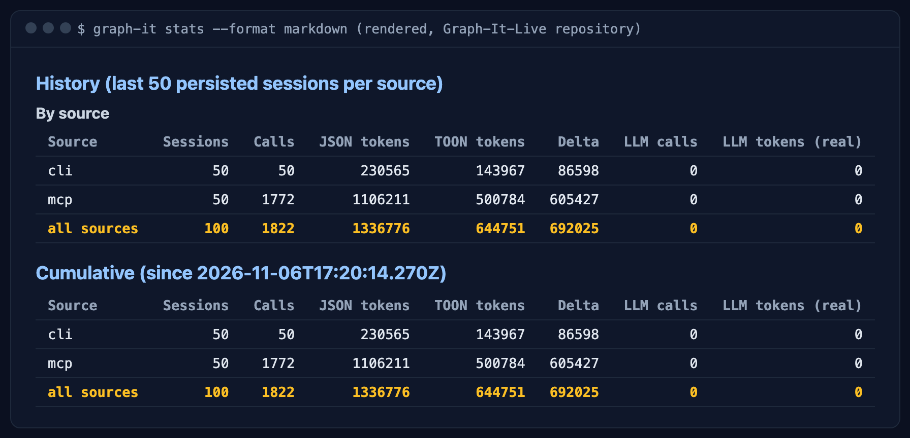

*`graph-it stats --format markdown` on this repository's own usage: TOON used about half the tokens of the same answers in JSON. Counts are `cl100k_base` estimates; your ratio depends on the tools you call.*

### Native Copilot tools

When the extension is installed, use these tools in Copilot Agent mode without configuring MCP:

| Tool group | Capabilities |
| --- | --- |
| Navigation | Dependencies, reverse dependencies, imports, module resolution, workspace index status |
| Symbols | Symbol graphs, callers, dependents, execution traces |
| Refactoring | Breaking changes, impact analysis, unused symbols, dead-code scans, Git diff review |
| Context | File logic, codemaps, unified graph context, natural-language graph queries |
| Call graph | Cross-file caller/callee queries and neighbourhood expansion |

The graph-context tool is available as `#graphContext`. Other native references include `#graphDeps`, `#graphFindRefs`, `#graphCallers`, `#graphImpact`, `#graphCodemap`, `#graphTrace`, `#graphDeadCode`, `#graphReviewPr`, `#graphQuery`, and `#graphArchitectureDiagram`.

The native tools answer in compact TOON by default, like the MCP server. Pass `response_format: "markdown"` for readable tables, or `"json"` to get the raw object.

### MCP server

The MCP server exposes 25 graph-analysis tools. Enable it in VS Code with `graph-it-live.enableMcpServer`, or start it from the CLI:

```bash
graph-it serve
```

For VS Code, add `.vscode/mcp.json`:

```json
{
  "servers": {
    "graph-it-live": {
      "type": "stdio",
      "command": "graph-it",
      "args": ["serve"],
      "env": {
        "WORKSPACE_ROOT": "${workspaceFolder}"
      }
    }
  }
}
```

For Cursor, use `.cursor/mcp.json` with the same server definition under `mcpServers` instead of `servers`. The same `graph-it serve` command works with Claude Desktop, Claude Code, Windsurf, and Antigravity. See the [CLI/MCP documentation](docs/CLI.md) for client-specific configuration and environment variables.

For Codex CLI:

```bash
codex mcp add graph-it-live --env WORKSPACE_ROOT=/path/to/project -- graph-it serve
```

### Portable agent plugin

The [`plugins/graph-it-live/`](plugins/graph-it-live/) directory is the portable Agent Plugin package.
It bundles the MCP server and five skills: `graph-it-live`, `graph-it-refactor`, `onboarding-express`,
`dead-code-hunter` and `pr-review`. Install it with the client you use:

#### Claude Code

From Claude Code, add the repository marketplace and install the plugin:

```text
claude plugin marketplace add magic5644/Graph-It-Live
/plugin install graph-it-live@graph-it-live
```

For a local checkout, start a session with `claude --plugin-dir ./plugins/graph-it-live`.

#### GitHub Copilot CLI

```text
copilot plugin marketplace add magic5644/Graph-It-Live
copilot plugin install graph-it-live@graph-it-live
```

#### VS Code

1. Open the Command Palette.
2. Run **Chat: Install Plugin From Source**.
3. Select `plugins/graph-it-live/`.

The VS Code extension itself remains available from the [VS Code Marketplace](https://marketplace.visualstudio.com/items?itemName=magic5644.graph-it-live)
and [Open VSX](https://open-vsx.org/extension/magic5644/graph-it-live).

#### Cursor

Open the **Plugins** panel, choose **Install from local source**, and select
`plugins/graph-it-live/`.

#### Codex

Add the repository's [Codex marketplace catalog](.agents/plugins/marketplace.json) to a configured
plugin marketplace, then open `/plugins` in Codex and install **Graph-It-Live**.

#### Windsurf, Antigravity, and other MCP clients

These clients can use the MCP server directly. Add this server entry to the client's MCP configuration:

```json
{
  "graph-it-live": {
    "type": "stdio",
    "command": "npx",
    "args": ["-y", "@magic5644/graph-it-live@latest", "serve"]
  }
}
```

Use the client's MCP configuration file and its expected top-level key (`servers` or `mcpServers`).
See the [MCP server instructions](#mcp-server) for ready-to-copy VS Code, Cursor, and Codex examples.

The repository also includes marketplace catalogs for [Claude Code](.claude-plugin/marketplace.json),
[GitHub Copilot](.github/plugin/marketplace.json) and [Codex](.agents/plugins/marketplace.json). The MCP entry pins the
latest published `@magic5644/graph-it-live` version and starts it with `npx`, so a
cached package starts without a new download (npm still revalidates the package metadata); a workflow updates the pin, the plugin manifests and
the marketplace versions after each npm publish.

### Agent skill

Install the Graph-It-Live skill for an AI agent:

```bash
npx skills add magic5644/skills/graph-it-live
```

The skill documents graph queries, codemaps, impact analysis, dead-code detection, and safe refactoring workflows.

## Configuration

### Branch Watch

Branch Watch is disabled by default. Enable `graph-it-live.branchWatch.enabled` for a workspace folder, select a local Git base branch and optionally a local or remote head branch, and use the native Branch status view to inspect changes automatically (it starts collapsed in the Graph-It-Live panel: expand it, or run `Graph-It-Live: Show Branch Status`). Branch selections are stored per workspace in the ignored `.graph-it/branch-watch.json`; the `baseRef` and `headRef` settings are retained only as a legacy fallback. An empty head, or a head equal to the checked-out branch, uses the current branch plus the final on-disk state; another head branch compares committed branch refs and does not include untracked workspace files. It never fetches, runs tests, or reports test success. The view shows file impact for supported languages, the same signature review as `graph-it review-pr` (TypeScript, JavaScript, Vue and Python, deleted files included, an unreadable file reported as a limitation), the import cycles the changes introduce, aggravate or touch, and explicit limitations. Cycles are read from the whole import graphs, as `graph-it review-pr` reads them: the head from the warmed index (nothing is parsed again on a file event) and the merge base from a private Git copy, parsed once per merge-base commit and reused until the base moves. On each file event, only the edited files are compared again; importers and consumers are always read fresh. Impact traversal is intentionally bounded (depth 3 and at most `graph-it-live.branchWatch.maxFiles` files, 200 by default), so a partial result is reported with its risk and confidence instead of being presented as complete. Right-click any message row and choose `Copy Message` to pass the exact text to an LLM or issue. The reminder `Tests must pass before delivery.` is informational.

Branch Watch requires the Graph-It-Live workspace root to be a supported Git repository. A folder without Git, an unborn or detached repository, conflicts, an inaccessible index, or an unsupported VCS is shown as `Branch watch unavailable`; the normal graph and CLI/MCP tools remain available.

Set these options in VS Code settings:

| Setting | Default | Purpose |
| --- | --- | --- |
| `graph-it-live.branchWatch.enabled` | `false` | Enable Branch Watch for the workspace folder |
| `graph-it-live.branchWatch.maxFiles` | `200` | Limit the changed files Branch Watch analyzes and the files its impact walk visits; cycles are not bounded |
| `graph-it-live.performanceProfile` | `default` | Select `default`, `low-memory`, `high-performance`, or `custom` |
| `graph-it-live.enableMcpServer` | `false` | Enable the built-in MCP server |
| `graph-it-live.maxDepth` | `50` | Limit dependency traversal depth |
| `graph-it-live.excludeNodeModules` | `true` | Exclude dependencies from `node_modules` |
| `graph-it-live.enableBackgroundIndexing` | `true` | Build reverse-dependency indexes in the background |
| `graph-it-live.unusedDependencyMode` | `hide` | Hide or dim unused dependencies |
| `graph-it-live.communityMode` | `path` | Group graph communities by folder (`path`) or by import structure (`louvain`); same as CLI `--communities` |
| `graph-it-live.preIndexCallGraph` | `true` | Pre-index the Live Call Graph |
| `graph-it-live.symbolViewLayout` | `hierarchical` | Select `hierarchical`, `force-directed`, or `radial` |

Workspace indexing (extension, CLI, and MCP) skips paths listed in the root `.gitignore`, plus `tests/fixtures/` and `out-*/` by default. Add a root `.graphitignore` with gitignore syntax to exclude more paths, or negate a rule to include it again, for example `!tests/fixtures/`.

`performanceProfile` sets indexing concurrency, cache sizes, and unused-analysis limits. To tune them by hand, select `custom` and edit the **Advanced: Performance overrides** section (search `@tag:advanced graph-it-live` in the Settings editor). The other profiles ignore these overrides.

## CI review gate

The `graph-it review-pr` command performs a deterministic local Git diff review before CI. It compares exported TypeScript, JavaScript, Vue and Python signatures, lists every file still importing a removed export, follows bounded dependent-symbol impact, and reports cycle evidence, unused exports, test candidates, and consumer standing. Consumers are classified as updated in the diff, covered by a test path, or unverified. The score reflects the highest-risk changed symbol; a high risk is report data, not a failing exit status. With a `graphit.architecture.json`, it also checks the rules on the base and on the head and says whether the diff degrades or improves the architecture: new, resolved and unchanged violations per rule, unit cycles, and edits of the rules files; a new `error` violation raises the risk and fails the Review Gate.

By default, `--base <ref>` is compared with the current working tree, including staged and unstaged file contents. Pass `--head <ref>` to compare two Git refs. Use `--depth` and `--max-files` to bound impact traversal and changed-file analysis. See the [`review-pr` CLI reference](docs/CLI.md#review-pr) for scoring thresholds, output formats, limitations, and examples.

<div align="center">
  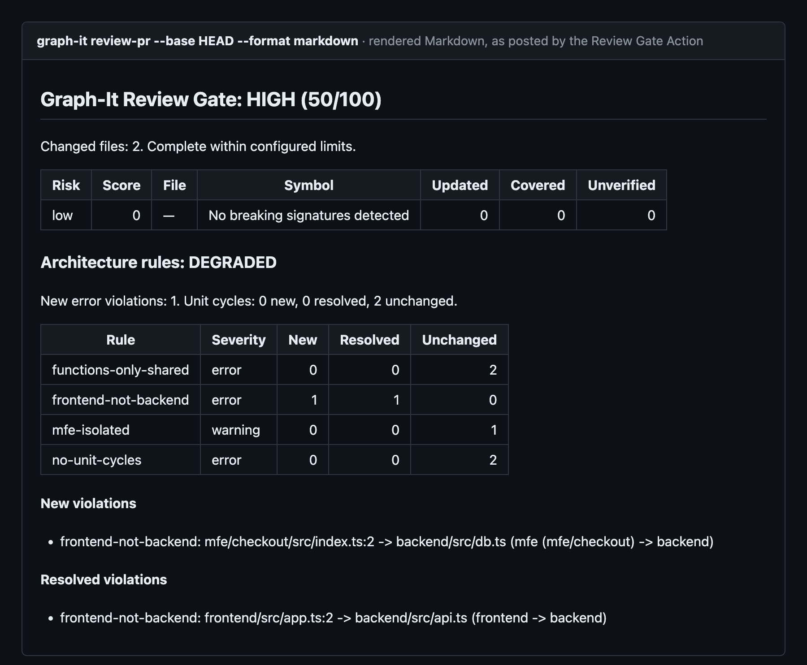
</div>

*`graph-it review-pr --base HEAD --format markdown` on the rules test fixture, rendered as the Review Gate Action posts it: the diff moves a backend import from `frontend` to `mfe/checkout`, so one violation is resolved and one new `error` violation fails the gate; the two existing unit cycles stay unchanged.*

The reusable GitHub Action is informational by default. Set `fail-on-risk: high` or `critical` to gate a pull request. Add it to a consumer workflow with [`docs/examples/graph-it-review-gate.yml`](docs/examples/graph-it-review-gate.yml).

Use `pull_request`, not `pull_request_target`, for untrusted pull requests. The action analyzes the consumer checkout in an isolated temporary directory and sends only a sanitized report to GitHub.

## Supported languages

| Language | File graph | Symbol View | Live Call Graph |
| --- | :---: | :---: | :---: |
| TypeScript / JavaScript | Yes | Yes | Yes |
| React (JSX / TSX) | Yes | Yes | Yes |
| Vue 3 (SFC) | Yes | Yes | Yes |
| Svelte | Yes | Yes | Yes |
| Python | Yes | Yes | Yes |
| Rust | Yes | Yes | Yes |
| C# / Go / Java | Yes | No | Yes |
| GraphQL | Yes | No | Yes |

**Vue 3 single-file components** (Vue 3.x, `<script>` and `<script setup>`, JS, TS, JSX and TSX): imports, symbols and call graph nodes keep the line and column of the `.vue` file. The template links `<Child />`, handlers (`@click="save"` passes, `save()` calls), interpolations, slots and custom directives to the script bindings they use, so a component used only in the template is not reported unused. `<script src>` and an HTML `<template src>` inside the workspace are read, and an edit of the external file refreshes its `.vue`. `.vue` files and the SFC component node show the Vue logo and green in every graph, apart from React. Review and Branch Watch report props and events added or removed by name.

<div align="center">
  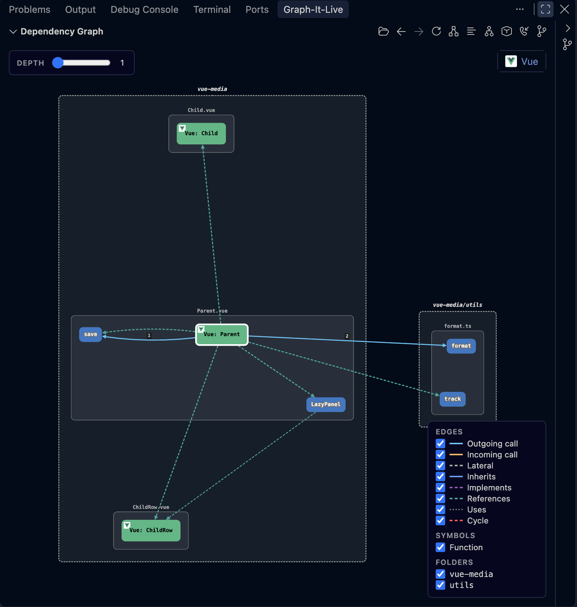
</div>

*The Vue template in the Live Call Graph, on a test fixture: put the cursor in the `<template>` of `Parent.vue` and run **Graph-It-Live: Show Call Graph**. `<Child @save="save" />` and `<child-row>` become `REFERENCES` edges (dashed), `{{ format(count) }}` and `@click="save()"` become calls (solid). The green nodes with the Vue logo are SFC components.*

<div align="center">
  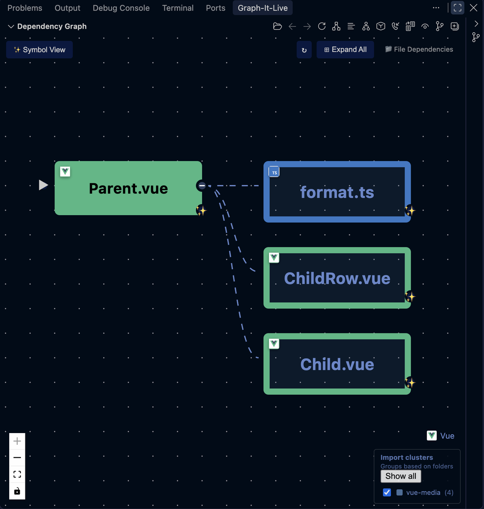
</div>

*The file graph of the same fixture: open `Parent.vue` and run **Graph-It-Live: Show Dependency Graph**. `.vue` files are green with the Vue logo; the Vue badge in the legend names the mark.*

Not resolved, and never guessed: Vue 2, Nuxt and other auto-imports, globally or plugin-registered components, a dynamic `:is`, a `pug` template, and an external file outside the workspace or reached through a symbolic link. A template that cannot be read fully counts every script binding as used. Props and events typed by an imported type or built at runtime are reported as partial; props/emits type compatibility is not checked. An external template edited while no Graph-It process is watching it is read again when its `.vue` changes or the index is rebuilt.

## Documentation

- [CLI reference](docs/CLI.md) — commands, REPL, output formats, and MCP tools
- [Architecture guide](docs/architecture.md) — Architecture view, `graphit.architecture.json` rules, and `check-architecture`
- [Development guide](DEVELOPMENT.md) — setup, builds, tests, and WASM architecture
- [Contributing guide](CONTRIBUTING.md) — contribution workflow and conventions
- [System architecture](docs/architecture/codemaps/architecture.md)
- [Class hierarchy](docs/architecture/codemaps/class-hierarchy.md)
- [TOON format](docs/architecture/TOON_FORMAT.md)
- [Coding standards](docs/development/CODING_STANDARDS.md)
- [Cross-platform testing](docs/development/CROSS_PLATFORM_TESTING.md)
- [Performance optimizations](docs/architecture/PERFORMANCE_OPTIMIZATIONS.md)
- [Documentation index](docs/README.md)

## Development

Requirements: Node.js 22 or later and npm.

```bash
git clone https://github.com/magic5644/Graph-It-Live.git
cd Graph-It-Live
npm install
npm run build
```

Press F5 in VS Code to launch the Extension Development Host.

| Command | Purpose |
| --- | --- |
| `npm run build` | Build the extension and copy WASM assets |
| `npm test` | Run unit tests |
| `npm run test:cli` | Run CLI tests |
| `npm run test:vscode` | Run VS Code E2E tests |
| `npm run lint` | Run ESLint |
| `npm run check:types` | Run strict TypeScript checks |
| `npm run package` | Build the VSIX package |
| `npm run package:verify` | Verify package contents |

See [DEVELOPMENT.md](DEVELOPMENT.md) for the full project structure, test strategy, WASM details, and troubleshooting.

## License

MIT. See [LICENSE](LICENSE).

Language icons are provided by [SuperTinyIcons](https://github.com/edent/SuperTinyIcons) under the CC0-1.0 license.

## Star History

<a href="https://www.star-history.com/?repos=magic5644%2FGraph-It-Live&type=date&legend=top-left">
 <picture>
   <source media="(prefers-color-scheme: dark)" srcset="https://api.star-history.com/chart?repos=magic5644/Graph-It-Live&type=date&theme=dark&legend=top-left&sealed_token=tKWEQ11VLzMx4dC3ZHvyM8J379zHlmU2lUlVABHWQ0yWeTNDwbvy9zxbYFSFiAod0MZ9RHDFy-KYuzkXEI37LhEfGiMP0nsPPtRiLlYlkl53OsTFff_MFSn2SNJXeoPlb3AzuInU8ln9JYhKJIZs4-LgsJ2R8z5pGIFFQBJmfiWvlywCcW-8XbztB03E" />
   <source media="(prefers-color-scheme: light)" srcset="https://api.star-history.com/chart?repos=magic5644/Graph-It-Live&type=date&legend=top-left&sealed_token=tKWEQ11VLzMx4dC3ZHvyM8J379zHlmU2lUlVABHWQ0yWeTNDwbvy9zxbYFSFiAod0MZ9RHDFy-KYuzkXEI37LhEfGiMP0nsPPtRiLlYlkl53OsTFff_MFSn2SNJXeoPlb3AzuInU8ln9JYhKJIZs4-LgsJ2R8z5pGIFFQBJmfiWvlywCcW-8XbztB03E" />
   
 </picture>
</a>
