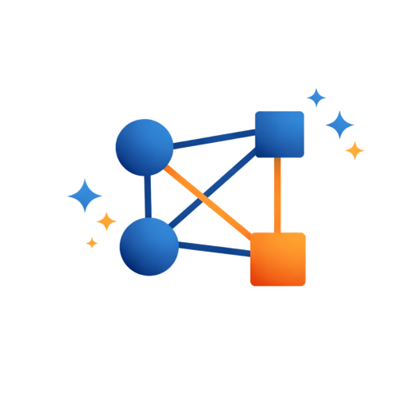
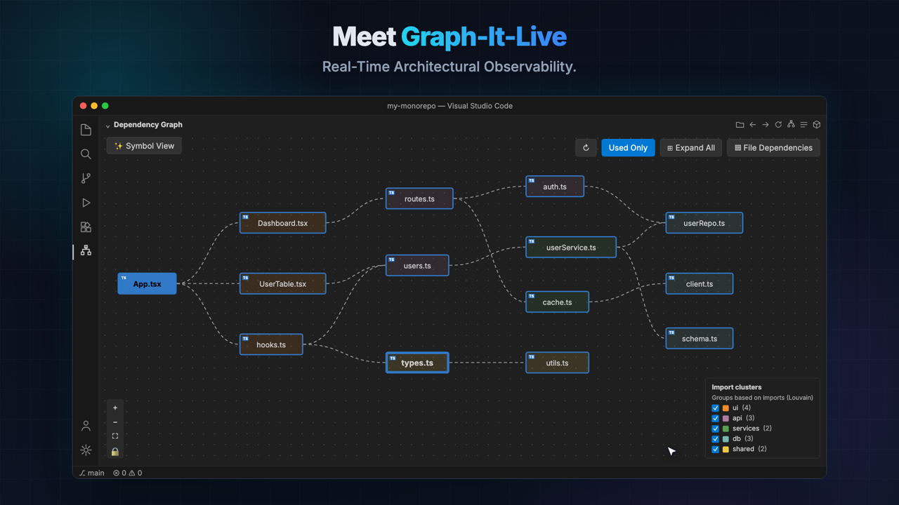
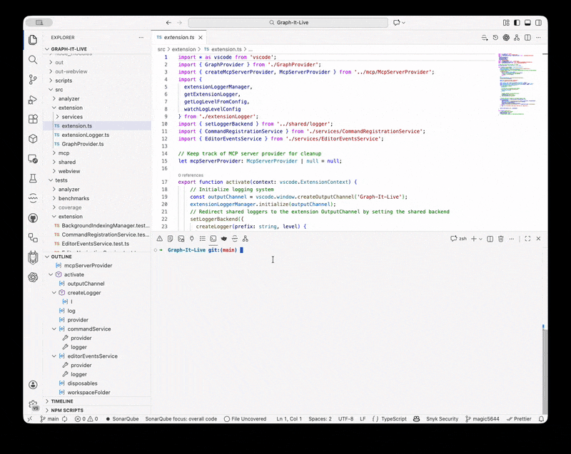
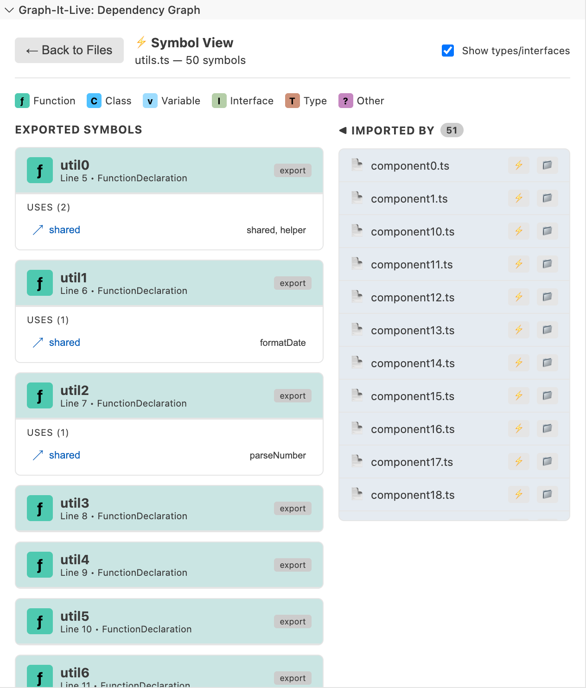
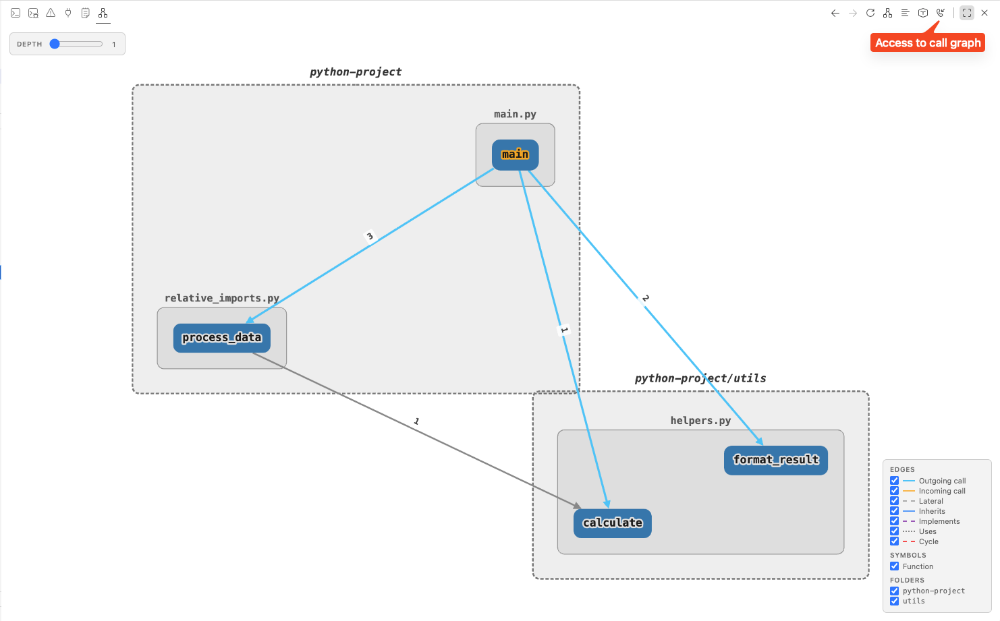
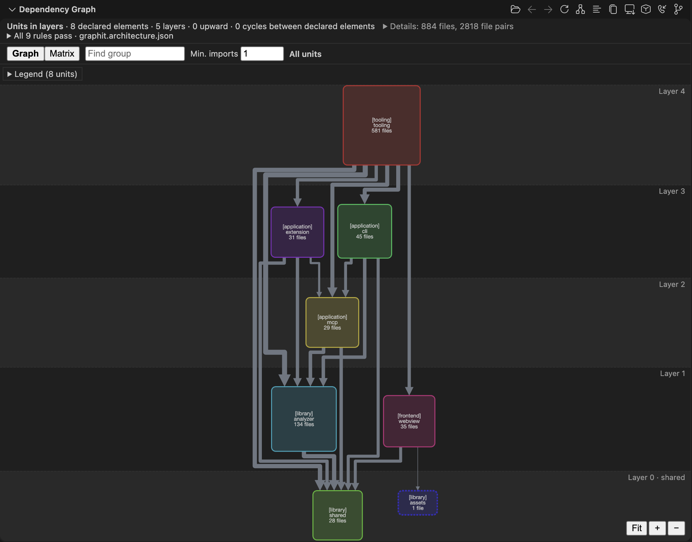
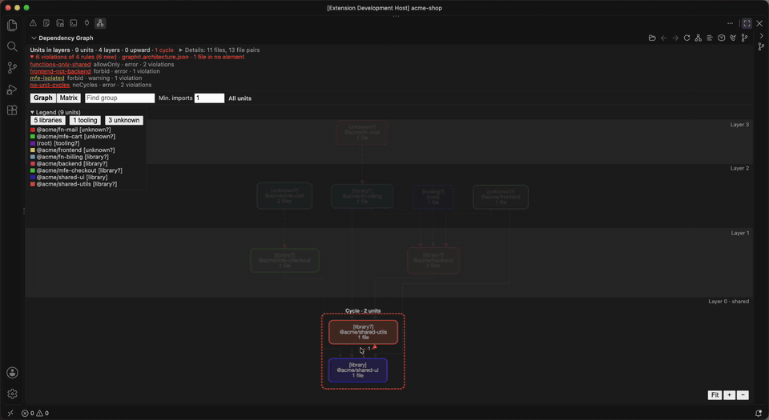
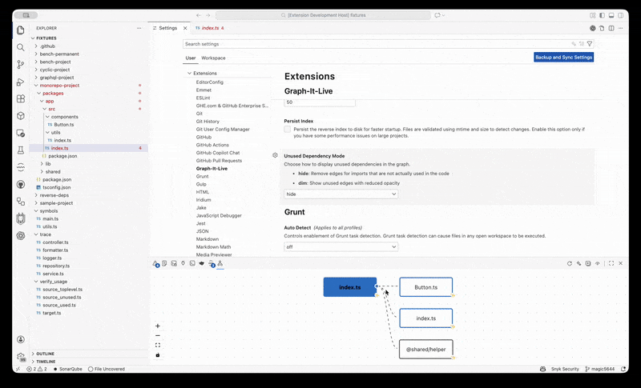
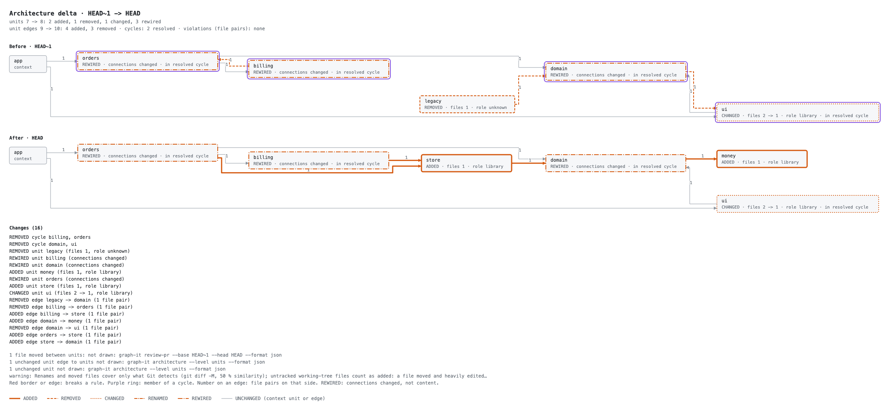

# Graph-It-Live

<div align="center">
  

  **See your codebase as a graph — in VS Code, your CLI, and your AI assistant.**

</div>

[](https://marketplace.visualstudio.com/items?itemName=magic5644.graph-it-live)
[](https://marketplace.visualstudio.com/items?itemName=magic5644.graph-it-live)
[](https://open-vsx.org/extension/magic5644/graph-it-live)
[](https://open-vsx.org/extension/magic5644/graph-it-live)
[](https://www.npmjs.com/package/@magic5644/graph-it-live)
[](LICENSE)


Graph-It-Live analyzes imports, symbols, calls, cycles, unused exports, and change impact. Use it as a VS Code extension, a standalone CLI, or an MCP/native tool provider for GitHub Copilot and other AI clients. Analysis runs locally and returns evidence from your codebase.

**The 75-second tour** (click to play, sound on)

[](media/graph-it-live-promo.mp4)

It walks through the file graph with Louvain import clusters, the Dependency Structure Matrix, boundary rules declared in `graphit.architecture.json`, and an AI agent fixing a rule violation through the Graph-It-Live MCP server.

More videos:

- [A real architecture fix in 120 seconds](media/graph-it-live-architecture-fix.mp4) ([poster](media/graph-it-live-architecture-fix-poster.png)): how this repository fixed issue #434, from `graph-it check-architecture` failing on 12 violations to a green check.
- [From a messy repository to a clean architecture in 2 minutes](media/graph-it-live-init.mp4) ([poster](media/graph-it-live-init-poster.png)): `graph-it init`, dead code, cycles and the Review Gate on `tests/demo/legacy-shop`.

## Table of Contents

- [Quick start](#quick-start)
- [Features](#features)
- [AI integrations](#ai-integrations)
- [Supported languages](#supported-languages)
- [Configuration](#configuration)
- [CI review gate](#ci-review-gate)
- [Documentation](#documentation)
- [Development](#development)
- [License](#license)
- [Star History](#star-history)

## Quick start

### VS Code extension

Requires VS Code 1.101 or later. Install from the [VS Code Marketplace](https://marketplace.visualstudio.com/items?itemName=magic5644.graph-it-live) or [Open VSX](https://open-vsx.org/extension/magic5644/graph-it-live), open a project, then run **Graph-It-Live: Show Dependency Graph** from the Command Palette. Click a file to open it, double-click it for the Symbol View, or use **Show Call Graph** for cross-file calls.

### Standalone CLI

```bash
npm install -g @magic5644/graph-it-live   # or: npx @magic5644/graph-it-live scan
graph-it init                              # guard today's architecture, list quick wins
graph-it                                   # interactive REPL
```

`graph-it --help` lists every command. See the [CLI reference](docs/CLI.md) for options, output formats, and the REPL.

### MCP server and AI assistants

```bash
graph-it serve
```

In VS Code, enable `graph-it-live.enableMcpServer`, or use the native Copilot tools that ship with the extension. Per-client setup is in [AI integrations](#ai-integrations).

## Features

File graph, Symbol View and Live Call Graph answer who imports a file, which functions call each other in a file, and which symbols call each other across files. Details for each view: [Views and supported languages](docs/features.md).

**File dependency graph.** File-to-file imports, circular dependencies, reverse dependencies; type-only cycles are drawn apart from runtime cycles. [More](docs/features.md#file-dependency-graph)

<div align="center">
  
</div>

**Symbol View.** Functions, classes, variables, callers, and recursive calls inside one file. [More](docs/features.md#symbol-view)

<div align="center">
  
</div>

**Live Call Graph.** Cross-file callers and callees, depth 1 to 5, grouped by folder, with recursion highlighted. [More](docs/features.md#live-call-graph)

<div align="center">
  
</div>

**Architecture view.** Units in layers with their roles, edges and cycles, a dependency structure matrix, and flow and sequence diagrams of one symbol. [Tour](docs/architecture-view.md) · [Guide](docs/architecture.md)

<div align="center">

</div>

**Architecture rules.** Declare what may import what in `graphit.architecture.json`; `graph-it check-architecture` gates CI, and `graph-it init` writes the rules from today's imports. [More](docs/architecture-view.md#architecture-rules)

<div align="center">

</div>

**Unused dependencies and impact analysis.** Hide or dim unused imports, detect unused exports, trace execution, and find the callers a signature change affects. [More](docs/features.md#unused-dependencies-and-impact-analysis)

<div align="center">
  
</div>

## AI integrations

The [portable Agent Plugin](plugins/graph-it-live/) bundles the MCP server and five skills. Install it, or the MCP server alone, with the client you use:

| Client | Setup |
| --- | --- |
| Claude Code | `claude plugin marketplace add magic5644/Graph-It-Live`, then `/plugin install graph-it-live@graph-it-live` |
| GitHub Copilot CLI | `copilot plugin marketplace add magic5644/Graph-It-Live`, then `copilot plugin install graph-it-live@graph-it-live` |
| GitHub Copilot in VS Code | Native tools (`#graphContext`, `#graphImpact`, …) with the extension; or **Chat: Install Plugin From Source** and select `plugins/graph-it-live/` |
| Cursor | **Plugins** panel, **Install from local source**, select `plugins/graph-it-live/`; or `.cursor/mcp.json` |
| Codex | `codex mcp add graph-it-live --env WORKSPACE_ROOT=/path/to/project -- graph-it serve` |
| Windsurf, Antigravity, other MCP clients | MCP server entry running `npx -y @magic5644/graph-it-live@latest serve` |
| Any agent (skill only) | `npx skills add magic5644/skills/graph-it-live` |

In Claude Code v2.1.331 or later, the MCP server also serves the five skills ([Skills over MCP](docs/ai-integrations.md#skills-over-mcp)).

MCP tools and the native Copilot tools answer in compact TOON by default; `graph-it stats` shows the tokens used against the same answers in JSON.

Full setup, the 25 MCP tools, the native Copilot tools, and ready-to-copy configurations: [AI integrations](docs/ai-integrations.md).

## Supported languages

| Language | File graph | Symbol View | Live Call Graph |
| --- | :---: | :---: | :---: |
| TypeScript / JavaScript | Yes | Yes | Yes |
| React (JSX / TSX) | Yes | Yes | Yes |
| Vue 3 (SFC) | Yes | Yes | Yes |
| Svelte | Yes | Yes | Yes |
| Python | Yes | Yes | Yes |
| Rust | Yes | Yes | Yes |
| C# / Go / Java | Yes | No | Yes |
| GraphQL | Yes | No | Yes |

Vue single-file components, React components, and the limits per language: [Supported languages](docs/features.md#supported-languages).

## Configuration

Settings live under `graph-it-live.*` (performance profile, MCP server, traversal depth, unused-dependency mode, communities). Indexing skips paths in the root `.gitignore`; add a `.graphitignore` to exclude more. **Branch Watch**, off by default, inspects the changes of a branch automatically in a native view. See [Configuration](docs/configuration.md).

## CI review gate

`graph-it review-pr --base <ref>` reviews a Git diff before CI: breaking signatures, consumers still importing a removed export, cycles, test candidates, architecture rules, and the before/after structure (units, folders, moves) and an optional before/after SVG (`--deltaSvg`, `diagram --delta`). A reusable GitHub Action posts the report and can gate a pull request with `fail-on-risk`. See the [`review-pr` reference](docs/CLI.md#review-pr) and the [example workflow](docs/examples/graph-it-review-gate.yml).



## Documentation

- [CLI reference](docs/CLI.md) — commands, REPL, output formats, and MCP tools
- [Architecture guide](docs/architecture.md) — Architecture view, `graphit.architecture.json` rules, and `check-architecture`
- [Architecture view tour](docs/architecture-view.md) — screenshots, diagram export, flow and sequence diagrams
- [Views and supported languages](docs/features.md) — file graph, Symbol View, Live Call Graph, Vue and React support
- [AI integrations](docs/ai-integrations.md) — per-client setup, MCP server, native Copilot tools, agent skill
- [Configuration](docs/configuration.md) — settings, Branch Watch, indexing exclusions
- [Development guide](DEVELOPMENT.md) — setup, builds, tests, and WASM architecture
- [Contributing guide](CONTRIBUTING.md) — contribution workflow and conventions
- [System architecture](docs/architecture/codemaps/architecture.md)
- [Class hierarchy](docs/architecture/codemaps/class-hierarchy.md)
- [TOON format](docs/architecture/TOON_FORMAT.md)
- [Coding standards](docs/development/CODING_STANDARDS.md)
- [Cross-platform testing](docs/development/CROSS_PLATFORM_TESTING.md)
- [Performance optimizations](docs/architecture/PERFORMANCE_OPTIMIZATIONS.md)
- [Documentation index](docs/README.md)

## Development

Requirements: Node.js 22 or later and npm.

```bash
git clone https://github.com/magic5644/Graph-It-Live.git
cd Graph-It-Live
npm install
npm run build
```

Press F5 in VS Code to launch the Extension Development Host.

| Command | Purpose |
| --- | --- |
| `npm run build` | Build the extension and copy WASM assets |
| `npm test` | Run unit tests |
| `npm run test:cli` | Run CLI tests |
| `npm run test:vscode` | Run VS Code E2E tests |
| `npm run lint` | Run ESLint |
| `npm run check:types` | Run strict TypeScript checks |
| `npm run package` | Build the VSIX package |
| `npm run package:verify` | Verify package contents |

See [DEVELOPMENT.md](DEVELOPMENT.md) for the full project structure, test strategy, WASM details, and troubleshooting.

## License

MIT. See [LICENSE](LICENSE).

Language icons are provided by [SuperTinyIcons](https://github.com/edent/SuperTinyIcons) under the CC0-1.0 license.

## Star History

<a href="https://www.star-history.com/?repos=magic5644%2FGraph-It-Live&type=date&legend=top-left">
 <picture>
   <source media="(prefers-color-scheme: dark)" srcset="https://api.star-history.com/chart?repos=magic5644/Graph-It-Live&type=date&theme=dark&legend=top-left&sealed_token=tKWEQ11VLzMx4dC3ZHvyM8J379zHlmU2lUlVABHWQ0yWeTNDwbvy9zxbYFSFiAod0MZ9RHDFy-KYuzkXEI37LhEfGiMP0nsPPtRiLlYlkl53OsTFff_MFSn2SNJXeoPlb3AzuInU8ln9JYhKJIZs4-LgsJ2R8z5pGIFFQBJmfiWvlywCcW-8XbztB03E" />
   <source media="(prefers-color-scheme: light)" srcset="https://api.star-history.com/chart?repos=magic5644/Graph-It-Live&type=date&legend=top-left&sealed_token=tKWEQ11VLzMx4dC3ZHvyM8J379zHlmU2lUlVABHWQ0yWeTNDwbvy9zxbYFSFiAod0MZ9RHDFy-KYuzkXEI37LhEfGiMP0nsPPtRiLlYlkl53OsTFff_MFSn2SNJXeoPlb3AzuInU8ln9JYhKJIZs4-LgsJ2R8z5pGIFFQBJmfiWvlywCcW-8XbztB03E" />
   
 </picture>
</a>
