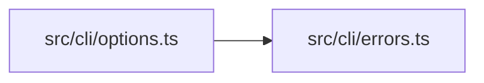
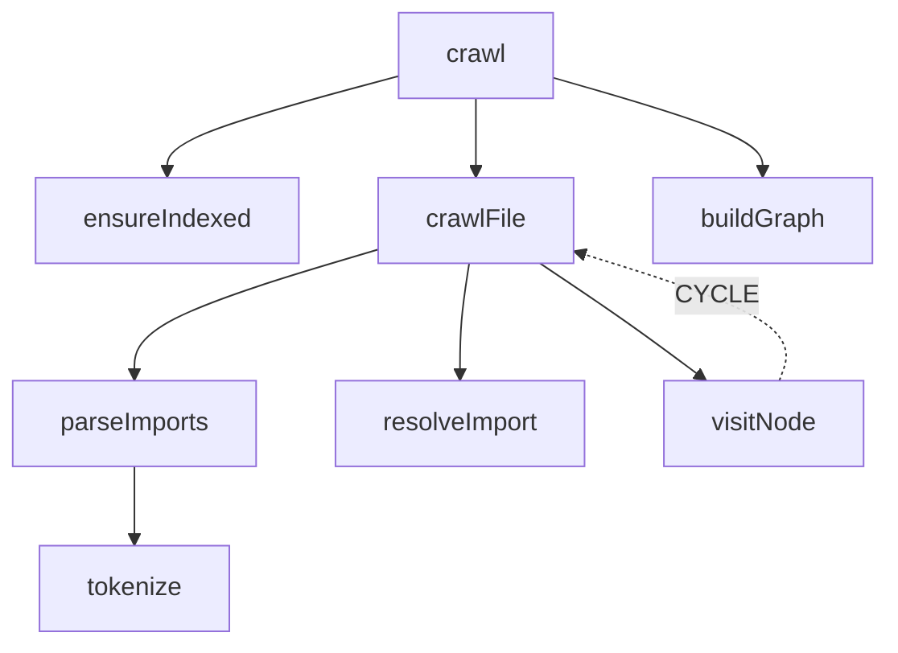

# Graph-It-Live CLI Reference

The `graph-it` CLI gives you full access to the dependency analysis engine of Graph-It-Live — **no VS Code required**. Run it in CI pipelines, pre-commit hooks, shell scripts, or in any terminal.

---

## Table of Contents

- [Installation](#installation)
- [Quick Start](#quick-start)
- [Global Options](#global-options)
- [Output Formats](#output-formats)
- [Commands](#commands)
  - [graph-it (no arguments)](#graph-it-no-arguments)
  - [scan](#scan)
  - [summary](#summary)
  - [explain](#explain)
  - [path](#path)
  - [path-in](#path-in)
  - [check-dependencies](#check-dependencies)
  - [cycles](#cycles)
  - [architecture](#architecture)
  - [check-architecture](#check-architecture)
  - [check](#check)
  - [trace](#trace)
  - [context](#context)
  - [review-pr](#review-pr)
  - [query](#query)
  - [stats](#stats)
  - [wiki](#wiki)
  - [export](#export)
  - [tool](#tool)
  - [serve](#serve)
  - [install](#install)
  - [update](#update)
- [MCP Tools Reference (via `graph-it tool`)](#mcp-tools-reference-via-graph-it-tool)
- [Advanced Analysis Workflows](#advanced-analysis-workflows)
  - [Pre-Refactor Safety Check](#pre-refactor-safety-check)
  - [Dead Code Audit](#dead-code-audit)
  - [Architecture Documentation](#architecture-documentation)
  - [CI Integration](#ci-integration)
  - [Piping & Scripting](#piping--scripting)
- [Tool Count: CLI vs MCP](#tool-count-cli-vs-mcp)

---

## Installation

**Prerequisite:** Node.js v22 or higher.

**Global install (recommended):**

```bash
npm install -g @magic5644/graph-it-live
```

After installation, `graph-it` is available system-wide:

```bash
graph-it --version
graph-it --help
```

**Without installing globally (via npx):**

```bash
npx @magic5644/graph-it-live scan
npx @magic5644/graph-it-live serve
```

**From VS Code extension:**

If you have the VS Code extension installed, you can expose the bundled binary to your PATH with:

```bash
graph-it install     # adds graph-it to your system PATH
```

**Troubleshooting: `graph-it` runs but prints nothing (fixed in v1.14.0)**

Versions v1.13.6 and earlier shipped a `bin/graph-it` wrapper that silently
broke `npm install -g` installs — every command exited `0` with no output at
all. If you're stuck on an affected version, `graph-it update` can't fix
itself (the whole CLI is dead on arrival, including the update command).
Reinstall manually instead:

```bash
npm install -g @magic5644/graph-it-live@latest
```

Once you're on v1.14.0+, `graph-it update` works normally again for future
releases.

---

## Quick Start

```bash
# 1. Go to your project root
cd /path/to/your/project

# 2. Index the workspace
graph-it scan

# 3. Get a workspace overview
graph-it summary

# 4. Analyze a specific file
graph-it summary src/main.ts

# 5. Find what depends on a file
graph-it tool find_referencing_files --targetPath=$(pwd)/src/utils.ts

# 6. Scan for dead code
graph-it check
```

---

## Global Options

These options are available for every command:

| Option | Shorthand | Default | Description |
|--------|-----------|---------|-------------|
| `--workspace <path>` | `-w` | auto-detected from `cwd` | Root directory of the project to analyze |
| `--format <format>` | `-f` | `text` | Output format: `text`, `json`, `toon`, `markdown`, `mermaid`; `csv` only for `architecture --matrix`, `sarif` only for `check-architecture` |
| `--help` | `-h` | — | Show help for the current command |
| `--version` | `-v` | — | Print the installed version |
| `--reindex` | — | — | Discard the cached index and rebuild it from scratch |
| `--no-cache` | — | — | Neither read nor write the index cache for this run |

**Workspace auto-detection:** If `--workspace` is omitted, `graph-it` uses the nearest directory, from the current one upward, that holds a `package.json` or `tsconfig.json` (the current directory when none does). An explicit `--workspace` is used exactly as given and must be an existing directory (exit code `3` otherwise). The MCP server applies the same rule to its working directory when `WORKSPACE_ROOT` is unset. The index and cache (`.graph-it/`) are created in the chosen root.

**Imports outside the workspace root** are skipped, never analyzed. When a scan skips some — typically from a monorepo sub-package whose path aliases or relative imports reach a sibling package — it prints one warning naming the detected monorepo root and the `--workspace` to rerun with, and `get_index_status` reports the count:

```text
  Warning: 1 import resolves outside the workspace root and was skipped (e.g. @core/x); dependents, impact and dead-code results cover this root only. Monorepo root detected (../..). Rerun with --workspace ../.. to include them.
```

```bash
# Explicit workspace
graph-it scan --workspace /abs/path/to/project

# Let it auto-detect from cwd
cd /path/to/project && graph-it scan
```

### Index cache

Each command runs in its own process, so without a cache every invocation would
re-parse the whole workspace. `graph-it` persists its indexes under
`.graph-it/cache/` in the workspace and reuses them on the next run, re-analyzing
only the files that changed. The MCP server and the VS Code extension read and
write the same cache, so whichever starts first indexes the workspace for all
three:

| File | Contents |
|------|----------|
| `meta.json` | Guard: cache layout version, Graph-It-Live version, workspace root, resolver config fingerprint |
| `reverse-index.json` | File-level dependency / reverse-dependency index |
| `callgraph.db` | SQLite call graph (written by `context`, `query`, `wiki`, the MCP server and the extension) |
| `index.lock` | Held while a process indexes; the others wait, then load its result |

A process that finds `index.lock` held waits for it (the CLI prints
`Waiting for the index being built by process N...`). A lock whose process is
gone, or older than 10 minutes, is taken over.

Indexing progress (`Indexing: n/m files...`) redraws in place only when stderr
is a terminal. Piped or redirected stderr (agents, CI logs) gets a single
summary line, such as `Indexed n/m files`.

The cache is invalidated automatically when the CLI version changes, when a
language query file is updated, per file by modification time and size, and
whenever more than 20% of the workspace changed — that last case triggers a full
rebuild. Added, deleted and renamed files are all detected. A running MCP server
or VS Code extension also watches `package.json` and `tsconfig*.json` files: when
one changes, it clears its resolver caches and re-indexes every indexed file,
since imports may now resolve elsewhere without any importer changing.

Turn it off with `--no-cache` (or `GRAPH_IT_NO_CACHE=1`), and force a clean
rebuild with `--reindex`. After each indexing run the CLI also writes
`.graph-it/state.json` (`workspaceRoot`, `lastScanTimestamp`, `filesIndexed`).
The VS Code extension also stores its local Branch
Watch base/head selection in `.graph-it/branch-watch.json`. `.graph-it/` writes
its own `.gitignore`, so none of it shows up in `git status`. It is disposable;
delete it at any time.

### Environment variables

| Variable | Effect |
|----------|--------|
| `GRAPH_IT_NO_CACHE=1` | Same as `--no-cache` (any non-empty value) |
| `GRAPH_IT_DISABLE_UPDATE_CHECK=1` | Skip the new-version notice. The notice is shown only on an interactive terminal |
| `GRAPH_IT_NO_STATS=1` | Do not persist session stats to `~/.graph-it/stats` (see [`stats`](#stats)) |
| `NO_COLOR` | Disable colors in the REPL |

`query` reads LLM provider variables (see [`query`](#query)); `serve` reads its own (see [`serve`](#serve)).

> Global options can appear before or after the command name (`graph-it --reindex summary` and `graph-it summary --reindex` are equivalent). They are removed from the command's own arguments, so `--workspace <dir>` never becomes part of a `query` question.
>
> Numeric command options (`--maxDepth`, `--depth`, `--token-budget`, `--max-files`, `--maxFiles`, `--top`, ...) must be integers within the documented range. Any other value stops the command with an error and exit code 1.

---

## Output Formats

All analysis commands support multiple output formats via `--format`:

| Format | Description | Best for |
|--------|-------------|----------|
| `text` *(default)* | Human-readable structured text | Terminal inspection |
| `json` | Standard JSON | Scripting, piping to `jq` |
| `toon` | Compact Token-Oriented Object Notation | AI consumption; measure savings for the payload |
| `markdown` | Data wrapped in a Markdown code block | Reports, documentation |
| `mermaid` | Mermaid flowchart diagram syntax | Architecture docs, README, Notion |

`toon` output is compacted: paths are workspace-relative, and keys that repeat a sibling are dropped (`relativePath` and `id` when equal to `path`, `sourceRelative`/`targetRelative`, and `sourceFile`/`targetFile` already carried by `sourceId`/`targetId`). MCP responses apply the same rule in every format. `json` keeps the full, uncompacted fields listed below.

MCP tools take `response_format` (`json`, `markdown`, `toon`). MCP `markdown` is readable Markdown with the same content as `toon`: the error of a failed call, freshness and pagination, scalar fields as a list, then one table per array. `structuredContent` always carries the full response.

**Format availability per command:**

`scan`, `summary`, `trace`, `explain`, `path`, `path-in`, `check-dependencies`, `cycles`, `architecture`, `check`, `review-pr` and `tool` accept all five formats; `architecture` also accepts `csv`, with `--matrix` only. `mermaid` draws the nodes and edges when the result has them, and a generic diagram of the JSON fields otherwise. The other commands differ:

| Command | Accepted formats | Other values |
|---------|------------------|--------------|
| `context` | `text`, `json`, `toon` | `markdown` and `mermaid` print `json` |
| `query` | `text`, `json`, `toon` | print `text` |
| `wiki` | `markdown` *(default)*, `json`, `toon` | print `markdown` |
| `stats` | `text`, `json` | `markdown` and `toon` print the `text` report |
| `check-architecture` | `text`, `json`, `toon`, `markdown`, `sarif` | `csv` is rejected (exit code 4) |
| `export` | `html` only | rejected |
| `serve`, `install`, `update` | — | `--format` is ignored |

**Examples:**

```bash
graph-it summary src/app.ts --format json
graph-it path src/index.ts --format mermaid      # → paste in GitHub, Notion, VS Code Preview
graph-it check --format markdown                  # → paste in a PR description
graph-it summary --format toon                    # → feed to an LLM
```

---

## Commands

### graph-it (no arguments)

Launches interactive mode when invoked without a command in a TTY session.

```
graph-it [options]
```

**Behavior:**

- If `stdin` is a TTY, starts the interactive REPL.
- If `stdin` is not a TTY, interactive mode is not started. Use direct commands such as `graph-it summary`, `graph-it trace`, or `graph-it check`.
- REPL session default output format is `text` unless changed with `/format`.

#### REPL slash commands

The palette lists canonical commands only, grouped by intent. Aliases still work when typed.

| Group | Command | Description |
|-------|---------|-------------|
| Navigate | `/scope` | Set session workspace scope (directory) |
| Navigate | `/file` | Set active file context for context-aware commands |
| Understand | `/trace` | Run trace flow for a selected file and optional symbol |
| Understand | `/explain` | Explain file logic (intra-file call hierarchy); defaults to the active file |
| Understand | `/context` | Bounded graph context for a question; with no argument, seeds from the current symbol |
| Understand | `/query` | Query the codebase with natural language (no quotes needed for multi-word questions) |
| Relations | `/check-dependencies` | Check incoming and outgoing dependencies |
| Relations | `/cycles` | List confirmed dependency cycles for a file |
| Relations | `/callers` | Find callers of a symbol (`query_call_graph`); defaults to the current symbol. Options: `--depth=N`, `--includeTypeOnly=true` |
| Relations | `/impact` | Impact analysis for a symbol change; defaults to the current symbol. Options: `--includeTransitive=true`, `--maxDepth=N` |
| Workspace | `/summary` | Summarize current file context or workspace |
| Workspace | `/architecture` | Build workspace architecture graph |
| Workspace | `/check` | Find unused exports |
| Workspace | `/check-architecture` | Check imports against `graphit.architecture.json` (`--config`, `--baseline`, `--update-baseline`); a failing check shows its report, then the error |
| Workspace | `/review-pr` | Review the Git diff against `--base <ref>` (optional `--head <ref>`) |
| Workspace | `/scan` | Force a workspace indexing scan |
| Output | `/format` | Set preferred output format for the session |
| Output | `/export` | Export dependency graph as standalone HTML (vis.js). Optional `--output <path>` / `-o <path>`. Scope: active file context → workspace scope (set via `/scope`) → full workspace |
| Output | `/wiki` | Generate a navigable markdown wiki from the call graph |
| Session | `/help` | Show REPL command help |
| Session | `/quit` | Exit interactive mode |

Hidden aliases (accepted when typed, not listed in the palette):

| Alias | Runs |
|-------|------|
| `/path` | `/scope` |
| `/deps`, `/dependencies`, `/deps-in`, `/deps-out`, `/path-in`, `/path-out` | `/check-dependencies` |
| `/cycle` | `/cycles` |

#### Typing paths

Wrap a path that contains spaces in quotes (`/file "src/my file.ts"`) or escape each space with a backslash (`/file src/my\ file.ts`). A backslash escapes only a space or a quote, so Windows paths such as `C:\repo\src` or `\\server\share` can be typed as they are. Single quotes keep their content literal.

#### Symbol completion

For `/trace`, `/callers` and `/impact`, type `#` after a workspace file (`/trace src/index.ts#`) and the palette lists that file's symbols, filtered by what follows the `#`. Typing `#` right after a completed file argument joins it to the file. The symbol list of each file is extracted once per session.

#### History and next steps

- `↑`/`↓` (on an empty line or while browsing) and `Ctrl+P`/`Ctrl+N` recall previous command lines.
- After each result, the footer suggests next steps for the current context: callers, impact and trace for the current symbol; explain, dependencies and cycles for the current file; otherwise summary, architecture and dead-code check. `Tab` puts the next suggestion on the command line.
- `Ctrl+F` searches the output, `Esc` clears the search.

#### Session state

REPL session state is in-memory for the current invocation and tracks:

- `workspaceRoot` (set with `/scope`)
- `lastFile` (set with `/file`, `/trace`, `/explain`, `/check-dependencies`, `/callers`, `/impact`)
- `lastSymbol` (set with `/trace`, `/callers`, `/impact`)
- `preferredFormat` (set with `/format`)

Other commands (`/summary`, `/check`, `/architecture`, `/cycles`, `/query`, `/format`, `/help`, ...) keep the current context; `/scope` clears it.

### scan

Index (or re-index) the workspace. Must be run before other analysis commands on first use; subsequent commands index automatically if needed.

```
graph-it scan [options]
```

**Options:**

| Option | Default | Description |
|--------|---------|-------------|
| `--workspace, -w` | auto-detected | Project root to index |
| `--format, -f` | `text` | Output format |

**What it does:**

1. Walks the workspace and parses every source file
2. Builds a dependency graph in memory (import/export edges)
3. Constructs a reverse index for O(1) "who imports this?" lookups
4. Prints the index status: state, reverse-index statistics, imports skipped outside the root, warm-up counts, and the on-disk size of the cache files

**Output (text):**

```
state: complete
isReady: true
reverseIndexEnabled: true
cacheSize: 0
reverseIndexStats:
  indexedFiles: 542
  targetFiles: 222
  totalReferences: 1494
outOfRootImports: 0
warmup:
  completed: true
  ...
cacheFiles:
  reverseIndexBytes: 412345
  callGraphBytes: 1708032
```

**Examples:**

```bash
graph-it scan
graph-it scan --workspace /path/to/project
graph-it scan --format json | jq '.reverseIndexStats.indexedFiles'
```

> **Tip:** In CI, run `graph-it scan` as a warm-up step before chaining other commands.

---

### summary

Print a workspace overview: index statistics plus (optionally) a codemap for a specific file.

```
graph-it summary [file] [options]
```

**Arguments:**

| Argument | Description |
|----------|-------------|
| `file` *(optional)* | Source file to generate a codemap for |

**Options:**

| Option | Default | Description |
|--------|---------|-------------|
| `--workspace, -w` | auto-detected | Project root |
| `--format, -f` | `text` | Output format |

**What it does (no file argument):**

Prints overall statistics: files indexed, edges, cycles, index freshness.

**What it does (with file argument):**

Returns index statistics **plus** a structured codemap for the file:
- Exported symbols
- Internal symbols
- Direct dependencies (files imported)
- Dependents (files that import this one)
- Call flow (intra-file symbol call order)
- Cycle indicators

**Output (text, with file):**

```
=== Index Status ===
Files: 347   Edges: 1824   Cycles: 2

=== Codemap: src/Spider.ts ===
Exports:  Spider, SpiderOptions
Internals: crawlFile, resolveImport, visitNode
Deps:     Parser.ts, PathResolver.ts, Cache.ts
Dependents: SpiderBuilder.ts, extension.ts
Call flow: crawl → crawlFile → resolveImport → visitNode
Cycles:   none
```

**Examples:**

```bash
graph-it summary
graph-it summary src/api/router.ts
graph-it summary src/api/router.ts --format markdown   # paste in docs
graph-it summary src/api/router.ts --format toon       # feed to LLM
```

---

### explain

Analyze the internal call hierarchy of a file — which functions call which, in what order, including recursive cycles.

```
graph-it explain <file> [options]
```

**Arguments:**

| Argument | Description |
|----------|-------------|
| `<file>` | Source file to analyze (absolute or relative to workspace root) |

**Options:**

| Option | Default | Description |
|--------|---------|-------------|
| `--workspace, -w` | auto-detected | Project root |
| `--format, -f` | `text` | Output format |

**What it does:**

Uses AST analysis (Tree-sitter + ts-morph) to map every symbol in the file and construct a call graph:
- Which symbols are exported vs. internal
- Which functions/methods call each other
- Entry points (symbols called by nobody internally)
- Cycle detection (recursive calls)

Each symbol's `kind` is shown by its LSP SymbolKind name (`Function`, `Method`, `Class`, …) in every format.

**Output (text):**

```
File: src/mcp/mcpServer.ts

Entry points: initializeServer(), main()

initializeServer()
  └── registerAllTools()         [call #1]
  └── setupFileWatcher()         [call #2]
  └── startListening()           [call #3]
      └── handleToolCall()
          ├── validateWorkspace()
          └── invokeWorker()

Cycles: none
```

**Examples:**

```bash
graph-it explain src/mcp/mcpServer.ts
graph-it explain src/analyzer/Spider.ts --format json
graph-it explain src/extension/GraphProvider.ts --format markdown
```

> **Use case:** Understand how data flows through a complex file before refactoring — without reading every line.

---

### path

Crawl the full dependency graph starting from an entry file (BFS traversal) and display all reachable files with their dependency relationships.

```
graph-it path <file> [options]
```

**Arguments:**

| Argument | Description |
|----------|-------------|
| `<file>` | Entry file to start crawling from |

**Options:**

| Option | Default | Description |
|--------|---------|-------------|
| `--workspace, -w` | auto-detected | Project root |
| `--format, -f` | `text` | Output format (`mermaid` generates a flowchart) |
| `--maxDepth <N>` | `50` | Maximum traversal depth, 1–100 |
| `--communities <mode>` | `path` | How `communityId`/`communityKey` group files: `path` by folder, `louvain` by import structure (see [Community modes](#community-modes)) |

**What it does:**

Starting from `<file>`, follows all import edges recursively and returns:
- `nodes`: every reachable file, with `relativePath`, `dependencyCount`, `dependentCount`, `hubScore`, `communityId` and `communityKey` (omitted for files in no community)
- `edges`: direct dependency edges (`source`, `target`, `sourceRelative`, `targetRelative`)
- `circularDependencies`: each cycle as a list of file paths
- `nodeCount`, `edgeCount` and the effective `maxDepth`

**Output (text, abridged):**

```
entryFile: /path/to/project/src/cli/options.ts
maxDepth: 50
nodeCount: 2
edgeCount: 1
nodes:
  [0]:
    path: /path/to/project/src/cli/options.ts
    relativePath: src/cli/options.ts
    ...
edges:
  [0]:
    sourceRelative: src/cli/options.ts
    targetRelative: src/cli/errors.ts
    ...
circularDependencies: []
```

**Output (mermaid):**



**Examples:**

```bash
graph-it path src/index.ts
graph-it path src/index.ts --maxDepth 3
graph-it path src/index.ts --communities louvain --format json | jq '.nodes[] | {relativePath, communityKey}'
graph-it path src/index.ts --format mermaid > architecture.md
graph-it path src/index.ts --format json | jq '.nodeCount'
```

> **Use case:** Generate an architecture diagram in seconds. Pipe `--format mermaid` output directly into your README, Notion page, or Confluence doc.

---

### path-in

Find incoming dependencies — which files import a given target file.

```
graph-it path-in <file> [options]
```

**Arguments:**

| Argument | Description |
|----------|-------------|
| `<file>` | Target file whose importers should be listed |

**Options:**

| Option | Default | Description |
|--------|---------|-------------|
| `--workspace, -w` | auto-detected | Project root |
| `--format, -f` | `text` | Output format (`mermaid` generates a flowchart) |

**Examples:**

```bash
graph-it path-in src/index.ts
graph-it path-in src/index.ts --format mermaid
```

---

### check-dependencies

Check both incoming and outgoing dependencies for a file in one call — combines `path` and `path-in` for a single target.

```
graph-it check-dependencies <file> [options]
```

**Arguments:**

| Argument | Description |
|----------|-------------|
| `<file>` | Target file to analyze |

**Options:**

| Option | Default | Description |
|--------|---------|-------------|
| `--workspace, -w` | auto-detected | Project root |
| `--format, -f` | `text` | Output format |

**Examples:**

```bash
graph-it check-dependencies src/index.ts
```

---

### cycles

List confirmed circular-dependency cycles that involve a given file.

```
graph-it cycles <file> [options]
```

**Arguments:**

| Argument | Description |
|----------|-------------|
| `<file>` | Target file to inspect for cycles |

**Options:**

| Option | Default | Description |
|--------|---------|-------------|
| `--workspace, -w` | auto-detected | Project root |
| `--format, -f` | `text` | Output format |

**Examples:**

```bash
graph-it cycles src/index.ts
```

---

### architecture

Build the full workspace dependency architecture graph by aggregating direct dependencies across every source file. Units, groups, levels, layers and file pairs are defined in the [architecture guide](architecture.md#concepts).

```
graph-it architecture [options]
```

**Options:**

| Option | Default | Description |
|--------|---------|-------------|
| `--maxFiles <N>` | unlimited | Cap on the number of analyzed source files |
| `--communities <mode>` | `path` | How `communityId`/`communityKey` group files: `path` by folder, `louvain` by import structure |
| `--groups` | off | Add `context`, `groups`, `unassigned`, `groupEdges` and `totals` to `json`/`toon` output; group `mermaid`/`markdown` diagrams (see [Grouped output](#grouped-output)) |
| `--level <level>` | — | `groups` = `--groups`; `units` replaces the file graph with the packages and their layers (see [Units output](#units-output)) |
| `--folder <key>` | — | `path` mode: the level below a unit or folder key, its sub-folders and own files as groups (see [Folder levels](#folder-levels)) |
| `--matrix` | off | Dependency structure matrix of the level (groups, `--level units` or `--folder`) instead (see [Matrix output](#matrix-output)) |
| `--workspace, -w` | auto-detected | Project root |
| `--format, -f` | `text` | Output format (`toon` recommended for large graphs; `mermaid` for diagrams; `csv` with `--matrix` only) |

Each node carries `communityId` (`0` = no community) and `communityKey` (`""` = no community). The `text` format lists the 8 largest communities after the top files.

**Examples:**

```bash
graph-it architecture
graph-it architecture --format mermaid
graph-it architecture --format toon
graph-it architecture --maxFiles 2000
graph-it architecture --communities louvain --format json
graph-it architecture --groups --format toon
graph-it architecture --groups --format mermaid
graph-it architecture --level units --format toon
graph-it architecture --level units --from apps/web --to packages/core --format json
graph-it architecture --folder "(root)/analyzer" --format toon
graph-it architecture --level units --matrix --format json
graph-it architecture --matrix --format csv > matrix.csv
```

#### Grouped output

`--groups` aggregates the file graph by community. Counts come from the full analyzed graph, before any display cap; without the flag the output is unchanged.

| Field | Content |
|-------|---------|
| `context` | `communityMode`, `revision` (same value as `explore_architecture`), `graphKind` (`imports`), `scope`, `exclusions`, `indexedAt` (last scan), `maxFiles`, `truncated` (`--maxFiles` hit), `failedFiles` |
| `groups` | `id`, `key`, `label`, `fileCount`, `internalEdgeCount` per community |
| `unassigned` | `fileCount` and `internalEdgeCount` of files with `communityId` `0` |
| `groupEdges` | `from`, `to`, `fileEdgeCount`: distinct directed file pairs from a file of `from` importing a file of `to`; group `0` = unassigned files |
| `totals` | `files`, `fileEdges`, `intraGroupEdges`, `interGroupEdges` (`intraGroupEdges + interGroupEdges = fileEdges`) |

`fileEdgeCount` counts file pairs; it is not the edge weight Louvain optimizes. Louvain ids are only valid within one result: they can change after any code change, so match groups across runs by `key`, not `id`.

With `--format mermaid` (or `markdown`), `--groups` draws a `flowchart LR` from the same counts:

- up to 260 files and 250 intra-group edges: one `subgraph` per group holding its files and the edges between them;
- beyond: one node per group (`analyzer (207 files)`), collapsed;
- edges between groups always join groups, labelled with `fileEdgeCount` (`G5 -->|141| G4`); at most 250 are drawn, the strongest first;
- leading `%%` comments state the community mode, graph kind, scope, `--maxFiles` cut, totals, the view (`expanded` / `collapsed`) and the hidden groups and group edges.

Node ids are numeric (`G1`, `F0`), so identical labels in different groups, quotes, `|`, `#` or Windows paths keep the diagram valid. The same renderer draws the [wiki](#wiki) index diagram.

Agents explore the same groups step by step with the MCP tool [`explore_architecture`](#explore_architecture): it builds the same graph, so for the same `--maxFiles` and community mode its `totals`, `groups` and `groupEdges` counts equal this output.

#### Curated diagrams

The generated diagram shows structure, not intent. For a presentation-grade diagram (like `docs/architecture/*.html`), feed the grouped JSON to a diagram skill such as `architecture-diagram` or `archify`:

```bash
graph-it architecture --groups --format json > architecture.json
```

> Using `architecture.json`, draw one box per entry of `groups` (label and `fileCount`) and one arrow per `groupEdges` entry labelled with `fileEdgeCount`. Keep the counts exactly; state `context.communityMode` and `context.scope` in the caption. Add the role notes below as annotations.

Role notes, layering rules and business names are human annotations: write them yourself and mark them as such, they are not derived from the graph. Draw runtime flows from `graph-it trace <file>#<symbol>` and label them static analysis: a call edge says the code can call, not that it ran.

#### Community modes

`path`, `architecture` and `export` accept `--communities path|louvain`; the MCP tool `crawl_dependency_graph` takes the same value as `communityMode`, and the VS Code graph reads the `graph-it-live.communityMode` setting. All three use the same detection, so the same graph gives the same communities.

| Mode | Groups files by | `communityKey` |
|------|-----------------|----------------|
| `path` (default) | First functional folder after `src`, `lib`, `packages`… | Folder name, e.g. `analyzer` |
| `louvain` | Import structure: deterministic Louvain (modularity), files that import each other end up together | Dominant folder of the members, or the most connected file for root-level files, cut to its last two segments (more when needed to stay distinct), e.g. `analyzer/graph-context`; `#<id>` is appended when two communities share a folder |

Files without a folder domain (`path`) or without any import edge (`louvain`) get `communityId` `0`.

> **Use case:** Bootstrap AI-assisted exploration of an unfamiliar codebase — pipe `--format toon` into an LLM prompt for a token-efficient architecture snapshot.

---

#### Units output

`--level units` reports what the VS Code Architecture view draws on top in `path` mode, with the same counts as `explore_architecture` with `level: "units"`. [Units](architecture.md#concepts) are packages, else top-level folders, plus `(root)`. Imports of a workspace package by its name resolve to its sources through the `node_modules` link.

| Field | Content |
|-------|---------|
| `context` | as above; `revision` also covers the units, their names and roles |
| `units` | `key` (folder or `(root)`), `name` (`package.json` name, else the folder), `fileCount`, `internalEdgeCount`, `layer` (0 = depends on no other unit; the units of a cycle share a layer), `role` (`function`, `micro-frontend`, `frontend`, `service`, `library`, `tooling` or `unknown`), `confidence` (`inferred`, or `declared` by `roles` in `graphit.architecture.json`) and `evidence` (`role` and `detail` of every match, the unit's role first by priority), deepest layer last |
| `unitEdges` | `from`, `to`, `fileEdgeCount`, `kind`: `down`, `upward` (to the same or a higher layer) or `cycle` (both units in one cycle), heaviest first |
| `upwardEdges`, `cycles` | number of upward edges, and of groups of units that depend on each other |
| `layerCount` | number of distinct layers of the units (the Architecture view's header) |
| `roleCounts` | units per role, in role priority order (see [Roles](architecture.md#roles) for the evidence of each role) |
| `totals` | `files`, `fileEdges`, `intraUnitEdges`, `interUnitEdges` |

With `--from <unit key> --to <unit key>` (both required, `--level units` only), the output is the evidence of that unit edge instead: `from` and `to` (the units), `kind` (`down`, `upward` or `cycle`; absent when the units are not linked) and every file `pairs` (`source` imports `target`), sorted by target then source path, with `page.total` equal to the edge's `fileEdgeCount`.

These are the pairs the Architecture view lists when a unit edge is clicked. A key may be typed with `\` on Windows; an unknown unit is an error.

#### Folder levels

`--folder <key>` walks down a unit as the Architecture view does when a folder is entered:

- **Key**: a unit key (from `--level units`) or a group key of a level. The top folders of a unit are `<unit>/<folder>`, umbrella folders such as `src` or `tests` skipped: `app/src/core` and `app/tests/core` both fall in `app/core`. Each sub-folder then adds its name (`app/core/util`).
- **Output**: the [grouped output](#grouped-output) fields for the files below the key only. Each sub-folder is a group; the key's own files form the group whose key is the key itself. `nestedGroups` lists the groups that hold sub-folders: pass their key to go one level deeper.
- **Counts** add up level by level: a group's `fileCount` and `internalEdgeCount` are the `totals.files` and `totals.fileEdges` of its own level. `context.revision` also covers the folder, so group ids hold for that level only.
- **Refused** with `--level units` or `--communities louvain` (Louvain groups have no folders); an unknown key is an error.

#### Matrix output

`--matrix` reports the dependency structure matrix of the level the other flags select: the groups (`path` or `louvain`, the unassigned files as one more row), the units (`--level units`) or a folder level (`--folder`). It is what the Architecture view's *Matrix* tab shows, with the same rows, cells and totals as `explore_architecture` with `view: "matrix"` (the CLI lists every cell, the MCP tool pages them).

| Field | Content |
|-------|---------|
| `rows` | `id` (group id, or unit key), `key`, `label`, `layer`, `cycle` (index in `cycles`, when in one), `internalEdgeCount` (the diagonal), `outgoingPairs` / `outgoingGroups` (Ce), `incomingPairs` / `incomingGroups` (Ca), `instability` (`I = Ce / (Ca + Ce)`, 2 decimals, `null` without any pair across the row's boundary) |
| `cells` | non-zero cells only, the diagonal included: `row`, `column` (indexes in `rows`), `fileEdgeCount` (file pairs where a file of the row imports a file of the column), `upward` (above the diagonal) |
| `cycles` | `firstRow`, `lastRow`, `members` (keys) of each group of two or more rows that depend on each other |
| `totals` | `rows`, `cells`, `fileEdges`, `intraEdges` (diagonal), `interEdges`, `upwardCells` |
| `formulas` | how rows are ordered, what a cell and an upward cell are, and the instability formula |

Rows and columns share one order: layer 0 first (depends on no other row), the rows of a cycle together, then by label (code-unit order, the same on every OS). Every dependency of a layered level then sits below the diagonal, so an `upward` cell belongs to a cycle. Off-diagonal cells are the `groupEdges` of `--groups` (or the `unitEdges` of `--level units`), and the diagonal their `internalEdgeCount`.

`--format csv` writes the whole matrix for a spreadsheet: a header row of labels, one line per row with its counts (empty = 0), then `Ce`, `Ca` and `I`. A label starting with `=`, `+`, `-`, `@`, a tab or a carriage return is prefixed with `'`, so a spreadsheet never runs it as a formula (scoped package names such as `@scope/lib` show the `'`). `--matrix` is refused with `--from`/`--to`, and `csv` without `--matrix`.

### check-architecture

Checks every static import of the workspace against the **architecture rules** declared in `graphit.architecture.json` at the workspace root. Rules are human annotation: the command only compares import pairs with them. For a step-by-step guide (local check, CI gate, baseline adoption), see the [architecture guide](architecture.md#by-task).

```bash
graph-it check-architecture [--config <file>] [--baseline <file>] [--update-baseline] [--format text|json|toon|markdown|sarif]
```

#### Architecture rules

```json
{
  "$schema": "https://raw.githubusercontent.com/magic5644/Graph-It-Live/main/schemas/architecture.schema.json",
  "elements": {
    "functions": { "path": "functions/*", "each": true },
    "frontend": { "path": "frontend/" },
    "mfe": { "path": "mfe/*", "each": true },
    "backend": { "path": "backend/" },
    "shared": { "unit": ["@acme/shared-*"] }
  },
  "rules": [
    { "name": "functions-only-shared", "from": "functions", "allowOnly": ["shared"], "severity": "error",
      "reason": "Functions are deployed alone; they share code only through libraries." },
    { "name": "frontend-not-backend", "from": ["frontend", "mfe"], "forbid": ["backend"], "severity": "error" },
    { "name": "mfe-isolated", "from": "mfe", "forbid": ["mfe"], "severity": "warning" },
    { "name": "no-unit-cycles", "noCycles": "units", "severity": "error" }
  ]
}
```

| Key | Meaning |
|-----|---------|
| `elements.<name>.path` | Workspace-relative gitignore-style patterns (the syntax of `.graphitignore`, no regular expression); no `..`, drive letter or backslash |
| `elements.<name>.unit` | Unit keys or package names of [`--level units`](#units-output); `*` matches any characters |
| `elements.<name>.role` | Unit roles: every unit with one of them (declared in `roles`, else inferred) |
| `elements.<name>.each` | Every matched folder (or unit) is an instance of its own; a file never breaks a rule against its own instance |
| `rules[].forbid` | Files of `from` may not import files of these elements |
| `rules[].allowOnly` | Files of `from` may import only these elements and their own instance |
| `rules[].noCycles` | `"units"`, or an element: no import cycle between units or between the element's instances |
| `rules[].severity` | `error` (default, fails the command), `warning`, `off` (skipped) |
| `rules[].reason` | Shown with every violation |
| `roles.<unit>` | Role of the units whose key or package name matches (`*` matches any characters; first match wins): `function`, `micro-frontend`, `frontend`, `service`, `library`, `tooling` or `unknown`. Not a rule: it only replaces the inferred role |

How the rules read:

- A file can belong to several elements; a rule checks each element of the importing file it names.
- `allowOnly` accepts the importer's own instance and **every** instance of a listed element (list an `each` element to allow all of them). A target selected by no element is a violation (`(no element)`).
- An element without `each` is a single instance, and a file never breaks a rule against its own instance: `noCycles` on such an element, or `forbid` of the element it comes `from`, could never report, so the config is refused (`needs each: true`).
- A rule with `severity: "off"` is not checked: its baseline entries are neither resolved nor dropped by `--update-baseline`.
- Only `graphit.architecture.json` and `graphit.architecture.baseline.json` at the workspace root are read by the view; `--config` and `--baseline` name others for the CLI and MCP.

The config is validated before anything runs: unknown keys, rules naming unknown elements, empty patterns, a missing kind or duplicate rule names are rejected with the JSON path of each error (`graphit.architecture.json: $.rules[0].from[1]: unknown element "web"`). Files larger than 256 KB (32 MB for a baseline) are refused, and `--config` / `--baseline` must stay inside the workspace. The published schema, [`schemas/architecture.schema.json`](../schemas/architecture.schema.json), gives completion in editors through `$schema`.

**Output** (`json`): `configFile`, `baselineFile`, `context` (with `revision`), `passed`, `totals` (`violations`, `newViolations`, `errors`, `newErrors`, `warnings`, `brokenRules`, `unmatchedFiles`, `resolved`), `rules` (each with `kind`, `severity`, `reason`, `violations`, `newViolations` and its `elementPairs`), `violations` (`rule`, `severity`, `source`, `target`, import `line`, element instances `from` / `to`, `new`), sorted by rule then file, `resolved`, `unmatchedFiles` (files no element selects: no rule checks them) and `configWarnings` (patterns matching nothing).

**Exit code**: 1 when an `error` violation is not in the baseline (the report is still printed on stdout), else 0. A missing or invalid config, a named baseline that does not exist, or `--config` / `--baseline` without a file also exit 1; a `--config` or `--baseline` outside the workspace exits 5, and `--format csv` exits 4.

**Baseline**: `--update-baseline` writes every current violation to `graphit.architecture.baseline.json` (or `--baseline <file>`), as workspace-relative `/` paths sorted by rule and file pair, so the file is identical on Linux, macOS and Windows. With a baseline, only violations absent from it are `new`; its entries no longer found are listed in `resolved`, so rerunning `--update-baseline` shrinks it.

**SARIF**: `--format sarif` writes SARIF 2.1.0 with one result per new violation, located on the importing line, for GitHub code scanning:

```yaml
- run: npx graph-it check-architecture --format sarif > architecture.sarif
- uses: github/codeql-action/upload-sarif@v3
  if: always()
  with:
    sarif_file: architecture.sarif
```

The VS Code Architecture view and the [`check_architecture`](#check_architecture) MCP tool report the same rules and counts.

### check

Find unused exported symbols (dead code) — either workspace-wide, scoped to a directory, or for a single file.

```
graph-it check [target] [options]
```

**Arguments:**

| Argument | Description |
|----------|-------------|
| *(none)* | Scan the entire workspace for unused exports |
| `<directory>` | Scan a specific directory and its subdirectories |
| `<file>` | Check a single file for unused exported symbols |

**Options:**

| Option | Default | Description |
|--------|---------|-------------|
| `--workspace, -w` | auto-detected | Project root |
| `--format, -f` | `text` | Output format |

**What it does:**

Combines the dependency graph with export analysis to find symbols that are exported but never imported anywhere in the project. Reports:
- File path of the symbol
- Symbol name and type (function, class, variable, type alias…)
- Whether it is completely unreferenced or only referenced within the same file

**Output (text, workspace-wide):**

```
Dead code scan — 347 files analyzed

src/utils/legacy.ts
  ⚠  formatDate        [function]   — exported, never imported
  ⚠  LegacyConfig      [interface]  — exported, never imported

src/api/deprecated.ts
  ⚠  oldHandler        [function]   — exported, never imported

3 unused exports found across 2 files.
```

**Output (text, single file):**

```
Checking src/utils/helpers.ts

  ✓  formatDate        used in 4 files
  ✗  parseQueryString  not used anywhere
  ✓  clamp             used in 2 files

1 unused export found.
```

**Examples:**

```bash
# Workspace-wide dead code scan
graph-it check

# Scope to a directory
graph-it check src/utils/

# Single file check
graph-it check src/api/handlers.ts

# Output as JSON for scripting
graph-it check --format json | jq '.entries[] | {relativePath, unusedCount}'

# Output as Markdown for PR descriptions
graph-it check --format markdown > dead-code-report.md
```

> **Use case:** Run `graph-it check` in a pre-commit hook or CI step to prevent dead code from accumulating.

---

### trace

Trace the complete execution path from a starting symbol — following every function call recursively until leaf functions are reached.

```
graph-it trace <file>#<Symbol> [options]
```

**Arguments:**

| Argument | Format | Description |
|----------|--------|-------------|
| `<file>#<Symbol>` | `path/to/file.ts#FunctionName` | Entry symbol (file path + `#` + symbol name) |

**Options:**

| Option | Default | Description |
|--------|---------|-------------|
| `--workspace, -w` | auto-detected | Project root |
| `--format, -f` | `text` | Output format (`mermaid` generates a call flowchart) |
| `--maxDepth <N>` | `10` | Maximum recursion depth |

**What it does:**

Starting from the specified symbol, follows every outgoing call edge recursively (DFS) and returns a tree showing the complete execution flow:
- Each function call with its file location
- Call ordering (numbered edges)
- Recursive calls / cycles detected and labelled

**Output (text):**

```
Trace: src/analyzer/Spider.ts#crawl

crawl (Spider.ts)
  ├─[1] ensureIndexed (runtime.ts)
  ├─[2] crawlFile (Spider.ts)
  │     ├─[1] parseImports (Parser.ts)
  │     │     └─[1] tokenize (lexer.ts)
  │     ├─[2] resolveImport (PathResolver.ts)
  │     └─[3] visitNode (Spider.ts)
  │           ⟲ crawlFile [CYCLE — recursive]
  └─[3] buildGraph (GraphBuilder.ts)

Depth reached: 4   Cycles: 1
```

**Output (mermaid):**



**Examples:**

```bash
graph-it trace src/index.ts#main
graph-it trace src/api.ts#handleRequest --format mermaid
graph-it trace src/Spider.ts#crawl --maxDepth 5
graph-it trace src/mcp/mcpServer.ts#initializeServer --format json
```

> **Use case:** Before changing a function signature, run `trace` to see every downstream function that will be affected, all the way to leaf functions.

---

### context

Retrieve one bounded, evidence-backed graph context from the file dependency
graph and cross-file call graph.

```
graph-it context [question] [options]
```

The command supports `search`, `neighbors`, `path`, `impact`, `refactor`, and
`overview` modes. A question, at least one seed, or both `--from` and `--to`
must be supplied. Endpoints alone infer `path` mode.

The shared executor has these public entry points:

| Surface | Entry point |
|---------|-------------|
| CLI | `graph-it context` |
| CLI analysis-tool bridge | `graph-it tool graph_context` |
| MCP server | `graphitlive_graph_context` |
| VS Code Language Model tool | `graph-it-live_graph_context`, referenced as `#graphContext` in Copilot Agent mode |

Relation filters accept `CONTAINS`, `IMPORTS`, `CALLS`, `INHERITS`,
`IMPLEMENTS`, `USES`, `TESTED_BY`, `IMPACTED_BY`, `BELONGS_TO`, `REFERENCES`,
`EXPLAINS`, and `DOCUMENTS` (up to 12 unique values).

| Option | Default | Description |
|--------|---------|-------------|
| `--mode <mode>` | inferred | `search`, `neighbors`, `path`, `impact`, `refactor`, or `overview` |
| `--seeds <file#symbol>` | — | Repeatable seed; a symbol-only value is also accepted |
| `--from <file#symbol>` / `--to <file#symbol>` | — | Path endpoints |
| `--scope <glob>` | workspace | Workspace-relative `*`, `**`, `?` scope |
| `--depth <N>` | `2` | Traversal depth, 1–5 |
| `--max-nodes <N>` | `200` | Requested nodes per page, 1–500; mandatory seeds and path endpoints are preserved, so the actual count can exceed this value |
| `--token-budget <N>` | `4000` | Output budget, 500–16,000. A budget too small for every seed drops the lowest-ranked seeds and sets `truncated`; only path endpoints are non-negotiable. |
| `--relations <relation>` | all | Repeatable relation filter, maximum 12 unique values |
| `--directed` | false | Keep path traversal directed |
| `--cursor <cursor>` | — | Continue a truncated result |
| `--format <format>` | global format | `json` or `toon` |
| `--detail <level>` | `standard` | `compact` (metadata stripped), `standard` and `full` (all fields). The token budget and `--max-nodes` set the node count at every level |
| `--workspace, -w <path>` | auto-detected | Workspace root |

```bash
graph-it context "what calls the request handler" --scope 'src/**' --format toon
graph-it context --mode path --from src/api.ts#handle --to src/db.ts#query --depth 4
graph-it context --mode impact --seeds src/api.ts#handle --relations CALLS --depth 3 --format json
graph-it context "how is authentication wired" --token-budget 8000 --format json
graph-it context "what calls the request handler" --format toon --detail compact --token-budget 800

# A continuation repeats the original request and options with nextCursor.
graph-it context "what calls the request handler" --scope 'src/**' --format toon --cursor '<nextCursor>'
```

Responses contain workspace-relative nodes, typed relations, provenance,
source line spans, paths, ambiguity candidates, omission counts, and a
continuation cursor when truncated. Source contents are not included; read the
identified files separately. JSON returns the structured response; TOON emits
`graph_context`, `nodes`, `edges`, `paths`, `ambiguous`, `omitted`, and
`nextQueries` blocks.

`seeds` is a list of node ids. The seed nodes themselves are in `nodes`, flagged
`isSeed` — they are not repeated.

Edges carry `relation`, `confidence`, `sourcePath` and `sourceLine` directly. An
`evidence` object is present only when it states something those fields do not:
the justification sentence for an ordinary edge is derived from its relation and
confidence, not stored on every edge.

Pick `--detail` by the fields you need. Every level fills the token budget
before truncating, and keeps the continuation cursor:

| Level | Fields |
|-------|--------|
| `compact` | language, score and edge source locations dropped, at most 3 `nextQueries` |
| `standard` (default) | complete |
| `full` | complete |

Because `compact` spends fewer tokens per node, the same budget returns more
nodes. A candidate too large for the remaining budget, such as a document linked
to many selected symbols, is skipped rather than ending the page.

Search seeds favor code: a test that matches the question ranks below matching
source symbols unless the question mentions tests. A symbol whose name equals a
whole word of the question (case-insensitive, stopwords aside) ranks before
symbols that only share its parts, so `normalizePath` comes before
`normalizeRelativePath`. Documents excluded by
`.gitignore` or `.graphitignore` (for example a generated `wiki/`) are not indexed.

MCP clients call the prefixed server tool name:

```json
{
  "arguments": {
    "mode": "path",
    "from": { "filePath": "src/api.ts", "symbolName": "handle" },
    "to": { "filePath": "src/db.ts", "symbolName": "query" },
    "scope": "src/**",
    "depth": 4,
    "maxNodes": 100,
    "tokenBudget": 4000,
    "directed": true
  }
}
```

In Copilot Agent mode, reference the native tool directly, for example:

```text
#graphContext Find the impact of src/api.ts#handle within src/** at depth 3.
```

The manifest name for that native tool is `graph-it-live_graph_context`.
Invalid or out-of-workspace paths are rejected. Ambiguous entities are returned
as scored candidates without a silent selection. A cursor is rejected if the
request, scope, budget, filters, or index revision changed. Unsupported language
constructs remain absent, and unresolved calls remain `external:` nodes with
evidence marked `AMBIGUOUS` when several internal targets match.

Because the cursor is bound to the index revision, a later standalone CLI
invocation can reject it after re-indexing. Start again without `--cursor` when
that happens.

---

### review-pr

Run a deterministic local review of a Git diff:

```bash
graph-it review-pr --base origin/main [--head <ref>] [--depth 3] [--max-files 200] --format text|json|toon|markdown|mermaid
```

The command first ensures that the workspace index is available. It then lists changed files with `git diff` and compares exported TypeScript and JavaScript signatures between the base and head. Without `--head`, the head is the current working tree (`HEAD` plus staged and unstaged file contents). With `--head <ref>`, both sides come from Git refs and the changed-file list uses the three-dot comparison.

For each changed symbol, the bounded analysis can report:

- breaking signature changes;
- known dependent symbols and transitive impact up to `--depth` (default `3`, maximum `10`);
- cycle and unused-export evidence when the local index provides it;
- conventional test-file candidates;
- consumer standing: files **updated** in the diff, **covered** by a test path, or **unverified**. "Updated" is file-level: the consumer file changed, which does not prove its call site was fixed.

An export removed from one changed file and newly exported, with a comparable kind, by exactly one other changed file is reported as a move (change type `symbol-moved`, evidence kind `moved`, "Moved symbols" in Markdown) and weighs as residual work, so a pure move stays `low`. Differences between the old and the new declaration are still reported; an interface that became an object-literal type alias (or the reverse) has its members compared, and a kind change whose members cannot be compared stays breaking, except an inferred `ReturnType<…>` alias spelled out as an interface. The move is proven only when the reference index lists the old module's importers: a file that imports the name from the old module by name, or reaches the module through a default or namespace import, `export *`, dynamic `import()`, `require()` or an `import()` type, keeps the removal breaking and is listed as a consumer. Without a reference index, when it fails, or when several changed files export the name, the removal stays breaking and a limitation explains why. A file renamed with `git mv` is reviewed as an added file, as before.

The score is capped at `100` per symbol, and the result score is the highest symbol score. Risk thresholds are `low` (<20), `medium` (20–49), `high` (50–79), and `critical` (80–100). When the change requires call-site updates (anything but a return-type change), every consumer the diff does not touch adds risk, covered or not: a test only makes the breakage fail later. Otherwise consumers add no risk. Missing optional evidence, unsupported file types, and file limits are reported as limitations rather than invented findings. The command does not fail solely because the risk is high; use the Action's `fail-on-risk` input to gate CI.

`--max-files` defaults to `200` and accepts values from `1` to `1000`. The default output is text. Markdown output includes a consumer table, a list of consumers to check and the moved symbols; JSON and TOON expose the complete structured result. Invalid refs and invalid limits exit non-zero.

The MCP tool `graphitlive_review_pr` exposes the same bounded analysis through `baseRef`, optional `headRef`, `maxDepth`, and `maxFiles`. Omit `headRef` to review the checked-out worktree; provide a local or remote branch ref to compare two committed branch refs. The Action emits `vscode://magic5644.graph-it-live/graph-it-live.reviewCallGraph?file=<workspace-relative>&symbol=<encoded>&depth=3` only when a risky symbol has a workspace-relative file, printed in the PR comment as a code span to copy (GitHub strips non-http(s) Markdown links, so it is not clickable); the extension accepts depth 1–5 and validates the path again. Branch Watch's VS Code confidence label is UI context for incomplete local evidence; the CLI and MCP continue to expose the structured limitations and `isPartial` fields instead of that label.

#### GitHub Actions consumer workflow

The composite Action has no trigger of its own. Consumer repositories must add a `pull_request` workflow; see [`examples/graph-it-review-gate.yml`](examples/graph-it-review-gate.yml). It installs `@magic5644/graph-it-live@latest` in a temporary prefix and runs `graph-it review-pr --workspace "$GITHUB_WORKSPACE"` against the checked-out consumer repository. It never installs or builds consumer dependencies.

`cli-version` is optional: omit it to use npm `latest`, or supply an npm version, tag, or range. The Action validates the CLI's actual `graph-it-live vX.Y.Z` output, logs it, exposes it as `outputs.cli-version`, and rejects versions below `1.13.0`. It also exposes `risk` and `score` outputs.

Pin the Action to a release tag, such as `magic5644/Graph-It-Live/.github/actions/graph-it-review-gate@v1.18.0`. Never use `pull_request_target` to inspect untrusted PR code. Set `comment: false` for fork PRs; then grant only `contents: read` rather than `pull-requests: write`.

---

### query

Answer a natural language question about the codebase using the call graph. When an LLM API key is configured the answer is synthesised by the model; otherwise a heuristic fallback is used and a warning is printed to stderr.

```
graph-it query "<question>" [options]
```

**Arguments:**

| Argument | Description |
|----------|-------------|
| `<question>` | Natural language question about the codebase (max 1024 characters) |

**Options:**

| Option | Default | Description |
|--------|---------|-------------|
| `--workspace, -w` | auto-detected | Project root |
| `--depth <N>` | `2` | BFS depth for call graph traversal (1–5) |
| `--token-budget <N>` | `4000` | Max tokens for the subgraph context (500–16000) |
| `--format <fmt>` | `text` | Output format: `text`, `json`, `toon` |

**LLM configuration (environment variables):**

| Variable | Description |
|----------|-------------|
| `GRAPH_IT_LLM_PROVIDER` | Pin a provider: `anthropic`, `openai-compatible` (alias `openai`), or `copilot-cli`. When set, no other provider is tried. |
| `ANTHROPIC_API_KEY` | Use Anthropic (`claude-haiku-4-5`) |
| `OPENAI_API_KEY` | Use OpenAI-compatible provider |
| `OPENAI_BASE_URL` | Base URL for OpenAI-compatible endpoint |
| `OPENAI_MODEL` | Model name for OpenAI-compatible provider |
| `GRAPH_IT_COPILOT_BIN` | Path to the `copilot` binary (default: `copilot` on `PATH`) |

Without `GRAPH_IT_LLM_PROVIDER`, providers are tried in order: Anthropic, then
OpenAI-compatible. When none is usable, the command falls back to a heuristic
analysis and prints a notice to stderr.

**Using GitHub Copilot**

`copilot-cli` reuses your existing GitHub Copilot subscription through the local
[GitHub Copilot CLI](https://github.com/github/copilot-cli) — no API key needed:

```bash
copilot            # then /login, once
export GRAPH_IT_LLM_PROVIDER=copilot-cli
graph-it query "how does the indexer resolve imports"
```

It is never auto-detected, because every query spends Copilot premium request
credits (roughly 2–3 per query) and takes a few seconds. Set the variable only
when you want it.

> A plain `GITHUB_TOKEN` is **not** an inference credential: GitHub Models
> (`models.github.ai`) was retired on 2026-07-30. For a hosted endpoint, point
> `OPENAI_BASE_URL` at any OpenAI-compatible service (Azure AI Foundry, OpenAI,
> Ollama, LM Studio…).

**Examples:**

```bash
graph-it query "how does Spider crawl files"
graph-it query "how does Spider crawl files" --format text
graph-it query "what calls CallGraphIndexer" --depth 3
graph-it query "explain the MCP server architecture" --token-budget 8000
graph-it query "what is the entry point for the CLI" --format json
```

> **Breaking change:** `CallGraphIndexer` SCHEMA_VERSION was bumped from 2 to 3 alongside this feature. The index is automatically rebuilt on first use after upgrading.

---

### stats

Report session-level token metrics with strict separation between:
- **JSON vs TOON representation counts** from `gpt-tokenizer`'s
  `cl100k_base` encoding, and
- **real provider-reported LLM usage** (`llmUsage`).

```
graph-it stats [options]
```

**Options:**

| Option | Default | Description |
|--------|---------|-------------|
| `--workspace, -w` | auto-detected | Project root |
| `--stats-dir <dir>` | `~/.graph-it/stats` | Override persisted stats directory |
| `--format, -f` | `text` | Output format (`text`, `json`, `markdown`) |

**What it reports:**
- current process session (`byTool`, totals, `llmUsage`)
- persisted history (`bySource`, `byTool`)
- required wording that `llmUsage` is never summed into estimated encoding totals

**Local zero-LLM proof workflow:**

```bash
# Runs six graph-context workflows in JSON and TOON on a fixed local corpus.
# Known LLM credentials are removed from child processes.
# Raw outputs and report.json are written under .reports/context-economy/.
npm run test:context-economy
```

The generated `report.json` stores, for every corpus operation:

- raw JSON and TOON output;
- request and response representation counts from `cl100k_base`;
- quality, bound, freshness, and cold/warm/incremental latency metrics;
- `null` for unobserved MCP initialization, MCP tool-call, continuation, and
  provider billing-token metrics.

These tokenizer counts describe serialized representation size. They are not
provider billing tokens or proof that an LLM was called. Local graph traversal
performs no LLM request. The optional `query` command may use an LLM only to
extract keywords; without a provider key it uses the deterministic heuristic
fallback. MCP response synthesis belongs to the calling AI client, not to
Graph-It-Live's local analyzers.

**TOON encoding benchmark:**

```bash
# TOON encoding + token estimate on 100 / 1,000 / 5,000-node crawl payloads
npx vitest bench --run --config vitest.benchmark.config.mts tests/benchmarks/sessionStatsToon.bench.ts
```

**Examples:**

```bash
graph-it stats
graph-it stats --format json
graph-it stats --stats-dir /tmp/graph-it-stats --format markdown
```

---

### wiki

Generate a navigable markdown wiki from the call graph. Creates one article per source file with hub scores, symbol lists, caller/callee cross-links, and a grouped index — all with relative links only (portable, can be committed to the repo). The index opens with an architecture diagram grouped by path community, drawn like [`architecture --groups --format mermaid`](#grouped-output) from the static call graph: a file edge is at least one call between two wiki files. Beyond 50 files or 40 intra-group edges, groups collapse to single nodes and the index says so.

```
graph-it wiki [options]
```

**Options:**

| Option | Default | Description |
|--------|---------|-------------|
| `--output <dir>` | `wiki` | Output directory inside the workspace. Relative paths resolve against the workspace root; an absolute path must point inside it |
| `--force` | off | Replace an existing `index.md` or article that the wiki did not generate |
| `--scope <rel-path>` | entire workspace | Restrict the wiki to a folder or file within the workspace (`src/lib`, `./src/lib`, `src\lib` and absolute paths inside the workspace are equivalent) |
| `--exclude <pattern>` | — | Glob pattern to exclude (repeatable): `*` within a segment, `**` across segments, `?` one character. A pattern with `/` is anchored at the workspace root (`tests/**`); one without `/` matches any segment (`*.test.ts`, `fixtures`). Replaces the default exclusions when passed |
| `--top <N>` | `10` | Number of top hub files to list in the index (1–50) |
| `--format <fmt>` | `markdown` | Output summary format: `markdown`, `json`, `toon` |
| `--workspace, -w` | auto-detected | Project root |

`tests/`, `dist/`, `*.test.ts` and similar are excluded automatically unless `--exclude` is passed. The command fails with an error when the filters leave no indexed file.

Each article lists at most 20 callers and 20 callees and states how many were left out. Links point only to articles of the same run; files outside the scope appear as plain text. Article names flatten the path (`src/foo.ts` → `src_foo.ts.md`); colliding names get a numeric suffix (`src_a_b.ts-2.md`). Regenerating the wiki deletes articles of earlier runs that no longer match an included file; only files carrying the generated-article marker are deleted.

The output directory must stay inside the workspace: a path outside it, a `../` escape, a path on another Windows drive, or a symbolic link that leaves the workspace is rejected (exit code 5) before anything is written. Every generated file, `index.md` included, starts with the `<!-- graph-it-live:wiki-article -->` marker. When `index.md` or an article already exists without that marker, the command writes nothing (an `index.md` written by v1.17.1, before the marker, is still recognized by its `# Wiki — <workspace>` title) and fails (exit code 1) unless `--force` is passed. Symbolic links and directories in place of a wiki file are never written through, even with `--force`.

**Examples:**

```bash
graph-it wiki                                  # write to ./wiki/
graph-it wiki --output docs/wiki               # write to ./docs/wiki/
graph-it wiki --top 20 --format json           # JSON summary, top 20 hubs
graph-it wiki --output docs --force            # replace a hand-written docs/index.md
graph-it wiki --scope src/analyzer --exclude "**/*.spec.ts"
```

**Output structure:**

```
wiki/
  index.md          # Grouped architecture diagram + file index with hub scores
  articles/
    src_foo.ts.md   # One article per source file
    src_bar.ts.md
    ...
```

Each article contains:
- Hub score (0–100, higher = more depended-upon)
- Symbols (functions, classes, interfaces, types)
- Called by (callers from other files)
- Calls (callees in other files)
- All internal links are **relative** — safe to commit and view on any OS

> **REPL equivalent:** Use `/wiki` inside `graph-it` interactive mode.
> **MCP equivalent:** `graphitlive_generate_wiki` tool.

---

### export

Export the dependency graph as a standalone, self-contained HTML file (no server required) — open it directly in a browser.

The page groups files by community (same groups and counts as `architecture --groups`):

- The header states workspace, scope, index revision (last scan time), grouping mode and totals (files, file edges split intra-group / inter-group, groups).
- Groups are drawn as ellipses labelled with their computed name and file count, files as boxes. Graphs above 200 files open collapsed; double-click a group to expand it, a file to collapse its group, or use **Expand all** / **Collapse all**.
- Edges are directed (importer → imported). An edge touching a collapsed group is labelled with its number of distinct file pairs; click any edge to list those pairs (50 per page).
- Click a node to list its outgoing (orange) and incoming (blue) dependencies. The filter box matches file paths and group labels.
- Layout is force-directed only: a layered layout would imply false layering on cyclic groups.

```
graph-it export [scope] --format html [options]
```

**Arguments:**

| Argument | Description |
|----------|-------------|
| `[scope]` | Optional relative path to scope the exported graph to |

**Options:**

| Option | Default | Description |
|--------|---------|-------------|
| `--output, -o <file>` | `graph.html` | Output HTML file path |
| `--communities <mode>` | `path` | Group files by folder domain (`path`) or by import structure (`louvain`) |
| `--format, -f` | — | Must be `html` — this is the only supported format for `export` |
| `--workspace, -w` | auto-detected | Project root |

**Examples:**

```bash
graph-it export --format html
graph-it export src/analyzer --format html --output analyzer.html
graph-it export --format html --communities louvain
```

---

### tool

Invoke any of the 19 MCP analysis tools by name (see [Tool Count: CLI vs MCP](#tool-count-cli-vs-mcp)). The other five MCP tools have dedicated CLI equivalents or are covered by `--workspace`.

```
graph-it tool <name> [--<param>=<value> | --<param> <value>...] [options]
graph-it tool --list
graph-it tool <name> --help
graph-it tool <name> --args '<json>'
```

**Arguments:**

| Argument | Description |
|----------|-------------|
| `<name>` | MCP tool name (see `--list`) |
| `--list` | Print all 22 available tools with one-line descriptions |

**Options:**

| Option | Default | Description |
|--------|---------|-------------|
| `--<param>=<value>`, `--<param> <value>` | — | Pass individual parameters directly. Values are read as JSON when they parse (numbers, booleans, arrays), as text otherwise. A boolean parameter may stand alone (`--includeTypeOnly`). Any other token is a usage error |
| `--args '<json>'` | — | Pass parameters as a JSON object. Named `--<param>` flags are merged in and override matching keys |
| `--help, -h` | — | After `<name>`: list that tool's parameters (type, required/optional, description) and an example |
| `--workspace, -w` | auto-detected | Project root |
| `--format, -f` | `text` | Output format |

**List all tools:**

```bash
graph-it tool --list
```

Output:
```
Available MCP tools:

  graph_context                Returns a token-bounded subgraph answering a question about the codebase - the default entry point for graph questions.
  analyze_dependencies         Lists the import/export statements of one file, with each specifier resolved to a path on disk.
  crawl_dependency_graph       Builds the transitive file dependency graph reachable from one entry file.
  find_referencing_files       Lists every file that imports or references a given file (reverse dependency lookup).
  verify_dependency_usage      Reports whether a source file actually uses any symbol from a target file it imports.
  resolve_module_path          Resolves one module specifier, as seen from a given file, to a path on disk.
  get_index_status             Reports the state of the dependency index backing the other tools.
  invalidate_files             Drops the cached analysis for specific files so the next query re-reads them.
  rebuild_index                Clears all cached analysis and re-indexes the whole workspace.
  get_symbol_graph             Lists the symbols a file exports and the symbols OUTSIDE the file that each of them depends on.
  find_unused_symbols          Lists the symbols a file exports that nothing else in the workspace imports.
  trace_function_execution     Follows the call chain outward from one symbol, recursively, across files.
  analyze_breaking_changes     Compares two versions of a file and reports which signature changes break callers.
  get_impact_analysis          Reports everything affected by changing one symbol, direct and transitive.
  generate_codemap             Returns one file's exports, internals, dependencies, dependents and internal call flow in a single call.
  query_call_graph             Traces calls across files for several hops, in either direction, from a SQLite-backed call graph.
  scan_dead_code               Lists the unused exported symbols across a whole workspace or directory.
  explore_architecture         Explores the workspace architecture step by step: groups, one group's boundary, then the file pairs behind a group edge.
  check_architecture           Checks the workspace imports against the architecture rules declared in graphit.architecture.json.
```

**Calling a tool with parameters:**

```bash
# Using --param=value syntax
graph-it tool analyze_dependencies --filePath=/abs/path/to/file.ts

# Using --args JSON syntax (useful for complex/nested params)
graph-it tool analyze_dependencies --args '{"filePath":"/abs/path/to/file.ts"}'

# Combine both: named flags override matching JSON keys
graph-it tool query_call_graph --filePath=/abs/path/to/file.ts --args '{"symbolName":"crawl","relationTypes":["CALLS"]}'

# With format
graph-it tool query_call_graph --filePath=/abs/path/to/Spider.ts --symbolName=crawl --format json
```

**Examples per tool:**

```bash
# Index status
graph-it tool get_index_status

# Analyze direct imports/exports of a file
graph-it tool analyze_dependencies --filePath=$(pwd)/src/app.ts

# Full dependency graph from entry file (BFS)
graph-it tool crawl_dependency_graph --entryFile=$(pwd)/src/index.ts

# All files that import a given file
graph-it tool find_referencing_files --targetPath=$(pwd)/src/utils.ts

# Check if an import is actually used in source code
graph-it tool verify_dependency_usage --sourceFile=$(pwd)/src/app.ts --targetFile=$(pwd)/src/utils.ts

# Resolve a module specifier to its absolute path
graph-it tool resolve_module_path --fromFile=$(pwd)/src/app.ts --moduleSpecifier=./utils

# Exported symbols of a file and what each one uses outside it
graph-it tool get_symbol_graph --filePath=$(pwd)/src/Spider.ts

# Find all callers of a specific symbol across the project
graph-it tool query_call_graph --filePath=$(pwd)/src/Spider.ts --symbolName=crawl --direction=callers --depth=1

# Trace complete execution path from a symbol
graph-it tool trace_function_execution --filePath=$(pwd)/src/Spider.ts --symbolName=crawl

# Detect breaking API changes between two versions of a file
graph-it tool analyze_breaking_changes --filePath=$(pwd)/src/api.ts --oldContent='export function getUser(id: string): User;' --newContent='export function getUser(id: number): User;'

# Full impact analysis of changing a file
graph-it tool get_impact_analysis --filePath=$(pwd)/src/utils.ts --symbolName=formatUser

# Generate AI-friendly codemap of a file
graph-it tool generate_codemap --filePath=$(pwd)/src/Spider.ts

# Cross-file call graph (BFS from a symbol)
graph-it tool query_call_graph --filePath=$(pwd)/src/Spider.ts --symbolName=crawl --depth=3

# Workspace-wide dead code scan
graph-it tool scan_dead_code

# Scoped dead code scan
graph-it tool scan_dead_code --scopePath=$(pwd)/src/utils/

# Detect unused exports in a single file
graph-it tool find_unused_symbols --filePath=$(pwd)/src/api.ts

# Force cache flush for a file after editing
graph-it tool invalidate_files --filePaths='["$(pwd)/src/api.ts"]'

# Full index rebuild
graph-it tool rebuild_index
```

---

### serve

Start the MCP stdio server — enables any MCP-compatible AI client (Claude Desktop, Claude Code, Cursor, Windsurf, etc.) to connect to Graph-It-Live without VS Code.

```
graph-it serve [options]
```

**Options:**

| Option | Default | Description |
|--------|---------|-------------|
| `--workspace, -w` | auto-detected | Project root the server will analyze |

**What it does:**

Launches the full 22-tool MCP server process on `stdio`. The server:
- Accepts MCP JSON-RPC messages from stdin
- Performs dependency analysis on the workspace
- Returns results on stdout
- Auto-invalidates the cache when files change (via `chokidar`, debounced 300 ms)
- Exits when the client closes stdin; `SIGTERM` and `SIGINT` sent to `graph-it serve` are forwarded to the server, and the CLI exits with code 143 or 130 once it has stopped

**MCP client configuration:**

```bash
# Claude Code CLI (adds to your Claude config)
claude mcp add graph-it -- graph-it serve

# VS Code (.vscode/mcp.json)
{
  "servers": {
    "graph-it-live": {
      "type": "stdio",
      "command": "graph-it",
      "args": ["serve"],
      "env": { "WORKSPACE_ROOT": "${workspaceFolder}" }
    }
  }
}

# Cursor (.cursor/mcp.json)
{
  "mcpServers": {
    "graph-it-live": {
      "type": "stdio",
      "command": "graph-it",
      "args": ["serve"],
      "env": { "WORKSPACE_ROOT": "${workspaceFolder}" }
    }
  }
}

# Codex CLI
codex mcp add graph-it-live --env WORKSPACE_ROOT=/path/to/your/project -- graph-it serve

# Codex config (~/.codex/config.toml or .codex/config.toml)
[mcp_servers.graph-it-live]
command = "graph-it"
args = ["serve"]

[mcp_servers.graph-it-live.env]
WORKSPACE_ROOT = "/path/to/your/project"

# Claude Desktop (~/Library/Application Support/Claude/claude_desktop_config.json)
{
  "mcpServers": {
    "graph-it-live": {
      "command": "graph-it",
      "args": ["serve"],
      "env": { "WORKSPACE_ROOT": "/path/to/your/project" }
    }
  }
}
```

For a single installation that bundles the MCP server and Graph-It-Live
skills across compatible clients, use the [portable Agent Plugin](../plugins/graph-it-live/).
Its MCP entry pins the latest published CLI version and starts it with
`npx --prefer-offline`, so a cached package starts without a registry lookup;
the repository workflow updates the pin after each npm publish.

**Environment variables:**

| Variable | Default | Description |
|----------|---------|-------------|
| `WORKSPACE_ROOT` | `cwd` | Absolute path to project root |
| `EXCLUDE_NODE_MODULES` | `true` | Whether to skip `node_modules` |
| `MAX_DEPTH` | `50` | Maximum dependency depth |
| `TSCONFIG_PATH` | — | Path to the `tsconfig.json` used to resolve path aliases |
| `DEBUG_MCP` | — | `true` writes a rotating debug log to `~/mcp-debug.log` (5 MB) |

---

### install

Symlink the `graph-it` binary into your system `PATH` so it can be invoked from any directory without `npx`.

```
graph-it install
```

> **Note:** This is a VS Code extension convenience command. When using the npm global install, `graph-it` is already on your PATH.

---

### update

Check npm for a newer version of `@magic5644/graph-it-live` and install it if one is available.

```
graph-it update
```

Requires an active internet connection and `npm` in `PATH`.

---

## MCP Tools Reference (via `graph-it tool`)

The `graph-it tool` command invokes the 19 MCP analysis tools by name. The MCP server exposes 24 tools in total; the five that `graph-it tool` does not list have dedicated CLI equivalents: `review_pr` → `review-pr`, `query_natural_language` → `query`, `generate_wiki` → `wiki`, `get_session_stats` → `stats`, and `set_workspace` → `--workspace` (see [Tool Count: CLI vs MCP](#tool-count-cli-vs-mcp)).

### Tool Details

#### `analyze_dependencies`

**What it returns:** Direct `import` / `require` statements in a file, resolved to absolute paths.

```bash
graph-it tool analyze_dependencies --filePath=/abs/path/to/file.ts
```

**Output fields:** `filePath`, `dependencyCount`, `dependencies[]` (each dependency includes its resolved path, relative path, import type, line, module specifier, and extension)

---

#### `crawl_dependency_graph`

**What it returns:** The full BFS dependency tree starting from an entry file — all reachable files, edges, cycle information, and depth data.

```bash
graph-it tool crawl_dependency_graph --entryFile=/abs/path/to/index.ts
graph-it tool crawl_dependency_graph --entryFile=/abs/path/to/index.ts --maxDepth=5
graph-it tool crawl_dependency_graph --entryFile=/abs/path/to/index.ts --tokenBudget=8000
```

**Output fields:** `nodes[]`, `edges[]`, `circularDependencies[]`, `nodeCount`, `edgeCount`, `truncated`, `omitted`

`--tokenBudget` (500–16,000, default 4,000, or `0` for no limit) caps the
output size. Nodes keep crawl order (nearest first). A cut sets
`truncated: true`, `omitted.nodes` / `omitted.edges` count what was left out of
this page, and `nextOffset` gives the next page: pass it as `--offset` until
`nextOffset` is absent to read the whole graph. Each edge is sent once, with the
page holding the later of its two ends, so every edge refers to nodes already
sent. `nodeCount` and `edgeCount` keep the full totals. The CLI alias

Each node in `nodes[]` includes:
- `hubScore` (0–1): proportion of workspace files that import this node
- `communityId` (0+): path-based functional cluster — 0 = isolated, 1+ = first non-umbrella subdirectory group (e.g. files under `src/analyzer/` → same `communityId`)

---

#### `find_referencing_files`

**What it returns:** All files in the project that import the given file — an O(1) reverse lookup from the pre-built reverse index.

```bash
graph-it tool find_referencing_files --targetPath=/abs/path/to/utils.ts
```

**Output fields:** `targetPath`, `referencingFileCount`, `referencingFiles[]`

---

#### `verify_dependency_usage`

**What it returns:** Whether a specific imported module is actually referenced in the source code (i.e., is it a live import or an unused one).

```bash
graph-it tool verify_dependency_usage --sourceFile=/abs/path/to/app.ts --targetFile=/abs/path/to/node_modules/lodash/index.d.ts
```

**Output fields:** `sourceFile`, `targetFile`, `isUsed` (boolean), and optional `usedSymbolCount`

---

#### `resolve_module_path`

**What it returns:** The absolute filesystem path that a module specifier resolves to, applying TypeScript path aliases, Node.js resolution rules, and workspace configuration.

```bash
graph-it tool resolve_module_path --fromFile=/abs/path/to/app.ts --moduleSpecifier=@/utils/helpers
```

**Output fields:** `fromFile`, `moduleSpecifier`, `resolved`, `resolvedPath`, `resolvedRelativePath`, and optional `failureReason`

---

#### `get_index_status`

**What it returns:** Current state of the in-memory dependency index — number of indexed files, edges, index freshness, and memory usage.

```bash
graph-it tool get_index_status
```

**Output fields:** `state`, `isReady`, `reverseIndexEnabled`, `cacheSize`, `reverseIndexStats`, `outOfRootImports`, `warmup`, optional `callGraph`, and `cacheFiles` — the on-disk size in bytes of `.graph-it/cache/reverse-index.json` (`reverseIndexBytes`) and `callgraph.db` (`callGraphBytes`), 0 for one not written yet. When `outOfRootImports` is above 0 (imports skipped because they resolve outside the workspace root), it also returns `outOfRootImportExamples`, `monorepoRoot` (relative to the workspace root, when one is detected) and a `warning`.

---

#### `invalidate_files`

**What it does:** Removes specific files from the in-memory cache, forcing them to be re-analyzed on next access. Use after programmatic file edits.

```bash
graph-it tool invalidate_files --filePaths='["/abs/path/to/file.ts"]'
```

---

#### `rebuild_index`

**What it does:** Drops and rebuilds the entire dependency index from scratch. Useful after large refactors or when the index is stale.

```bash
graph-it tool rebuild_index
```

---

#### `get_symbol_graph`

**What it returns:** Symbol-level dependencies within a single file — which functions, classes, and variables are defined, and which call which internally.

```bash
graph-it tool get_symbol_graph --filePath=/abs/path/to/Spider.ts
```

**Output fields:** `filePath`, `relativePath`, `symbolCount`, `dependencyCount`, `symbols[]`, `dependencies[]`, `isSymbolView`

---

#### `find_unused_symbols`

**What it returns:** Exported symbols in a file that are never imported or referenced elsewhere in the project.

```bash
graph-it tool find_unused_symbols --filePath=/abs/path/to/api.ts
```

**Output fields:** `filePath`, `relativePath`, `unusedCount`, `unusedSymbols[]`, `totalExportedSymbols`, `unusedPercentage`

---

#### `trace_function_execution`

**What it returns:** The complete recursive call chain from a starting symbol — DFS traversal following every outgoing call edge until leaf functions.

```bash
graph-it tool trace_function_execution --filePath=/abs/path/to/Spider.ts --symbolName=crawl
graph-it tool trace_function_execution --filePath=/abs/path/to/Spider.ts --symbolName=crawl --maxDepth=5
```

**Output fields:** `rootSymbol`, `maxDepth`, `callCount`, `uniqueSymbolCount`, `maxDepthReached`, `callChain[]`, `visitedSymbols[]`

---

#### `analyze_breaking_changes`

**What it returns:** Signature and export changes detected by comparing the supplied old content with the new content (or the current file if `newContent` is omitted).

```bash
graph-it tool analyze_breaking_changes --filePath=/abs/path/to/api.ts --oldContent='export function getUser(id: string): User;' --newContent='export function getUser(id: number): User;'
```

**Output fields:** `filePath`, `breakingChangeCount`, `errorCount`, `warningCount`, `breakingChanges[]`, `nonBreakingChanges[]`, `removedSymbols[]`

`oldContent` must be the full previous file content. With `symbolName`, the tool fails instead of reporting zero changes when the symbol is declared in neither version (the error lists close name matches) or when a non-empty `oldContent` declares nothing comparable, such as a placeholder. A symbol declared only in the new version is reported as a non-breaking change.

---

#### `get_impact_analysis`

**What it returns:** Direct and transitive symbols affected by changing one symbol.

```bash
graph-it tool get_impact_analysis --filePath=/abs/path/to/utils.ts --symbolName=formatUser
```

**Output fields:** `targetSymbol`, `impactLevel`, impact counts, `impactedItems[]`, `affectedFiles[]`, and `summary`

---

#### `generate_codemap`

**What it returns:** A structured, AI-friendly overview of a file in a single call: exports, internals, dependencies, dependents, call flow, and cycles.

```bash
graph-it tool generate_codemap --filePath=/abs/path/to/Spider.ts --format toon
```

**Output fields:** `filePath`, `relativePath`, `language`, `lineCount`, `exports[]`, `internals[]`, `dependencies[]`, `dependents[]`, `callFlow`, cycle data, and `analysisTimeMs`

> **Tip:** Use `--format toon` for repeated node and edge rows, then measure the
> result for your payload; the reduction is data-dependent.

---

#### `graph_context` (CLI bridge) / `graphitlive_graph_context` (MCP)

**What it returns:** A unified, read-only graph context combining files,
symbols, tests, calls, imports, impact, hubs, communities, paths, provenance,
and bounded follow-up retrieval.

**Parameters:** `question`, `seeds`, `mode`, `from`, `to`, `relations`, `scope`,
`depth` (1–5), `maxNodes` (1–500 requested nodes per page; mandatory seeds and
path endpoints can make the actual count larger), `tokenBudget` (500–16000), `directed`,
`cursor`, and `format` (`toon` or `json`). A request needs a question, a
non-empty seed list, or both endpoints. Endpoint-only requests infer `path`.

```bash
graph-it tool graph_context --question="what calls the request handler" --scope='src/**' --format=toon
graph-it tool graph_context --args '{"mode":"path","from":{"filePath":"src/api.ts","symbolName":"handle"},"to":{"filePath":"src/db.ts","symbolName":"query"},"directed":true}' --format toon
graph-it tool graph_context --args '{"mode":"impact","seeds":[{"filePath":"src/api.ts","symbolName":"handle"}],"relations":["CALLS"],"scope":"src/**","depth":3,"tokenBudget":4000}' --format json
```

The default token budget is 4000. `maxNodes` is a requested page bound, not a
hard absolute cap: path endpoints are always preserved, so the actual node count
can exceed the requested value. Seeds are preserved too when they fit; a budget
too small for all of them drops the lowest-ranked ones rather than failing the
request. The response reports `truncated`, `omitted`, `tokenEstimate`, and an
opaque `nextCursor`, and `seeds` lists node ids whose nodes appear in `nodes`
flagged `isSeed`. Public paths are workspace-relative and source contents are not
returned by default. MCP clients use `graphitlive_graph_context`; `graph_context`
is the internal worker name exposed by the CLI analysis-tool bridge.

#### `query_call_graph`

**What it returns:** BFS neighbourhood of callers and callees from a symbol, using the SQLite call graph index built by the Live Call Graph engine. This is the one tool for "who calls X" and "what does X call". Type-only references (`USES` edges) are left out unless you pass `--includeTypeOnly=true`; `--relationTypes` overrides both.

```bash
graph-it tool query_call_graph --filePath=/abs/path/to/Spider.ts --symbolName=crawl --depth=3

# Who calls crawl? (one hop)
graph-it tool query_call_graph --filePath=/abs/path/to/Spider.ts --symbolName=crawl --direction=callers --depth=1
```

**Output fields:** `symbol`, `callers[]`, `callees[]`, `totalCallers`, `totalCallees`, `depth`, `direction`, `indexedFiles`, `truncated`, `omitted`, and optional `indexTimeMs`

`--tokenBudget` (500–16,000, default 4,000, or `0` for no limit) caps the
output size. Callers and callees keep BFS order (nearest hops first) and are
interleaved, so both directions shrink together. A cut sets `truncated: true`,
`omitted.callers` / `omitted.callees` count what was left out of this page,
and `nextOffset` gives the next page: pass it as `--offset` until it is absent.
`totalCallers` and `totalCallees` keep the full counts.

> **Note:** Requires the call graph index to have been built (auto-triggered on first use or when the VS Code panel is opened).

---

#### `scan_dead_code`

**What it returns:** All unused exported symbols found across the entire workspace (or a scoped directory), combining dependency graph analysis with export tracking.

```bash
# Entire workspace
graph-it tool scan_dead_code

# Scoped to a directory
graph-it tool scan_dead_code --scopePath=/abs/path/to/src/utils/
```

**Output fields:** `rootDir`, `scopePath`, `scannedFiles`, `filesWithDeadCode`, `totalUnusedSymbols`, `entries[]`, `skippedFiles`, `truncated`, `filesBeyondLimit`, `analysisTimeMs`. When `truncated` is `true`, `maxFiles` stopped the scan and `filesBeyondLimit` files were not analysed: raise `--maxFiles` or narrow `--scopePath` before concluding there is no dead code.

---

#### `explore_architecture`

**What it returns:** The grouped workspace architecture, one step at a time, from the same graph as [`architecture --groups`](#grouped-output) (same counts for the same `maxFiles` and `communityMode`):

| Request | View | Content |
|---------|------|---------|
| no `group`, `from`, `to` | `summary` | `totals`, `unassigned`, the largest `groups` and `groupEdges` (with `fromLabel` / `toLabel`) |
| `group` | `group` | the group, its `files`, and its `incoming` / `outgoing` group edges |
| `from` + `to` | `evidence` | the distinct file `pairs` (`source` imports `target`) behind that group edge; empty when the groups are not linked |
| `level: "units"` + `from` + `to` (unit keys) | `evidence` | the file `pairs` behind that unit edge, sorted by target then source, with the edge `kind`; `page.total` equals its `fileEdgeCount` |
| `folder` (with any of the above) | as above | the same views one [folder level](#folder-levels) down, plus `folder` and `nestedGroups`; group ids and `revision` belong to that level |

```bash
graph-it tool explore_architecture
graph-it tool explore_architecture --group=analyzer
graph-it tool explore_architecture --from=mcp --to=analyzer --limit=20 --offset=20
graph-it tool explore_architecture --communityMode=louvain
graph-it tool explore_architecture --level=units
graph-it tool explore_architecture --level=units --from=apps/web --to=packages/core
graph-it tool explore_architecture --folder='(root)/analyzer' --group='(root)/analyzer/community'
```

- **Group reference**: `id` (a number, such as `--group=2`) or `key` or `label` (a string, such as `--group=analyzer` or `--group='"2"'` for a folder named `2`). `0` or `unassigned` names the files without a group; an unknown group is an error.
- **Paging**: every list is paged by `limit` (default 50, max 500) and `offset`. The group view pages `files`, `incoming` and `outgoing` together (edges sorted by `fileEdgeCount`); `page` gives each list's total, `truncated` and a `nextOffset` while any list has more items.
- **Context**: every response carries `context` (community mode, `revision`, graph kind `imports`, scope, exclusions, `maxFiles`, truncation, failed files) and `provenance`, which separates code facts (static import pairs) from computed groupings and states that labels carry no interpretation. Symbols and lines come from `find_referencing_files`, `query_call_graph` and `get_impact_analysis`, named in `nextSteps`.
- **Revision**: the graph is rebuilt on each call and group ids depend on it. `context.revision` is a SHA-256 of the community mode, each file's group and the file edges, identical on every OS for the same graph. Pass it back as `revision` (`--revision=<hash>`) with a group id or an `offset`: if the architecture has changed since, the call fails with both revisions and you restart from the summary. Without `revision`, the call is answered from the current graph.

---

#### `check_architecture`

**What it returns:** what [`check-architecture`](#check-architecture) reports in `json` (same `violations`, `rules` and `totals`), with the `violations` paged by `limit` (default 50, max 500) and `offset`, or only one rule's with `rule`; `unmatchedFiles` and `resolved` are capped at `limit`, their totals whole. An agent can check a planned change against the rules before making it.

```bash
graph-it tool check_architecture
graph-it tool check_architecture --rule=frontend-not-backend
graph-it tool check_architecture --config=config/architecture.json --baseline=config/baseline.json
```

`config` and `baseline` are workspace-relative. Pass the previous `context.revision` back as `revision` with an `offset`: the call fails if the code, the rules or the baseline changed since.

---

#### `query_natural_language` (MCP)

**What it returns:** A structured, relevant graph subgraph for the calling model to interpret. The MCP tool does not synthesize prose. The dedicated CLI equivalent, `graph-it query`, returns an answer using the configured provider or its heuristic fallback.

**Parameters:**

| Parameter | Type | Default | Description |
|-----------|------|---------|-------------|
| `question` | string | — | Natural language question (max 1024 characters) |
| `depth` | number | `2` | BFS depth for call graph traversal (1–5) |
| `tokenBudget` | number | `4000` | Max tokens for subgraph context (500–16000) |
| `fileFilter` | string | — | Glob pattern to restrict which files are included |
| `outputFormat` | string | `toon` | Subgraph format passed to the LLM: `toon` or `json` |

```bash
graph-it query "how does Spider crawl files"
graph-it query "what calls CallGraphIndexer" --depth 3
```

**LLM configuration:**
- `GRAPH_IT_LLM_PROVIDER` → pins the provider (`anthropic`, `openai-compatible`, `copilot-cli`)
- `ANTHROPIC_API_KEY` → uses `claude-haiku-4-5`
- `OPENAI_API_KEY` + `OPENAI_BASE_URL` + `OPENAI_MODEL` → uses OpenAI-compatible provider
- `GRAPH_IT_LLM_PROVIDER=copilot-cli` → uses the local GitHub Copilot CLI (no API key)
- Nothing configured → heuristic fallback (warning printed to stderr)

> **Note:** The LLM calling this tool performs the synthesis — the tool returns a structured subgraph that the model interprets.

---

#### `generate_wiki` (MCP)

Generate a navigable markdown wiki from the call graph. One article per source file, hub scores, symbol lists, caller/callee cross-links, and a grouped index — all with relative links only.

| Parameter | Type | Default | Description |
|-----------|------|---------|-------------|
| `outputDir` | string | `wiki` | Workspace-relative output directory for wiki files. Existing files without the generated-file marker are never replaced; the call fails instead |
| `topHubsLimit` | number | `10` | Number of top hub files to list (1–50) |
| `scope` | string | whole workspace | Relative path to restrict the generated wiki |
| `exclude` | string[] | default exclusions | Relative glob patterns to exclude |
| `response_format` | string | `json` | MCP output format: `json`, `markdown`, or `toon` |

```bash
graph-it wiki
graph-it wiki --output docs/wiki
graph-it wiki --top 20 --format toon
```

---

## Advanced Analysis Workflows

### Pre-Refactor Safety Check

Before modifying a module, understand its full impact surface:

```bash
# 1. Find all files that import the module
graph-it tool find_referencing_files --targetPath=$(pwd)/src/UserService.ts

# 2. Find all callers of the function you're changing
graph-it tool query_call_graph --filePath=$(pwd)/src/UserService.ts --symbolName=getUser --direction=callers --depth=1

# 3. Detect if your new signature breaks anything
graph-it tool analyze_breaking_changes \
  --filePath=$(pwd)/src/UserService.ts \
  --oldContent='export function getUser(id: string): User;' \
  --newContent='export function getUser(id: number): User;'

# 4. Full combined impact report
graph-it tool get_impact_analysis --filePath=$(pwd)/src/UserService.ts --symbolName=getUser

# 5. Trace the full execution tree from your entry point
graph-it trace src/UserService.ts#getUser --format mermaid
```

---

### Dead Code Audit

Find and remove unreachable code safely:

```bash
# Workspace-wide scan (shows all unused exports)
graph-it check --format json > dead-code.json

# Count total unused exports
jq '.totalUnusedSymbols' dead-code.json

# Scope to a specific module
graph-it check src/utils/ --format markdown > utils-dead-code.md

# Single file audit
graph-it check src/api/handlers.ts
```

---

### Architecture Documentation

Generate dependency diagrams and documentation automatically:

```bash
# Mermaid flowchart for the main entry point
graph-it path src/index.ts --format mermaid > docs/architecture.md

# Codemap for every file in a module (pipe through xargs)
find src/analyzer -name "*.ts" | xargs -I{} graph-it summary {} --format markdown >> docs/analyzer-reference.md

# AI-friendly overview of the whole project
graph-it summary --format toon > project-overview.toon

# Execution flow diagram for a critical function
graph-it trace src/mcp/mcpServer.ts#initializeServer --format mermaid > docs/server-flow.md
```

---

### CI Integration

Run dependency checks in your CI pipeline:

```bash
#!/bin/bash
# .github/scripts/dependency-check.sh

set -euo pipefail

echo "=== Indexing workspace ==="
graph-it scan --workspace .

echo "=== Dead code check ==="
DEAD=$(graph-it check --format json | jq '.totalUnusedSymbols')
echo "Unused exports: $DEAD"
if [ "$DEAD" -gt 10 ]; then
  echo "⚠ Too many unused exports ($DEAD). Clean up dead code before merging."
  exit 1
fi

echo "=== Checking for circular dependencies ==="
CYCLES=$(graph-it path src/index.ts --format json | jq '.circularDependencies | length')
if [ "$CYCLES" -gt 0 ]; then
  echo "⚠ $CYCLES circular dependency/ies detected."
  graph-it path src/index.ts --format json | jq -c '.circularDependencies[]'
fi

echo "✅ Dependency checks passed."
```

---

### Piping & Scripting

Because the analysis commands support `--format json`, the output integrates naturally with `jq` and shell pipelines:

```bash
# Find the 10 files imported most often within the graph reachable from an entry point
graph-it path src/index.ts --format json \
  | jq -r '.nodes[] | "\(.dependentCount) \(.relativePath)"' \
  | sort -rn | head -10

# List all TypeScript files with circular dependencies
graph-it tool crawl_dependency_graph --entryFile=$(pwd)/src/index.ts --format json \
  | jq -r '.circularDependencies[][]' | sort -u

# Generate a report of all files that depend on a utility module
graph-it tool find_referencing_files \
  --targetPath=$(pwd)/src/utils/format.ts \
  --format json | jq -r '.referencingFiles[].path'

# Check if a specific import is unused in a file
graph-it tool verify_dependency_usage \
  --sourceFile=$(pwd)/src/app.ts \
  --targetFile=$(pwd)/src/utils.ts \
  --format json | jq '.isUsed'
```

---

## Tool Count: CLI vs MCP

The CLI exposes **19 tools** via `graph-it tool --list`, and the MCP server provides **24 tools** in total. All 19 CLI tools are MCP analysis tools:

| Context | Tool count | Notes |
|---------|-----------|-------|
| `graph-it tool --list` | 19 | 19 shared analysis tools |
| MCP server (`graph-it serve`) | 24 | 19 shared analysis tools + 5 excluded from `tool --list` (see below) |

v1.20.0 removed the five transition aliases that v1.17.0 had already dropped from the MCP server. `graph-it tool <alias>` now exits non-zero and names the replacement:

| Removed alias | Use instead |
|---------------|-------------|
| `get_symbol_callers`, `get_symbol_dependents` | `query_call_graph --direction=callers --depth=1` |
| `parse_imports` | `analyze_dependencies` |
| `expand_node` | `crawl_dependency_graph` |
| `analyze_file_logic` | `generate_codemap` or `graph-it explain` |

The VS Code Language Model tools of the same names (`graph-it-live_get_symbol_callers`, …) are unaffected.

The 5 MCP tools excluded from `tool --list` fall into two groups:

- **`set_workspace`** — a **server management tool**. It tells a running MCP server instance which directory to analyze. In CLI context this is handled by the `--workspace` flag (or auto-detection from `cwd`), so it is intentionally excluded from the CLI tool list.
- **`review_pr`, `query_natural_language`, `generate_wiki`, `get_session_stats`** — each has a dedicated, first-class CLI command instead of being invoked generically via `tool`: [`review-pr`](#review-pr), [`query`](#query), [`wiki`](#wiki), [`stats`](#stats).

**Summary:** The CLI gives you 100% parity with the MCP tools. Nothing in MCP is unreachable from the CLI — `set_workspace` is redundant in CLI context, and the other 4 tools are exposed via friendlier dedicated commands rather than the generic `tool` invocation.
