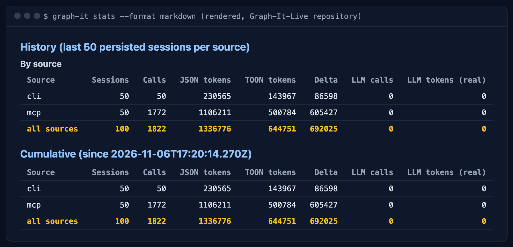

# AI integrations

Graph-It-Live exposes local graph analysis to GitHub Copilot, Claude, Cursor, Windsurf, Antigravity, and other MCP-compatible clients.

## Token savings

MCP tools and the native Copilot tools answer in compact TOON by default; pass `response_format: "json"` when a script parses the result. Run `graph-it stats` to see what that saves across the CLI, the MCP server and VS Code: the last 50 sessions per source, an **all sources** total, and cumulative totals that rotation never reduces.



*`graph-it stats --format markdown` on this repository's own usage: TOON used about half the tokens of the same answers in JSON. Counts are `cl100k_base` estimates; your ratio depends on the tools you call.*

## Native Copilot tools

When the extension is installed, use these tools in Copilot Agent mode without configuring MCP:

| Tool group | Capabilities |
| --- | --- |
| Navigation | Dependencies, reverse dependencies, imports, module resolution, workspace index status |
| Symbols | Symbol graphs, callers, dependents, execution traces |
| Refactoring | Breaking changes, impact analysis, unused symbols, dead-code scans, Git diff review |
| Context | File logic, codemaps, unified graph context, natural-language graph queries |
| Call graph | Cross-file caller/callee queries and neighbourhood expansion |

The graph-context tool is available as `#graphContext`. Other native references include `#graphDeps`, `#graphFindRefs`, `#graphCallers`, `#graphImpact`, `#graphCodemap`, `#graphTrace`, `#graphDeadCode`, `#graphReviewPr`, `#graphQuery`, and `#graphArchitectureDiagram`.

The native tools answer in compact TOON by default, like the MCP server. Pass `response_format: "markdown"` for readable tables, or `"json"` to get the raw object.

## MCP server

The MCP server exposes 25 graph-analysis tools. Enable it in VS Code with `graph-it-live.enableMcpServer`, or start it from the CLI:

```bash
graph-it serve
```

For VS Code, add `.vscode/mcp.json`:

```json
{
  "servers": {
    "graph-it-live": {
      "type": "stdio",
      "command": "graph-it",
      "args": ["serve"],
      "env": {
        "WORKSPACE_ROOT": "${workspaceFolder}"
      }
    }
  }
}
```

For Cursor, use `.cursor/mcp.json` with the same server definition under `mcpServers` instead of `servers`. The same `graph-it serve` command works with Claude Desktop, Claude Code, Windsurf, and Antigravity. See the [CLI/MCP documentation](CLI.md) for client-specific configuration and environment variables.

For Codex CLI:

```bash
codex mcp add graph-it-live --env WORKSPACE_ROOT=/path/to/project -- graph-it serve
```

## Portable agent plugin

The [`plugins/graph-it-live/`](../plugins/graph-it-live/) directory is the portable Agent Plugin package.
It bundles the MCP server and five skills: `graph-it-live`, `graph-it-refactor`, `onboarding-express`,
`dead-code-hunter` and `pr-review`. Install it with the client you use:

### Claude Code

From Claude Code, add the repository marketplace and install the plugin:

```text
claude plugin marketplace add magic5644/Graph-It-Live
/plugin install graph-it-live@graph-it-live
```

For a local checkout, start a session with `claude --plugin-dir ./plugins/graph-it-live`.

### GitHub Copilot CLI

```text
copilot plugin marketplace add magic5644/Graph-It-Live
copilot plugin install graph-it-live@graph-it-live
```

### VS Code

1. Open the Command Palette.
2. Run **Chat: Install Plugin From Source**.
3. Select `plugins/graph-it-live/`.

The VS Code extension itself remains available from the [VS Code Marketplace](https://marketplace.visualstudio.com/items?itemName=magic5644.graph-it-live)
and [Open VSX](https://open-vsx.org/extension/magic5644/graph-it-live).

### Cursor

Open the **Plugins** panel, choose **Install from local source**, and select
`plugins/graph-it-live/`.

### Codex

Add the repository's [Codex marketplace catalog](../.agents/plugins/marketplace.json) to a configured
plugin marketplace, then open `/plugins` in Codex and install **Graph-It-Live**.

### Windsurf, Antigravity, and other MCP clients

These clients can use the MCP server directly. Add this server entry to the client's MCP configuration:

```json
{
  "graph-it-live": {
    "type": "stdio",
    "command": "npx",
    "args": ["-y", "@magic5644/graph-it-live@latest", "serve"]
  }
}
```

Use the client's MCP configuration file and its expected top-level key (`servers` or `mcpServers`).
See the [MCP server instructions](#mcp-server) for ready-to-copy VS Code, Cursor, and Codex examples.

The repository also includes marketplace catalogs for [Claude Code](../.claude-plugin/marketplace.json),
[GitHub Copilot](../.github/plugin/marketplace.json) and [Codex](../.agents/plugins/marketplace.json). The MCP entry pins the
latest published `@magic5644/graph-it-live` version and starts it with `npx`, so a
cached package starts without a new download (npm still revalidates the package metadata); a workflow updates the pin, the plugin manifests and
the marketplace versions after each npm publish.

## Agent skill

Install the Graph-It-Live skill for an AI agent:

```bash
npx skills add magic5644/skills/graph-it-live
```

The skill documents graph queries, codemaps, impact analysis, dead-code detection, and safe refactoring workflows.
