# Architecture view tour

A walk through the Architecture view, its diagrams (export, flow, sequence) and the architecture rules, with screenshots. For every term, mark, control and option, see the [architecture guide](architecture.md).

The Architecture view draws the whole workspace as **units** (the elements declared in `graphit.architecture.json`, else the projects: folders holding a `package.json`, `pyproject.toml`, `go.mod` or other project manifest, else top-level folders) in layers, with the import edges between them, their roles (`application`, `function`, `micro-frontend`, `frontend`, `service`, `library`, `test`, `fixture`, `tooling`, `unknown`) and their cycles. It answers three questions: what are my layers, who depends on this, and does the code follow my rules. The [architecture guide](architecture.md) defines every term, explains the marks of each view and how to fix what they raise: cycles, rule violations, unmatched files.

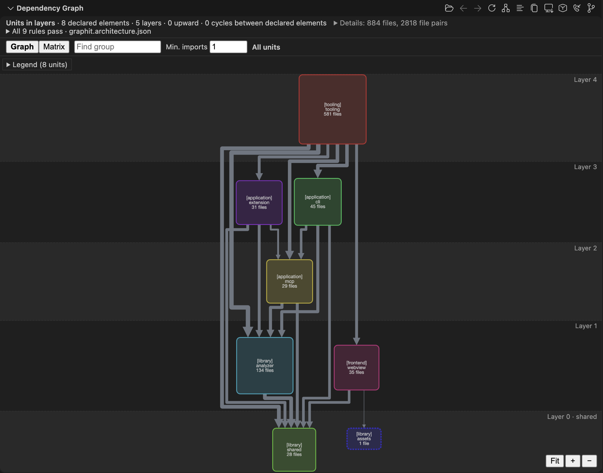

*Graph-It-Live's own declared elements as units in layers, with their roles and the rules of its `graphit.architecture.json`. Open it with *Switch to Architecture View* in the *Dependency Graph* view title bar.*

Quick start:

1. Open the *Dependency Graph* view and click *Switch to Architecture View* (icon `$(type-hierarchy)`).
2. Double-click a unit to enter its folders; *Escape* goes back.
3. Click an edge to list the file pairs behind it.
4. Select a node, then *Dependents by group* to see every group that imports it.
5. Click *Matrix* for the dependency structure matrix of the level.

The CLI (`graph-it architecture --level units`) and the MCP tool `explore_architecture` report the same counts.

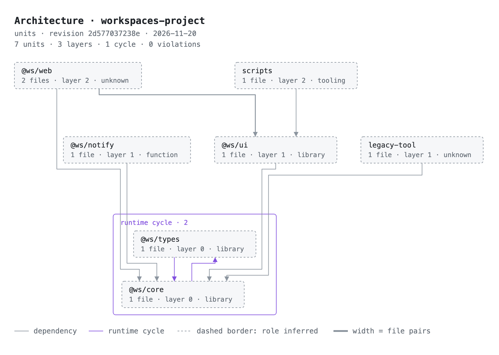

*`graph-it diagram` on a test fixture with no config: each node names its role, and a dashed border marks an inferred role (in the view, hover a unit for its evidence); a role declared under `roles` gets a solid border. Click a role in the units legend to filter.*

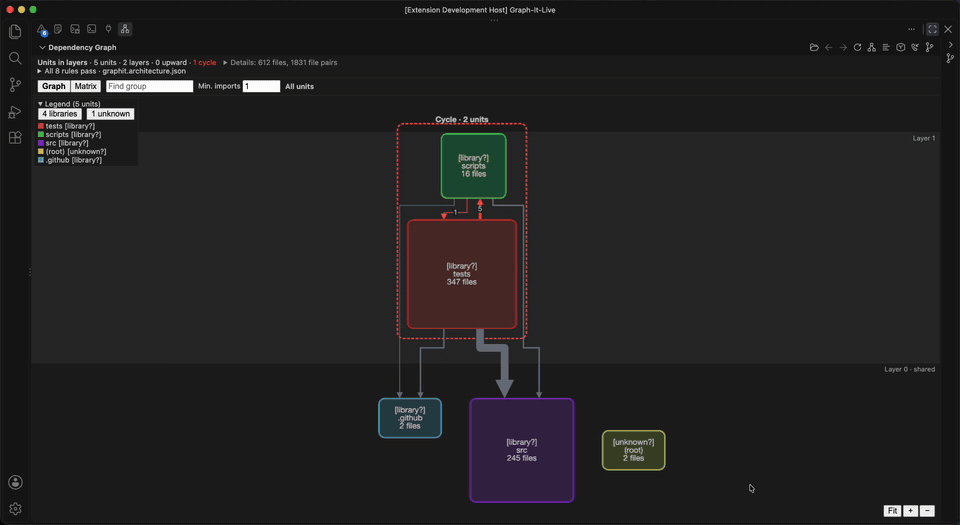

*Double-click a unit or folder to enter it; the breadcrumb or *Escape* goes back.*

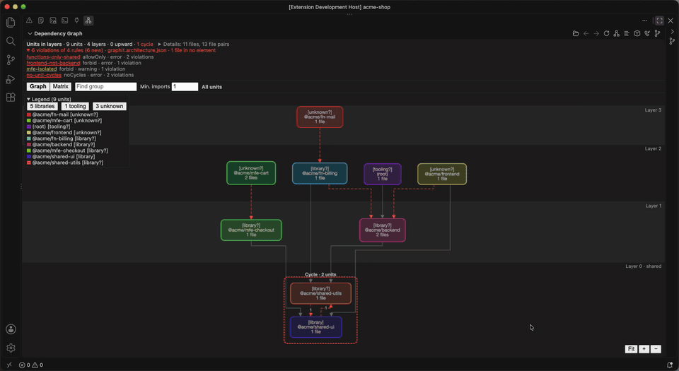

*Click an edge for its file pairs, then a file to open it.*

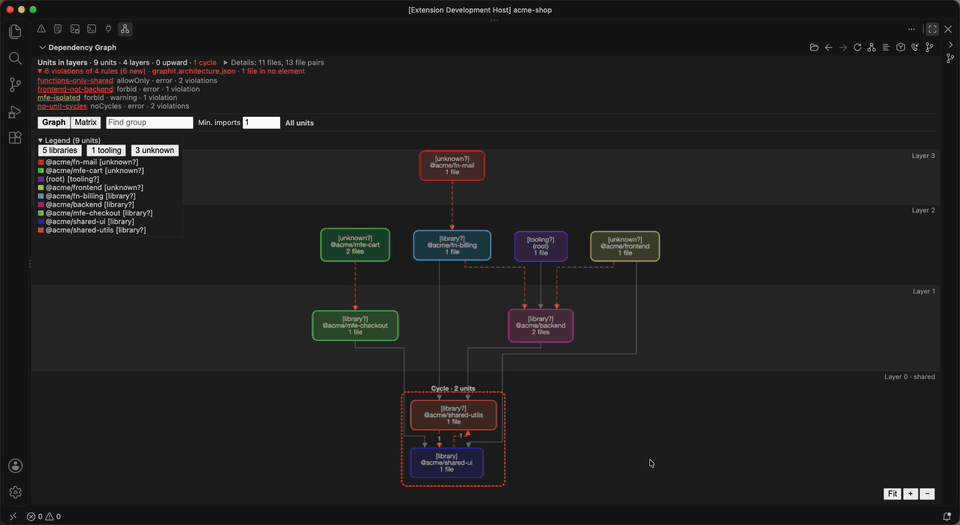

*Select a node, then *Dependents by group* in the bottom-left action bar.*

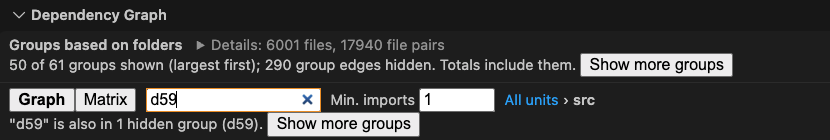

*Enter a unit with more than 50 folder groups: the view draws the 50 largest, and *Show more groups* draws up to 150.*

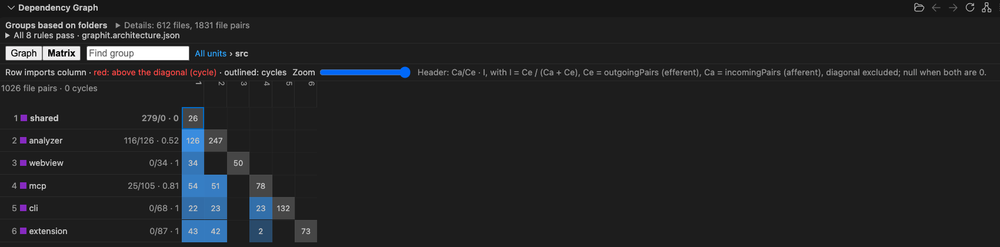

*Click the *Matrix* tab (*Units | Folder | Matrix | Flow | Seq*) for the dependency structure matrix of the drawn level.*

To share the drawn level as a picture, click *Export Architecture Diagram* (icon `$(desktop-download)`) in the *Dependency Graph* view title bar, then save it as `.svg`, `.html` or `.png`. *Copy Architecture Diagram as SVG* (icon `$(copy)`) puts the SVG on the clipboard. Both commands are also in the Command Palette while the Architecture view is open. The export draws the units, or the groups of the entered unit or folder, as a graph or a matrix, with the rule violations of the view; the graph also keeps the role filter and *Min. imports*, which the matrix does not apply. It uses the renderer of `graph-it diagram`: without a role or *Min. imports* filter, the same level gives the same SVG as the CLI; the PNG is that SVG at twice its size, and the SVG follows the editor's light or dark theme. Exports need the default `graph-it-live.communityMode` (`path`).

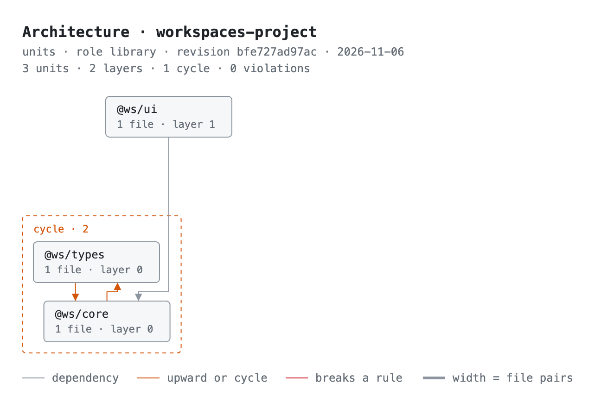

*An exported diagram with the role filter on `library`: the caption names the filter.*

To see what one function does step by step, draw its call flow: `graph-it diagram --view flow src/mcp/worker/invokeTool.ts#invokeTool --format svg`. Each column is one step in call order (a file's symbols), and each row a lane: main, alternative (a branch that returns) or error (a `catch`, or a branch that throws). `--maxSteps` (up to 12) and `--startLine` (1-based, for same-name symbols) refine it; the `export_architecture_diagram` MCP tool draws the same with `view: "flow"`.

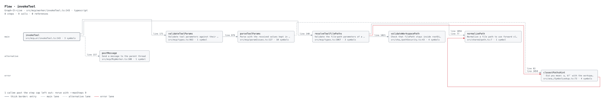

*`graph-it diagram --view flow` on this repository: one step per column, one lane per row.*

In VS Code, put the cursor in a function and click the *Flow* or *Seq* tab of the *Dependency Graph* view's Architecture mode: it draws that symbol, and says why when it cannot (no editor, unsupported file, cursor between symbols). You can also right-click a function in the editor and run **Show Flow Diagram (Symbol at Cursor)**, or right-click a file in the Explorer and run **Show Diagram…** to pick a view (**Show Folder Diagram** on a folder). The diagram opens in the *Dependency Graph* view, with the tabs *Units | Folder | Matrix | Flow | Seq* above it, the same views as `graph-it diagram --view`. *Follow cursor* redraws the diagram for the symbol or folder under the cursor; off, it stays pinned. Click a step to open its declaration, or a call label to open its call site.

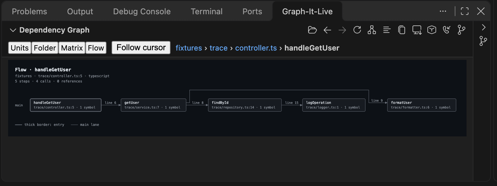

*Show Flow Diagram on `handleGetUser` in the `tests/fixtures/trace` fixture.*

For the order of the calls, draw a sequence diagram: `graph-it diagram --view sequence src/cli/commands/diagram.ts#run --depth 2 --format svg`. One lifeline per file (or per class with `--participants class`), one message per call, activation bars, and the `alt` / `opt` / `loop` / `catch` fragments with their guards. `--depth`, `--maxMessages` (up to 60) and `--startLine` bound it, and a note names what was left out. `--format mermaid` writes a `sequenceDiagram` that GitHub renders in a pull request or a README; the MCP tool takes `view: "sequence"` and `diagramFormat: "mermaid"`. In VS Code, **Show Diagram…** › *sequence*, or the *Seq* tab next to *Flow*, draws the symbol at the cursor: a lifeline opens its file, a call its call site, and Export also writes Mermaid (`.mmd`). An entry is a function or a method that calls something: the symbol pick shows each symbol's call count, and a symbol that calls nothing (a class, a constructor) shows *No calls found* with the file's symbols that do, one click away. Not drawn: dynamic dispatch, library callbacks, `node_modules`, return values.

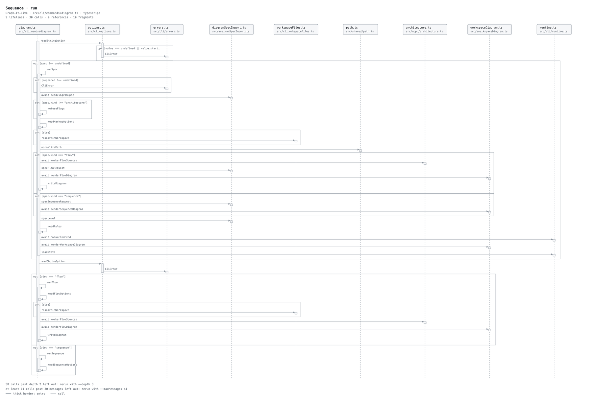

*`graph-it diagram --view sequence` on this repository: one lifeline per file, one message per call in order.*

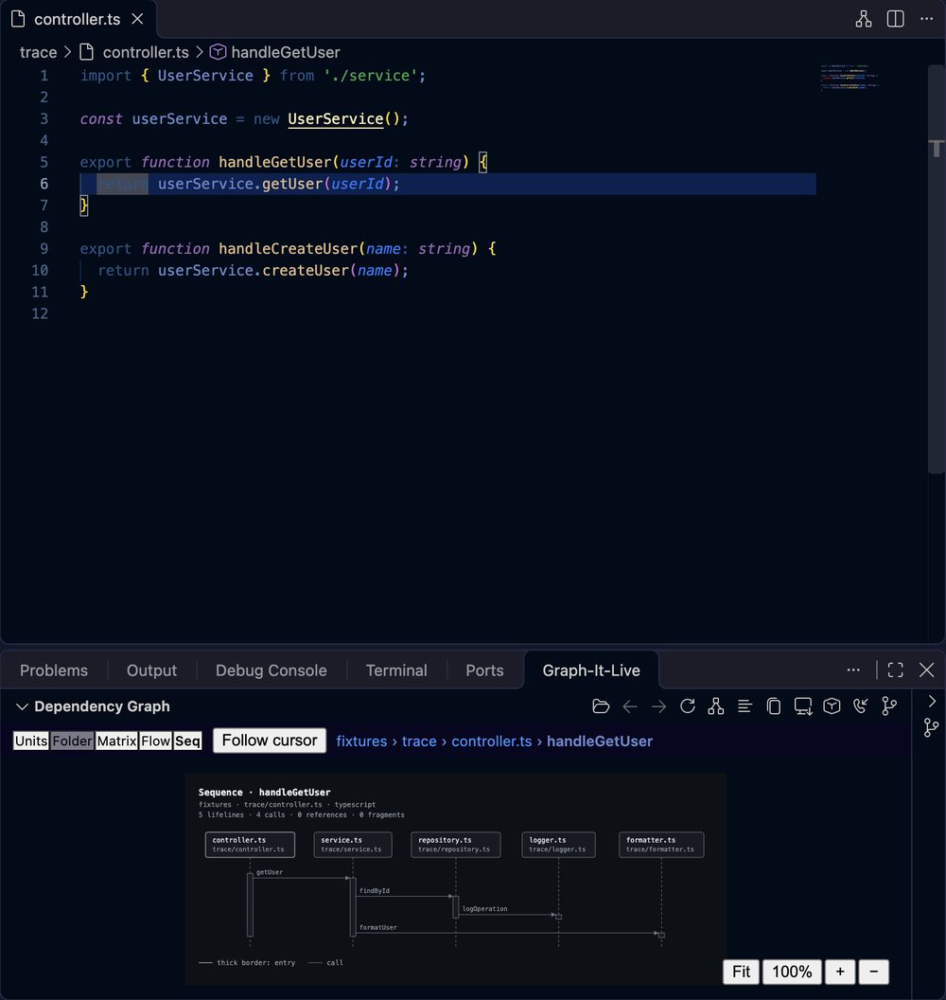

*Cursor in `handleGetUser` (`tests/fixtures/trace`), then a click on the* Seq *tab: no right-click needed.*

The *Flow* and *Seq* tabs zoom from 10% to 400%: the wheel or a pinch zooms around the pointer, a drag pans, and the buttons at the bottom right are *Fit*, *100%*, *+* and *−* (keys *0*, *+*, *-* on a focused step, lifeline or call). A new diagram opens fitted; a redraw of the same symbol keeps the zoom. Steps, lifelines and calls stay clickable at every zoom, and the drawing stays sharp.

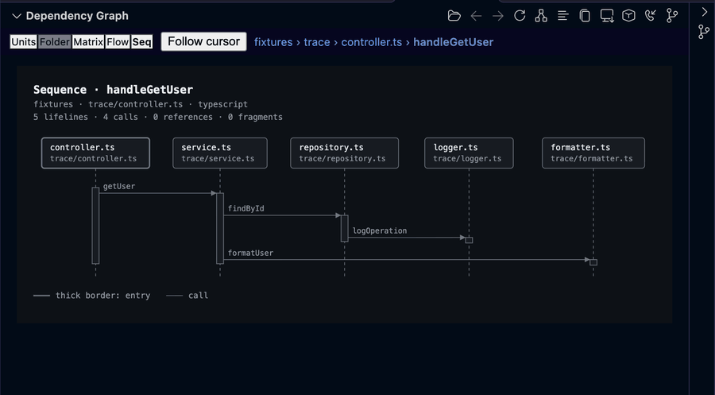

*Fit, + four times, 100%, − twice, Fit on the* Seq *tab.*

## Architecture rules

Declare your intended architecture in `graphit.architecture.json` at the workspace root: `elements` name sets of files, `rules` say what each may import, and `roles` declare what each unit is. The view lists each rule with its violations; `graph-it check-architecture` exits with 1 on a new `error` violation, so it can gate CI, with SARIF output for code scanning and a baseline for existing code. On existing code, `graph-it init` writes the config from today's imports, so only new drift fails, and reports quick wins and the reading of the dependency matrix. See [the config file](architecture.md#the-config-file) for a complete example.

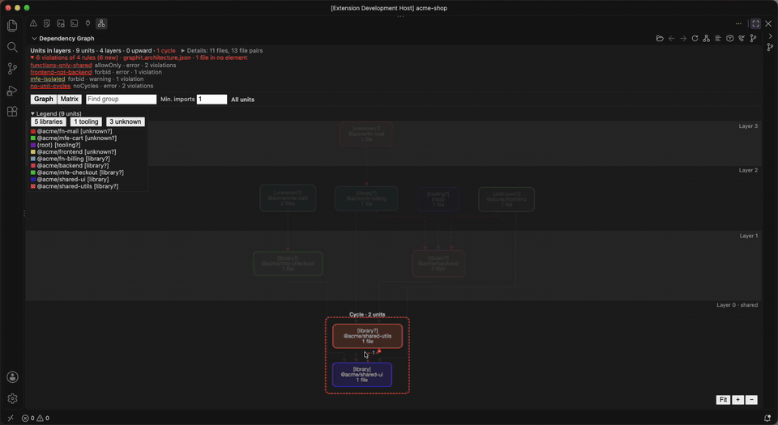

*Write `graphit.architecture.json` at the workspace root, then click *Refresh*: click a rule to list the file pairs that break it, then a file to open it.*

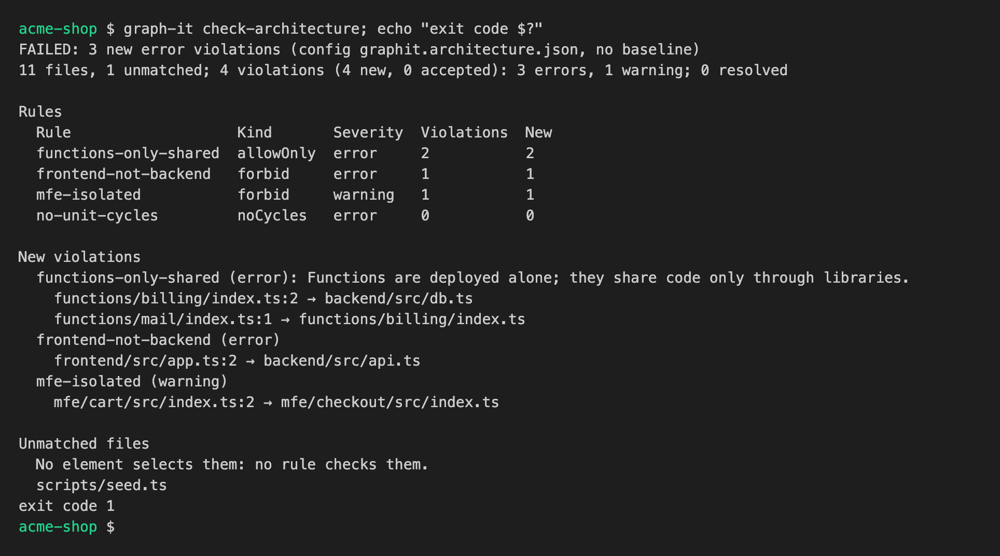

*`graph-it check-architecture` on the rules test fixture: verdict, totals, rules table, then each new violation as `importing/file.ts:line → target`. Add `--verbose` to list baselined violations, `--format markdown` for a PR comment.*

## Before/after comparison in review-pr

`graph-it review-pr` compares the structure of the head with the base at the same two levels as the view: units, then the folder groups of each unit. It lists added, removed, renamed and changed units and groups, files that moved between them, and edges and cycles that appeared or were resolved. Items are matched by file overlap after Git rename detection, so a renamed folder is not a removal plus an addition. The comparison never changes the review score or gate. The same comparison can be drawn as one before/after SVG: `graph-it diagram --delta`, `graph-it review-pr --deltaSvg`, or the Review Gate `delta-diagram` input ([architecture delta](CLI.md#architecture-delta)). Fields, warnings and failure cases: [`review-pr`](CLI.md#review-pr).
