# Architecture view, rules and check-architecture

Graph-It-Live draws the architecture of a workspace from its static imports, checks it against rules you write, and exposes the same data in VS Code, the `graph-it` CLI and the MCP server.

## What it answers

- **What are my layers?** Packages (or top-level folders), ordered so that each one imports only those below it, with the loops between them.
- **Who depends on this?** Every package or folder that imports a package, a folder or a file, directly or not.
- **Does the code follow my architecture?** Every import checked against the rules of `graphit.architecture.json`, locally or in CI.


*Units in layers with their roles, a cycle outlined, and rule violations (test fixture monorepo). Open it with **Switch to Architecture View** in the title bar of the **Dependency Graph** view.*

## Concepts

Each term has one meaning in this page, the README and [`docs/CLI.md`](CLI.md).

| Term | Meaning |
| --- | --- |
| **File pair** | One file importing another file (static import). Every count in the view is a number of file pairs. |
| **Unit** | A package: a folder holding a `package.json`, workspace member or not, outside `node_modules`. Without any package below the root, each top-level folder is a unit. Files outside every package form the `(root)` unit. |
| **Group** | A node of one level: a unit, a folder inside a unit, or a Louvain community. |
| **Level** | What the view draws at once: the units, the folders of an entered unit or folder, or the Louvain communities. |
| **Edge** | The file pairs from one group to another of the same level. |
| **Layer** | Depth of a group in its level: layer 0 depends on no other group; a group sits one layer above the deepest group it imports. |
| **Cycle** | Groups that import each other, directly or not. They share a layer. |
| **Upward edge** | An edge to a group of the same or a higher layer. Drawn red, like the edges of a cycle. |
| **Role** | What a unit is (`function`, `frontend`, `library`…), inferred from its manifest and files, or declared. See [Roles](#roles). |
| **Element** | A named set of files in `graphit.architecture.json`, selected by path, unit or role. |
| **Rule** | What the files of an element may or may not import. |
| **Baseline** | The violations you accept for now, in `graphit.architecture.baseline.json`. Only new violations fail. |

Groups follow the `graph-it-live.communityMode` setting (CLI `--communities`, MCP `communityMode`):

- `path` (default): units, then folders. Units and folder levels exist only in this mode.
- `louvain`: communities of files that import each other, one flat level.



*A workspace holds units; entering a unit shows its folder groups; entering a group shows its files. Source: [`architecture/architecture-concepts.mmd`](architecture/architecture-concepts.mmd).*

## Read the view

Each part of the view below answers three questions: what it is for, how to read it, and how to fix what it raises. [Every mark at a glance](#every-mark-at-a-glance) lists all marks in one table; [Fix what the view raises](#fix-what-the-view-raises) gives the fix procedures. The CLI and MCP calls that give the same reading are in [Same data, three surfaces](#same-data-three-surfaces).

### Graph

**What it is for.** See the layers of the workspace and the imports that go against them. Open the **Dependency Graph** view in the Activity Bar, then click **Switch to Architecture View** (icon `$(type-hierarchy)`) in its title bar.

**How to read it.**

- **Layers.** Groups sit in horizontal bands, dependents above, dependencies below. Layer 0, at the bottom, imports no other group of the level; each group sits one layer above the deepest group it imports. So a normal edge points down, and its importer is above it.
- **A group in an unexpected layer.** A group high in the graph imports a long chain below it. A group you expected high that sits on layer 0 imports nothing of its level. A unit without any unit edge says *No cross-unit imports* in its tooltip: it sits on layer 0 without being shared.
- **Nodes and edges.** See the [graph nodes](#graph-nodes) and [graph edges](#graph-edges) marks. Hover a node or an edge for its tooltip: files, internal edges, role evidence, the rules an edge breaks.
- **Header, at the units level.** *Units in layers*, then:

  | Count | Meaning |
  | --- | --- |
  | *N units* | Packages (folders holding a `package.json`), else top-level folders |
  | *N layers* | Bands of the units level |
  | *N upward* | Unit edges to a unit on the same or a higher layer, outside a cycle; red when above 0 |
  | *N cycles* | Groups of units that import each other; a click shows the first cycle block |
  | *N weaker edges hidden* | Down edges past the strongest 3 × N (N = units of the level); set *Min. imports* to show the edges by weight |
  | *Details* | Files, file pairs (within and between groups), scanned and analysed files; *N failed* = files that could not be read or parsed, counted as files without imports |

  Inside a unit, the header reads *Groups based on folders* (or *Groups based on imports (Louvain)*). *X of Y groups shown (largest first)* means the level holds more groups than drawn; totals include them, and *Show more groups* draws more.
- **Navigate.** Double-click a unit to enter its folders; double-click a folder holding sub-folders (double border) to go one level deeper; double-click another group to expand its files. Go back with the breadcrumb or *Escape*.
- **`path` or `louvain`.** `graph-it-live.communityMode` decides the groups. `path` (default) answers "how do my packages and folders depend on each other?": it gives units, folder levels, layers and upward edges. `louvain` answers "which files really work together, whatever their folder?": one flat level of communities, without units or layers. Switch to `louvain` when the folders no longer match the coupling, for example a folder whose files all import another folder.


*Graph-It-Live itself: double-click `src`, then `analyzer`, press *Fit*, then go back with the breadcrumb.*

**How to fix what it shows.** Red block or solid red edges: [a cycle](#a-cycle); see also [an upward edge](#an-upward-edge-outside-a-cycle). Dashed red edge: [a rule violation](#a-rule-violation). A group in the wrong band, or a thick edge between groups meant to be independent: [an unexpected layer or a heavy dependency](#an-unexpected-layer-or-a-heavy-dependency).

### Evidence panel

**What it is for.** See the imports behind one edge, to decide how to remove it.

**How to read it.**

1. Click an edge. The evidence panel lists its file pairs, 50 at a time (*Load more*), grouped by imported file: each imported file, then its importers under `←`.
2. Click a file to open it at the import.

A file pair counts one file importing another, whatever the number of import lines: two `import` statements from `ui/page.ts` to `core/store.ts` are one pair. The count on the edge is therefore at most the number of import lines.

To remove the edge, remove every pair. Pairs sharing one imported file are often fixed together: move that file, or the part of it they use. A single importer with many pairs is often one file in the wrong group.


*Click an edge for the file pairs behind it, then a file to open it.*

### Dependents panel

**What it is for.** See what is impacted when you change or remove a unit, a folder or a file: every group that imports it, directly or not.

**How to read it.**

1. Select the node: click it, use the arrow keys, the units legend or a matrix row.
2. Click **Dependents by group** in the action bar at the bottom left (or right-click the node).
3. Read the *Dependents* tab: *Depends on X: N files in M groups (static imports)*, then one row per group, nearest first, with *D direct · T in all · min. depth K*.
   - *direct*: files of the group that import the selection.
   - *in all*: files of the group that depend on it, directly or not.
   - *min. depth*: the shortest import chain; 1 = imports the selection directly.
   - *+ N files inside its own group (D direct)*: dependents inside the selection's own group, counted apart.
4. Expand a row to list its files with their depth; click a file to open it.

The graph and the matrix highlight the result: see [dependents highlight](#dependents-highlight). **Clear** removes it.

Counts use every static import of the workspace, drawn or not. Runtime-only use (reflection, string paths) is not seen. For symbol-level impact, use `get_impact_analysis`.

**How to act on it.** Before removing or changing the selection, open each group with direct importers: those files change first. A group reached only at a high depth is impacted through others; changing the groups in between can cut it off. A group you did not expect in the list is a dependency to question: click its edge for the file pairs, then see [an unexpected layer or a heavy dependency](#an-unexpected-layer-or-a-heavy-dependency).


*Select a unit, a group or a file, then **Dependents by group** in the bottom-left action bar.*

### Dependency structure matrix

**What it is for.** The same level as the graph, complete and exact. The graph draws the 50 largest groups and at most 3 × N down edges per level; the matrix has a row for every group and a cell for every edge, with its exact count. Layers and cycles read at a glance. Click **Matrix** in the *Graph | Matrix* switch.

**How to read it.**

- **Cells.** A cell counts the file pairs where a file of the row imports a file of the column. The diagonal (grey) counts pairs inside a group. The colour gets stronger with the count, on a log scale, so one heavy cell does not wash out the others. The number is written once the zoom makes cells big enough.
- **Order.** Rows follow layer order: layer 0 first, the members of a cycle kept together, then by label. A row imports only rows above it, so a clean architecture has every cell below the diagonal.
- **Red marks.** The matrix legend reads *red: above the diagonal (cycle) · outlined: cycles · red frame: breaks a rule*:
  - **Red fill**: a cell above the diagonal. Rows follow the layers, so this happens only inside a cycle: the cell is one of the imports closing it.
  - **Outlined block**: a red square on the diagonal around the rows of one cycle.
  - **Red frame**: a cell whose imports break a rule; its fill does not change.
- **Row headers `Ca/Ce · I`.** *Ca* is the incoming file pairs from other groups, *Ce* the outgoing file pairs to other groups, and `I = Ce / (Ca + Ce)`; the tooltip also gives the number of groups on each side. A stable group (I near 0) is imported a lot and imports little: changing it impacts many groups. An unstable group (I near 1) imports a lot and is imported little: it is cheap to change. A stable group depending on an unstable one is a smell: every change of the unstable group reaches all importers of the stable one. *–* means no pair crosses the group's boundary.

Worked example: three units `shared`, `core` and `ui`, where `core` imports `shared` and `ui` imports both.

| | 1 shared | 2 core | 3 ui |
| --- | --- | --- | --- |
| **1 shared** | 4 | | |
| **2 core** | 6 | 9 | |
| **3 ui** | 2 | 5 | 7 |

Every cell sits below the diagonal. Now `shared/format.ts` imports `core/config.ts`: `core` and `shared` form a cycle, share layer 0 and move together at the top (by label, `core` first).

| | 1 core | 2 shared | 3 ui |
| --- | --- | --- | --- |
| **1 core** | 9 | 6 (red fill) | |
| **2 shared** | 1 | 4 | |
| **3 ui** | 5 | 2 | 7 |

Rows 1–2 are outlined. The red cell, `core` → `shared`, has 6 pairs; its mirror below the diagonal, `shared` → `core`, holds the new import with 1 pair. Both close the cycle: start with the smaller one, `shared` → `core`.


*Matrix of Graph-It-Live's `src`: a layered architecture fills only the lower triangle. Enter a unit, then click **Matrix**.*

**How to fix what it shows.** Click a cell for its file pairs in the evidence panel. Click a row header to select its unit or group, or to enter a folder holding sub-folders. Red fill or outlined block: [a cycle](#a-cycle). Red frame: [a rule violation](#a-rule-violation). A heavy cell between groups meant to be independent: [a heavy dependency](#an-unexpected-layer-or-a-heavy-dependency).

### Rules panel

**What it is for.** Check every import against the rules of `graphit.architecture.json`, without leaving the editor. It appears once that file exists at the workspace root (see [The config file](#the-config-file)).

**How to read it.**

- The summary reads *N violations of M rules (K new)*, M being the rules with at least one violation, or *All N rules pass*, N being every rule; then the config file. It turns red when an `error` rule has a new violation.
  - *violations*: file pairs breaking a rule.
  - *new*: violations missing from `graphit.architecture.baseline.json`; only new violations of `error` rules fail `check-architecture`. The others are baselined: accepted for now.
  - *N files in no element*: unmatched files. No element selects them, so no rule checks them.
- One line per rule: its name (underlined and coloured by severity when it has violations), its kind, severity and count. Hover the name for its `reason`; click it to list its file pairs in the evidence panel.
- Config warnings, such as a pattern matching no file, follow in the warning colour.
- *Architecture rules not checked: …* means the config could not be used; the message says why.

**How to fix what it shows.** [A rule violation](#a-rule-violation), [unmatched files](#unmatched-files).

### Roles legend

**What it is for.** Tell what each unit is (`function`, `frontend`, `library`…), so that rules can target units by role (`{ "role": "function" }` in an element) and the graph can show one kind of unit. A role says nothing about what the code does: it comes from manifests and file names only (see [Roles](#roles)).

**How to read it.** The legend, top left at the units level, lists the role counts, then each unit with its colour and badge. `[role?]` is inferred; `[role]` is declared under `roles` in `graphit.architecture.json`. Hover a unit for its key, layer, role and confidence, and the unit on the graph for the evidence. Click a role to show only its units; click it again to show every unit. Click a unit to select it.

**How to fix it.** A wrong or `[unknown?]` role: declare the right one under [`roles`](#roles-key).

### *Files changed* banner

**What it is for.** Tell you the drawn view no longer matches the files.

**How to read it.** *Files or architecture rules changed since this view was built.* appears when a file of the graph, `graphit.architecture.json`, its baseline, a `package.json` or a `tsconfig*.json` changes. The view does not rebuild by itself: a build reads every file of the workspace, and rebuilding on each save would redraw the graph while you read it.

**What to do.** Click **Refresh** when you want the new state, for example after a fix, to check the edge or the violation is gone. The view is also built when it opens and when `graph-it-live.communityMode` changes.

## Every mark at a glance

Colours follow the VS Code theme: *red* is the theme's error colour, *focus* its focus border colour.

### Graph nodes

| Look | Meaning |
| --- | --- |
| Light fill and border in a unit's colour | A unit; its folder groups keep its colour once entered |
| **Dashed red block** titled *Cycle · N units* | Units importing each other, directly or not (units level) |
| Dashed grey border | The `unassigned` group: files no group took |
| Double border | A folder holding sub-folders: a double-click enters its level instead of expanding its files |
| Dotted grey border | A *more* placeholder: click it to load the next files of the group |
| Box around files, title on top | An expanded group: a compound around its files |
| Thin border | A file inside an expanded group |
| `[role?]` or `[role]` in the label | The unit's role, inferred or declared (units level) |
| Solid focus border | The selected group |
| Solid focus border on a highlighted background | A *Find group* match |

### Graph edges

| Look | Meaning |
| --- | --- |
| Grey, no label | A normal edge, going down a layer |
| **Solid red**, with its count | An upward edge (to the same or a higher layer) or an edge inside a cycle |
| **Dashed red** | Breaks a rule of `graphit.architecture.json` (it may also be upward); never hidden by the 3 × N cap, only by *Min. imports* |
| Focus colour, with its count | Highlighted: you hover or selected it, or one of its ends |
| Not drawn | Hidden: a down edge past the strongest 3 × N (header *weaker edges hidden*), or any edge below *Min. imports* when it is above 1 |
| Faded | Not linked to the hovered or selected group or edge |

### Matrix cells

| Look | Meaning |
| --- | --- |
| Grey, on the diagonal | File pairs inside the group |
| Blue, below the diagonal | The row imports the column: the normal direction |
| **Red fill**, above the diagonal | The row imports a column of the same layer: one of the imports closing a cycle |
| **Outlined block**, on the diagonal | The rows of one cycle |
| **Red frame** | The cell breaks a rule; its fill does not change |
| Stronger colour | More file pairs (log scale) |

### Dependents highlight

| Look | Graph | Matrix |
| --- | --- | --- |
| The selection | Double focus border | Strongest row tint |
| Direct importers | Thick solid focus border | Strong row tint |
| Indirect dependents | Dashed focus border | Light row tint |
| Unrelated | Dimmed | No tint |

### Look-alikes

- **Solid red edge vs dashed red edge.** Solid: the edge goes against the layers (upward or in a cycle), with or without rules. Dashed: the edge breaks a rule you wrote, whatever its direction.
- **Red fill vs red frame.** Fill: the cell is above the diagonal, inside a cycle. Frame: the cell breaks a rule. A cell can have both.
- **Dashed red block vs dashed grey border.** Red block: a cycle of units around them. Grey border: the `unassigned` group itself.
- **Double border: folder vs selection.** A 4px double border in the unit's colour: a folder holding sub-folders. A thicker double border in the focus colour: the selection of *Dependents by group*.
- **Faded vs dimmed.** Faded: away from what you hover or selected; it goes when the pointer leaves. Dimmed (less faded): unrelated to the dependents; it stays until **Clear**.
- **Outlined block vs red frame.** The outline spans the rows of a cycle on the diagonal; the frame surrounds one cell.

## Fix what the view raises

Each fix ends with **Refresh** (or `graph-it architecture`, `graph-it check-architecture`) to confirm.

### A cycle

Graph: a dashed red block, solid red edges inside it. Matrix: red fill above the diagonal, an outlined block. Header: *N cycles*.

1. Click the cycle count in the header to show the first block, or find the outlined block in the matrix.
2. Click each red edge or each cell of the block. The evidence panel lists its file pairs.
3. Start with the edge or cell with the fewest pairs: it is the cheapest to remove, and often the import that should not exist.
4. Remove its pairs with one of:
   - **Move the shared code down.** The imported part does not belong to the higher unit: move it to the lower unit, or to a new unit both import.
   - **Invert the dependency.** The lower unit owns an interface, a callback or an event; the higher unit implements or subscribes to it.
   - **Merge the units.** They are one concept split in two: one unit has no cycle.
5. Refresh: the edge or cell is gone, and the block shrank or disappeared.

To keep the cycle from coming back, add a `noCycles` rule (see [Rules](#rules)).

### An upward edge outside a cycle

Layers come from the same imports as the edges, at the units level as at each folder level: a group sits one layer above the deepest group it imports. So an edge outside a cycle always goes down, every solid red edge belongs to a cycle, and the header's *N upward* reads 0. Folder levels draw no cycle block: there, a group of solid red edges is the cycle. If *N upward* ever reads more than 0, read and fix that edge as for [a cycle](#a-cycle).

### A rule violation

A dashed red edge, a red-framed matrix cell, a red rule in the Rules panel.

1. Click the rule in the Rules panel. The evidence panel lists its violating file pairs; hover the rule for its `reason`.
2. Click the importing file to open it at the import.
3. Fix the import, not the rule: import the code through an allowed element, or move it where the rule allows it.
4. Refresh the view, or run `graph-it check-architecture`: the rule shows 0 violations.

Change the rule only when the architecture itself changed. Baseline a violation (`graph-it check-architecture --update-baseline`) only for accepted legacy debt, never to let new code pass: see [Adopt rules on existing code](#adopt-rules-on-existing-code).

### Unmatched files

The Rules panel shows *N files in no element*; `graph-it check-architecture` lists them under `unmatchedFiles`.

1. Run `graph-it check-architecture` to list the files.
2. Add an element that selects them, or widen the `path`, `unit` or `role` of an existing one.
3. Give the element its rules.
4. Run `graph-it check-architecture` again: no unmatched file is left.

### An unexpected layer or a heavy dependency

A unit higher than expected, or a thick edge or heavy cell between two units meant to be independent.

1. Open the matrix and read the unit's row: its non-empty cells are what it imports; the heaviest ones raise its layer.
2. Click the cell, or the edge in the graph, to list the file pairs.
3. Remove them as for a cycle: move the shared code down, or invert the dependency.
4. To keep the two units apart, add a `forbid` rule between their elements.

## By task

### Check rules locally

1. Write `graphit.architecture.json` at the workspace root (see [The config file](#the-config-file)).
2. Click **Refresh** in the Architecture view. The Rules panel shows "N violations of M rules (K new)", or "All N rules pass".
3. Click a rule to list its violating file pairs; click a file to open it at the import.
4. Or run `graph-it check-architecture` in a terminal.

Violating edges are dashed red; violating matrix cells are framed red. To fix them, see [A rule violation](#a-rule-violation).


*Rules panel of an npm-workspaces monorepo (test fixture). Add `graphit.architecture.json` at the workspace root to get the panel.*

### Fail CI on a forbidden import

1. Commit `graphit.architecture.json`.
2. Add `npx graph-it check-architecture` to the pipeline. It exits with 1 when an `error` rule has a violation that is not in the baseline.
3. Optional, for GitHub code scanning: write SARIF and upload it.

```yaml
- run: npx graph-it check-architecture --format sarif > architecture.sarif
- uses: github/codeql-action/upload-sarif@v3
  if: always()
  with:
    sarif_file: architecture.sarif
```

Each new violation is then annotated on the importing line. Other exit codes are listed in [`docs/CLI.md`](CLI.md#check-architecture).


*`graph-it check-architecture` on this repository: 8 rules, every file in an element, no violation, exit code 0.*

### Adopt rules on existing code

1. Write the rules you want, even if the code breaks them today.
2. Run `graph-it check-architecture --update-baseline`. It writes every current violation to `graphit.architecture.baseline.json`.
3. Commit the baseline. From now on, only new violations fail.
4. Fix violations over time, then run `--update-baseline` again: resolved entries leave the file.

The baseline holds workspace-relative `/` paths, so it is identical on Linux, macOS and Windows.

## Same data, three surfaces

The view, the CLI and the MCP server build the same graph: for the same community mode and file limit, counts are equal.

| Task | VS Code Architecture view | CLI | MCP tool |
| --- | --- | --- | --- |
| Units, layers, roles | Opens on units (`path` mode) | `graph-it architecture --level units` | `explore_architecture` with `level: "units"` |
| Groups | `graph-it-live.communityMode` setting | `graph-it architecture --groups` | `explore_architecture` (summary) |
| One level down | Double-click a unit or folder | `--folder <key>` | `folder` |
| One group's files and edges | Double-click a group without sub-folders | — | `group` |
| File pairs behind an edge | Click the edge | `--level units --from <unit> --to <unit>` | `from` and `to` |
| Matrix | *Graph \| Matrix* switch | `--matrix` (`--format csv`) | `view: "matrix"` |
| Dependents by group | **Dependents by group** action | — | — (use `find_referencing_files` or `get_impact_analysis`) |
| Check rules | Rules panel | `graph-it check-architecture` | `check_architecture` |
| Write the baseline | — | `check-architecture --update-baseline` | — |

All options and output fields: [`architecture`](CLI.md#architecture), [`check-architecture`](CLI.md#check-architecture), [`explore_architecture`](CLI.md#explore_architecture), [`check_architecture`](CLI.md#check_architecture).

## View controls

| Action | Mouse | Keyboard |
| --- | --- | --- |
| Focus the canvas | Click it | *Tab* |
| Select a group | Click | Arrow keys (nearest group in that direction) |
| Highlight neighbours | Hover or click a group or edge | — |
| Enter a unit, folder or group | Double-click | *Enter* |
| Go back one level | Breadcrumb step, or *×* | *Escape* |
| Clear the selection | Click the background, or *Clear* | *Escape* (see below) |
| List an edge's file pairs | Click the edge | — |
| Selection actions | Action bar (bottom left), or right-click | *Tab* to the action bar |
| Fit, zoom in, zoom out | Buttons (bottom right) | *0*, *+*, *-* |
| Switch graph and matrix | *Graph \| Matrix* | — |
| Move in the matrix | Click a cell or row header | Arrow keys, *Enter* on a row header |
| Find a group | *Find group* box | — |
| Hide weak edges | *Min. imports per edge* | — |
| Draw more groups | *Show more groups* | — |
| Show only one role | Click the role in the units legend | — |

*Escape* steps back one thing at a time: it closes the action menu, then the evidence or dependents panel, then leaves the entered group or focus, then goes up one level, back to the units.

A screen reader announces the selected group's name, layer, edges and cycle.

After it opens, the view rebuilds on **Refresh** and when `graph-it-live.communityMode` changes, never on a file change: see [*Files changed* banner](#files-changed-banner).

## Roles

A role describes a unit. It comes from the unit's manifest, top-level configs, `index.html` and entry file, never from the code's meaning. Each file read stays inside the workspace and under 1 MiB; nothing is executed.

| Role | Evidence (any of) |
| --- | --- |
| `function` | `@types/aws-lambda`, `aws-lambda`, `@azure/functions` or `firebase-functions` dependency; `serverless.yml`, `host.json`, or a SAM `template.yaml` in the unit; an exported `handler` in its entry (`main`, `index.*`, `handler.*`) |
| `micro-frontend` | `@module-federation/*` or `single-spa` dependency; `ModuleFederationPlugin` in a bundler config |
| `frontend` | `react`, `vue`, `@angular/core`, `svelte` or `solid-js` dependency, with an `index.html` or a bundler config (vite, webpack, next, nuxt, rspack, `angular.json`) |
| `service` | `express`, `fastify`, `@nestjs/core`, `koa` or `hono` dependency; a `Dockerfile` with `EXPOSE` |
| `library` | none of the above, and imported by another unit (unless all its files are tooling) |
| `tooling` | only scripts, tests or config files (`scripts/`, `tools/`, `e2e/`, `tests/`, `.github/`, `*.test.*`, `*.config.*`), even when imported |
| `unknown` | nothing conclusive |

A unit matching several roles takes the first in the table; the other matches stay as evidence. The badge reads `[role?]` when inferred and `[role]` when declared; its tooltip lists the evidence.


*`[library?]` is inferred, `[library]` declared. Click a role in the legend to keep only its units.*

## The config file

`graphit.architecture.json` sits at the workspace root. It has three optional top-level keys. Do not mix up `rules` and `roles`:

| Key | Answers | Effect |
| --- | --- | --- |
| `elements` | Which files belong together? | Names sets of files for the rules |
| `rules` | Which imports are allowed? | Violations in the view, `check-architecture` exit code |
| `roles` | What is each unit? | Badge `[role]` instead of `[role?]`, legend counts, `role` selectors of elements |

A file without `rules` checks nothing. Rules are your annotation: the tool only compares import pairs with them.

### Example

A monorepo with serverless functions, a frontend, micro-frontends, a backend and shared libraries:

```json
{
  "$schema": "https://raw.githubusercontent.com/magic5644/Graph-It-Live/main/schemas/architecture.schema.json",
  "elements": {
    "functions": { "path": "functions/*", "each": true },
    "frontend": { "path": "frontend/" },
    "mfe": { "path": "mfe/*", "each": true },
    "backend": { "path": "backend/" },
    "shared": { "unit": ["@acme/shared-*"] }
  },
  "rules": [
    { "name": "functions-only-shared", "from": "functions", "allowOnly": ["shared"], "severity": "error",
      "reason": "Functions are deployed alone; they share code only through libraries." },
    { "name": "frontend-not-backend", "from": ["frontend", "mfe"], "forbid": ["backend"], "severity": "error" },
    { "name": "mfe-isolated", "from": "mfe", "forbid": ["mfe"], "severity": "warning" },
    { "name": "no-unit-cycles", "noCycles": "units", "severity": "error" }
  ],
  "roles": {
    "@acme/shared-*": "library",
    "tools/*": "tooling"
  }
}
```

### Elements

An element selects files by any of:

- `path`: workspace-relative gitignore-style patterns, as in `.graphitignore`.
- `unit`: unit keys or package names from `graph-it architecture --level units`; `*` matches any characters.
- `role`: unit roles, for example `{ "role": "function" }`.

With `each: true`, every matched folder or unit is an instance of its own. `mfe → mfe` then means "another micro-frontend", never a file of the same one. A file can belong to several elements.

### Rules

| Field | Meaning |
| --- | --- |
| `forbid` | Files of `from` may not import these elements |
| `allowOnly` | Files of `from` may import only these elements and their own instance; a target in no element is a violation |
| `noCycles` | `"units"` or an `each` element: no import cycle between them |
| `severity` | `error` (default, fails `check-architecture`), `warning`, or `off` (not checked) |
| `reason` | Shown with every violation |

A rule that could never report is refused: `noCycles` on an element without `each`, or `forbid` of the element it comes `from` without `each`.

### Roles key

`roles` maps unit keys or package names to a role; `*` matches any characters and the first match wins. It only replaces the inferred role: it is not a rule. Its keys are unit keys or package names, never element names.

### Write the file for your workspace

1. Run `graph-it architecture --level units` (or open the Architecture view) and note the unit keys.
2. Under `elements`, name each part of your architecture by `path`, `unit` or `role`. Every source file should belong to an element: `check-architecture` reports the others as `unmatchedFiles`.
3. Under `rules`, write what each element may import (`allowOnly`) or must not import (`forbid`), with a `reason`.
4. Optionally, under `roles`, fix every role the view infers wrongly or marks `[unknown?]`.
5. Run `graph-it check-architecture`: it should report 0 violations, no unmatched file and no config warning.

A single-package repository has its top-level folders as units. Graph-It-Live's own [`graphit.architecture.json`](../graphit.architecture.json) is one: its elements split `src/` into layers, and `roles` declares the units:

```json
"roles": {
  "src": "library",
  "tests": "tooling",
  "scripts": "tooling",
  ".github": "tooling",
  "(root)": "tooling"
}
```

The config is validated before anything runs; each error names its JSON path. A pattern matching no file is a config warning. The `$schema` line gives completion and validation in editors. Full key reference: [`docs/CLI.md`](CLI.md#architecture-rules).

## Limits

- **Static imports only.** Dynamic imports the analyzer resolves count; runtime-only use does not.
- **Units and folder levels need `path` mode.** `louvain` gives one flat level of communities; their ids change with the code, so match them by `key`.
- **Groups drawn per level**: the 50 largest; *Show more groups* draws up to 150 for the session. Header totals, *Find*, the matrix, dependents and rules still cover every group.
- **Edges drawn**: at most 3 × N down edges per level (N = groups of the level), the strongest; upward, cycle and rule-breaking edges always. *Min. imports per edge* above 1 shows edges by weight instead, and then hides every edge below it.
- **Files in an entered group**: 200 at a time, most imported first; at most 500 files drawn at once.
- **Lists**: evidence and dependents files, 50 at a time; MCP pages default to 50 items, 500 at most.
- **Config size**: `graphit.architecture.json` up to 256 KB, baseline up to 32 MB; `--config` and `--baseline` must stay inside the workspace.
- **Workspace**: the view analyses the configured workspace folder. Of the rules files, it reads only `graphit.architecture.json` and `graphit.architecture.baseline.json` at its root; `--config` and `--baseline` name others for the CLI and MCP.

## How it is built



*`src/analyzer/architecture/` builds the file graph, units, roles, rules and matrix; the extension's `ArchitectureViewService`, the CLI commands `architecture` and `check-architecture`, and the MCP tools `explore_architecture` and `check_architecture` use it. Source: [`architecture/graph-it-live-architecture.mmd`](architecture/graph-it-live-architecture.mmd).*
