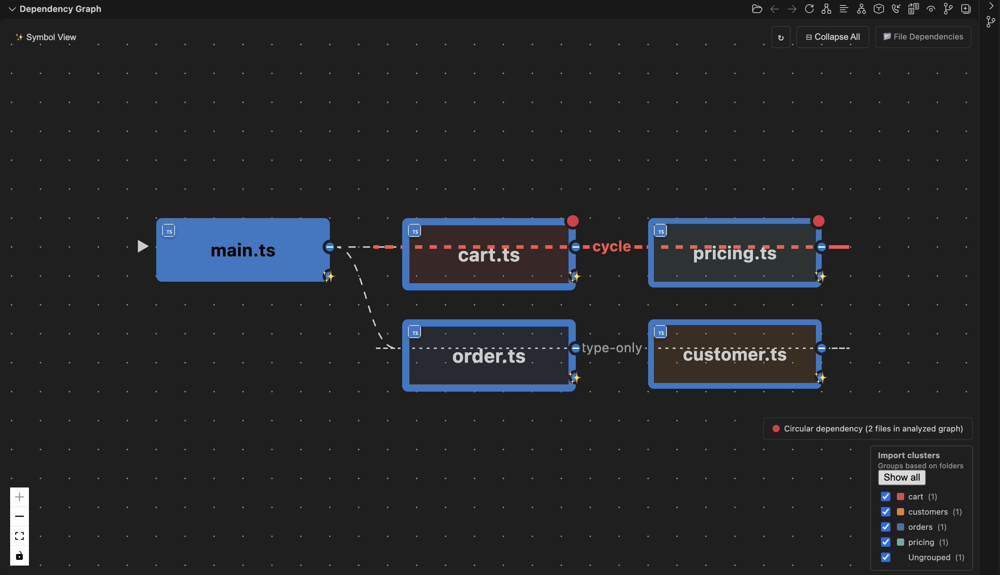
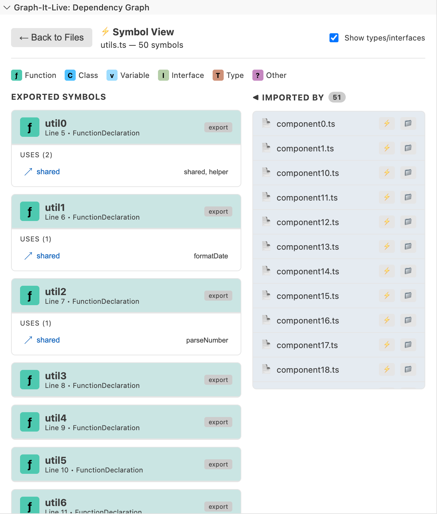
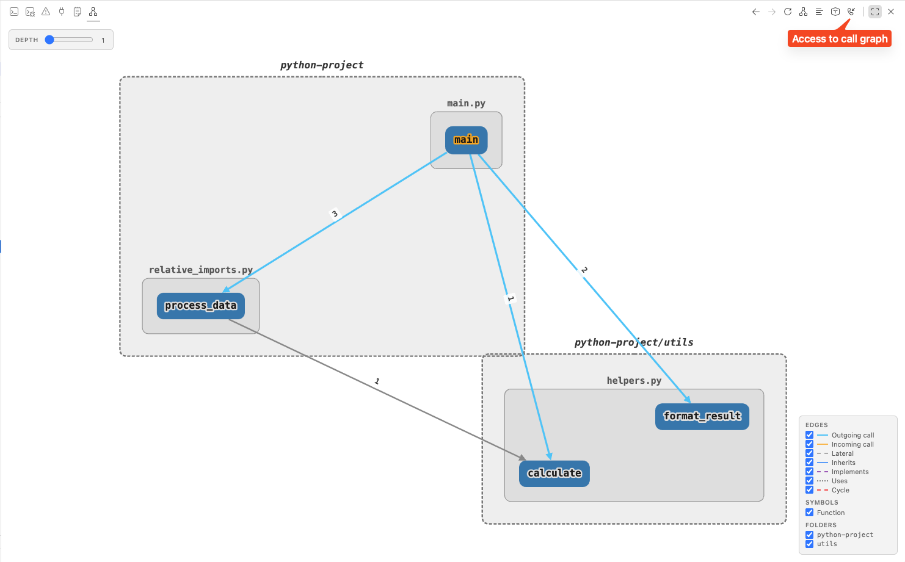
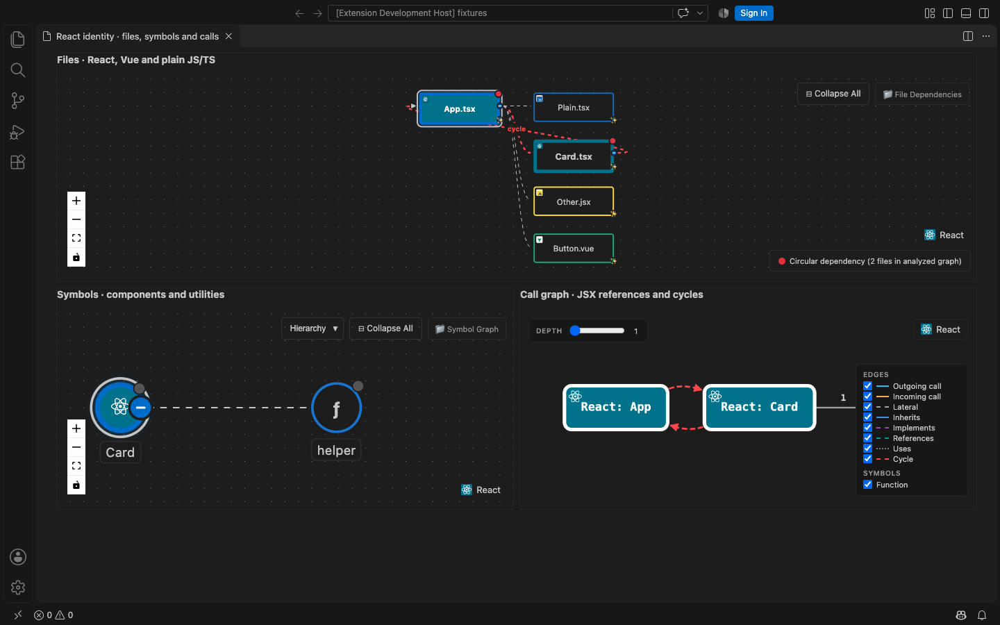
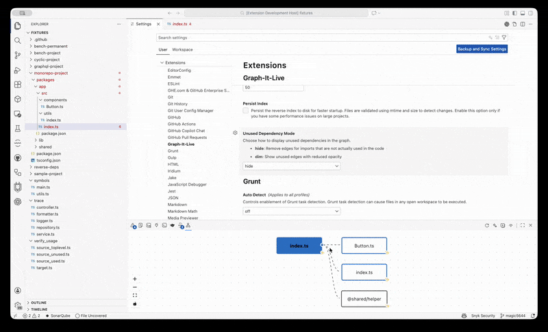
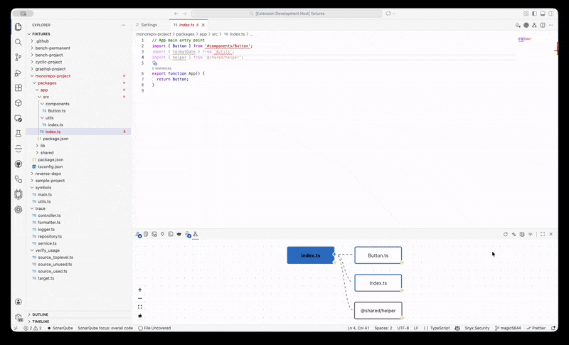
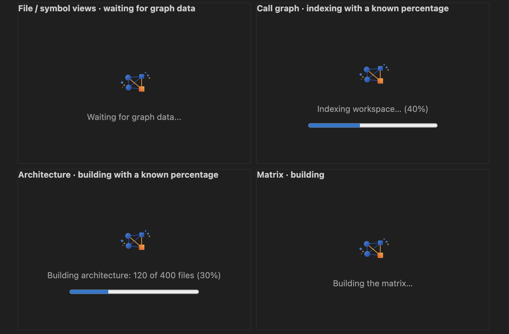
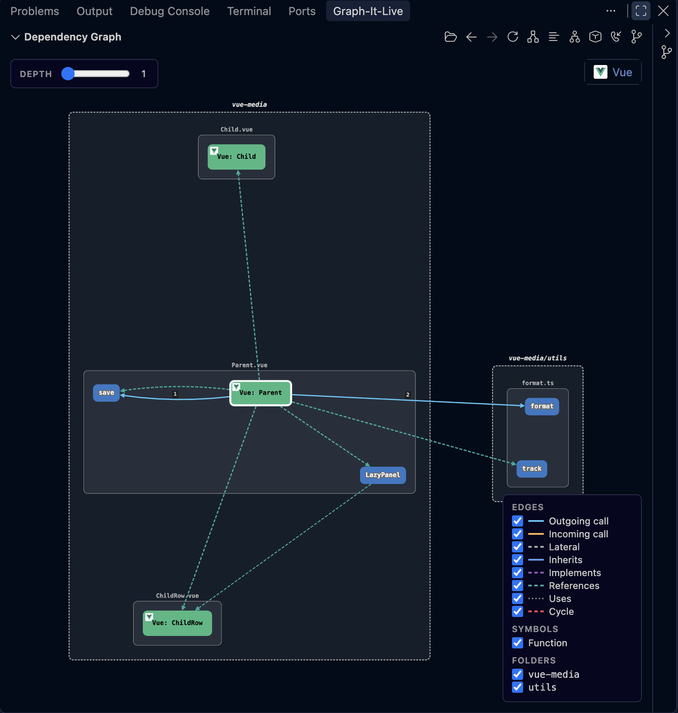
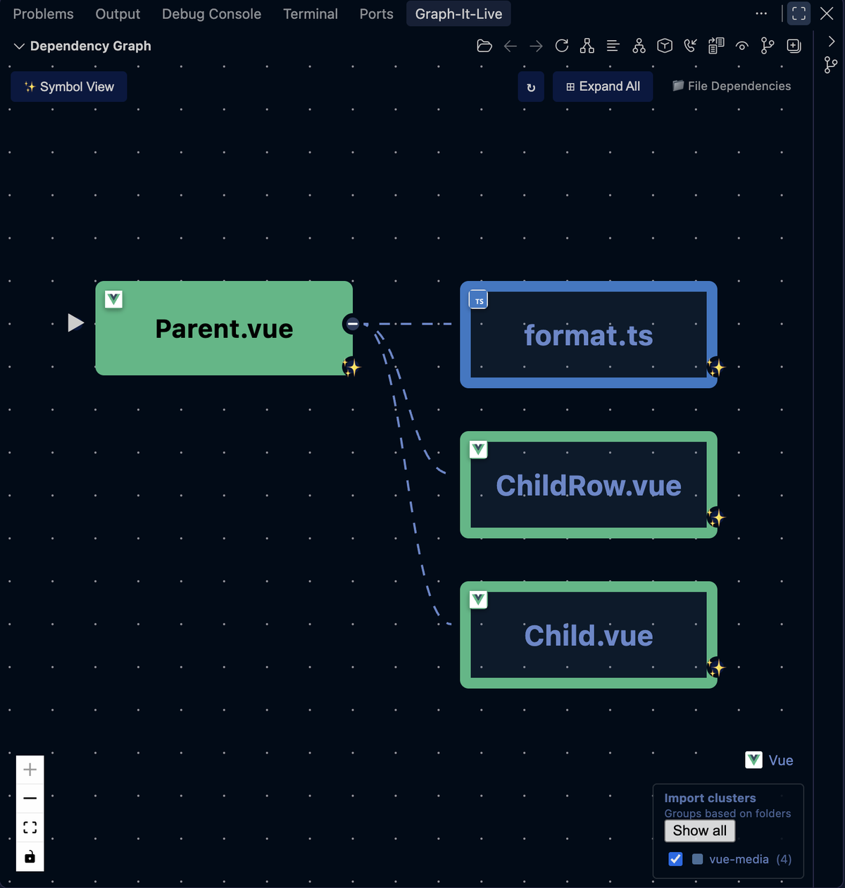

# Views and supported languages

The file graph, the Symbol View and the Live Call Graph in detail, then the languages each view supports. The Architecture view has its own page: [Architecture view tour](architecture-view.md).

| View | Answers | Analysis layer |
| --- | --- | --- |
| **File graph** | Which files import this file? What depends on this module? | Regex and AST parsing |
| **Symbol view** | Which functions and classes call each other in this file? | AST analysis |
| **Live call graph** | Which symbols call each other across files? | Tree-sitter and SQLite |

Use the same graph data to navigate code, review refactors, generate codemaps, and give AI assistants focused context instead of entire source files.

### First useful actions in VS Code

| Goal | Action |
| --- | --- |
| Explore imports | Open the dependency graph and expand a file node |
| Inspect functions | Switch to **Symbol View** or double-click a file |
| Find callers | Open **Show Call Graph** with a symbol selected |
| Find reverse dependencies | Use **Show Reverse Dependencies** |
| Hide unused imports | Enable **Filter Unused Dependencies** |
| Refresh analysis | Run **Refresh Graph** or **Force Graph-It-Live re-index** |

## File dependency graph

- Visualize file-to-file imports across a workspace.
- Detect circular dependencies and highlight cycles. A cycle whose every import is type-only (`import type`, Python `if TYPE_CHECKING:`) is drawn dotted and labelled `type-only`, apart from runtime cycles; `graph-it-live.ignoreTypeImports` hides type-only edges at once.

*Graph-It-Live: Show Dependency Graph on a file, then Expand All.*
- Expand and collapse nodes as you explore.
- Open files directly from graph nodes.
- Find reverse dependencies with an indexed lookup.

## Symbol View

Drill into TypeScript, JavaScript, Python, or Rust files to see functions, classes, variables, outgoing calls, incoming callers, and recursive calls. Click a symbol to navigate to its definition.

  

## Live Call Graph

The Live Call Graph shows cross-file symbol relationships in a Cytoscape.js panel.

- Expand callers and callees with a depth from 1 to 5. A view shows at most 500 symbols, nearest hops first; a notice counts the hidden ones.
- Group symbols by folder.
- Number calls in invocation order.
- Highlight self-recursion and mutual recursion.
- Filter by symbol type or folder.
- Refresh automatically after file saves.
- Show runtime references that are not calls as `REFERENCES` edges: a passed function (`register(save)`, `items.map(format)`) in every language, and in `.jsx` and `.tsx` files a rendered component (`<Card />`) or an attribute value (`onClick={save}`). An edge appears only when the name resolves to an import or to one declaration in the file. Imports resolve through aliases, barrels, default exports, `lazy(() => import('./literal'))`, and `memo()` or `forwardRef()` around a component name. Identified React components carry the React icon and color here, in the file graph and in the Symbol View.

  

  

*React components on a test fixture: the file graph marks `.tsx` files that declare components, the Symbol View marks the `Card` component, and the call graph shows `App` and `Card` rendering each other: two `REFERENCES` edges, red because they form a cycle. Open any `.jsx` or `.tsx` file; the React badge in each view's legend names the mark.*

The Live Call Graph supports TypeScript, JavaScript, React (JSX and TSX, parsed with the TSX grammar), Vue, Svelte, Python, Rust, C#, Go, Java, and GraphQL. C#, Go, Java, and GraphQL are supported in the file graph and Live Call Graph; Symbol View support is currently limited to TypeScript, JavaScript, Python, and Rust. In GraphQL, operations and fragments call the fragments they spread; an operation's default root type (`Query`, `Mutation`, `Subscription`), type conditions, field, argument and variable types, and union members are type-only references (`USES`, shown with `includeTypeOnly`); `implements` is an `IMPLEMENTS` edge.

A method call links only when the type of its receiver is proven: `this`/`self`, a parameter or variable with a declared type, a construction (`new Calculator()`, `Calculator()`), or a static call (`Calculator.create()`). The type can be declared in the same file or in another one. In TypeScript, JavaScript, and Python, it must be bound by an import (aliases, barrels, default and type-only imports included). The call reaches the method that this class declares in its own body. When a method is declared more than once (Python redefinition, TypeScript overloads), it reaches the last declaration. Inherited methods, union or unknown types, and a rebound variable create no edge. They never reach a same-named method of another class. Java and Go are the exception: a receiver of unknown type still links by method name.

In TypeScript and Python, a call on a returned value links too, read from the annotation of the function or method that returns it, never inferred:

- a named return type: `make(): Calculator`, `def make() -> Calculator` (also `-> "Calculator"`). The name resolves in the callee's file, through its own imports;
- a fluent method: `: this` or `-> Self` returns the receiver's type, so `b.setX(1).build().compute()` follows each link;
- an identity generic: `<T>(value: T): T`, or `def f(value: T) -> T` with a `TypeVar` or a PEP 695 parameter, returns the type of its argument.

A chain stops at its first unproven link and after 8 calls. An unannotated return, a union, `Promise<T>`/`Awaited`, `Optional[T]`, utility types, other generics, `any`/`unknown`, overloads with different return types and `async def` create no edge. Java, C#, Go and Rust do not type returned values yet: Java and Go link such a call by method name, C# and Rust do not link it.

## Unused dependencies and impact analysis

- Hide or dim unused dependencies.
- Detect unused exported symbols.
- Trace execution from a function or symbol.
- Identify callers affected by a signature change.
- Generate a codemap with exports, internals, dependencies, dependents, and call flow.

  
  

## While a view loads

  

*Every view shows the same loading state with the Graph-It-Live logo: what it waits for, and a progress bar once the percentage is known (call graph indexing, Architecture build). You see it when a view opens before its data is ready, for example *Show Call Graph* on a workspace not indexed yet.*

## Supported languages

| Language | File graph | Symbol View | Live Call Graph |
| --- | :---: | :---: | :---: |
| TypeScript / JavaScript | Yes | Yes | Yes |
| React (JSX / TSX) | Yes | Yes | Yes |
| Vue 3 (SFC) | Yes | Yes | Yes |
| Svelte | Yes | Yes | Yes |
| Python | Yes | Yes | Yes |
| Rust | Yes | Yes | Yes |
| C# / Go / Java | Yes | No | Yes |
| GraphQL | Yes | No | Yes |

**Vue 3 single-file components** (Vue 3.x, `<script>` and `<script setup>`, JS, TS, JSX and TSX): imports, symbols and call graph nodes keep the line and column of the `.vue` file. The template links `<Child />`, handlers (`@click="save"` passes, `save()` calls), interpolations, slots and custom directives to the script bindings they use, so a component used only in the template is not reported unused. `<script src>` and an HTML `<template src>` inside the workspace are read, and an edit of the external file refreshes its `.vue`. `.vue` files and the SFC component node show the Vue logo and green in every graph, apart from React. Review and Branch Watch report props and events added or removed by name.

  

*The Vue template in the Live Call Graph, on a test fixture: put the cursor in the `<template>` of `Parent.vue` and run **Graph-It-Live: Show Call Graph**. `<Child @save="save" />` and `<child-row>` become `REFERENCES` edges (dashed), `{{ format(count) }}` and `@click="save()"` become calls (solid). The green nodes with the Vue logo are SFC components.*

  

*The file graph of the same fixture: open `Parent.vue` and run **Graph-It-Live: Show Dependency Graph**. `.vue` files are green with the Vue logo; the Vue badge in the legend names the mark.*

Not resolved, and never guessed: Vue 2, Nuxt and other auto-imports, globally or plugin-registered components, a dynamic `:is`, a `pug` template, and an external file outside the workspace or reached through a symbolic link. A template that cannot be read fully counts every script binding as used. Props and events typed by an imported type or built at runtime are reported as partial; props/emits type compatibility is not checked. An external template edited while no Graph-It process is watching it is read again when its `.vue` changes or the index is rebuilt.
